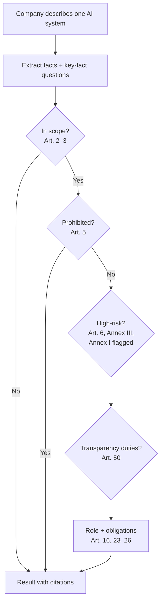
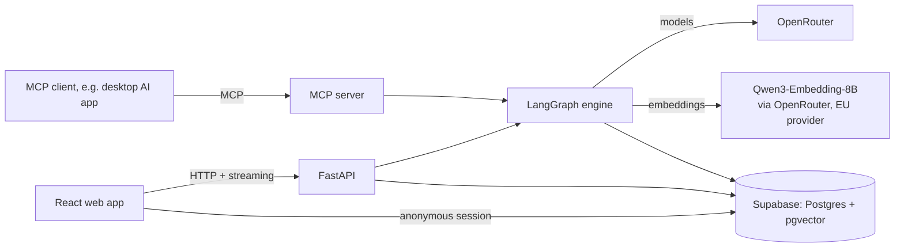

# AI Act Classification Assistant — Capstone Init Document

Sep 24, 2026 · @Ahmed · revised after design review

Describe your AI tools in plain words, and get a cited, tested EU AI Act classification and a to-do list for each one.

## Project summary

Case fit: Case 1 (RAG knowledge assistant) and Case 3 (smart search over a legal corpus), with elements of Case 2 (MCP tools other agents can call).

**README paragraph (draft):** The EU AI Act sorts AI systems into risk classes with very different obligations, and its timeline changed in July 2026. Small companies often can't tell which class their tools fall into, and the free checkers available are questionnaires that give indicative answers without showing their reasoning. This assistant lets a company describe its AI tools in plain words, in English or German. It checks each one against the Act in the Act's own order: scope, prohibited practices, high-risk status and transparency duties. It returns a classification in which every step cites the provision it relies on, and turns the result into a list of obligations with deadlines and draft documents. When the facts or the law don't settle the answer, it says so instead of guessing. Its accuracy is measured against labelled cases based on current law and published in this README. It gives guidance, not legal advice.

A link to the project on [showcase.turingcollege.com](https://showcase.turingcollege.com/) will go near the top of the README.

## Situation, Complication, Resolution

**Situation.** The AI Act applies to any company that builds or uses AI in the EU. Transparency duties under Article 50 have applied since 2 August 2026. High-risk obligations follow on 2 December 2027 (Annex III) and 2 August 2028 (Annex I).

**Complication.** Classification is hard, and the rules just moved.
- The Digital Omnibus, Regulation (EU) 2026/1744, entered into force on 27 July 2026. It changed deadlines, extended SME relief to small mid-caps, added two new prohibitions from 2 December 2026, and softened some duties. Many online sources are now outdated.
- Companies are not prepared. In a representative Bitkom survey of 602 German companies (2024), only 24% had dealt with the AI Act at all, just 3% intensively, and 24% had never heard of it; 69% said they need help dealing with the Act (published 9 September 2024; decision 007). In Deloitte's 2024 survey of about 500 managers in Germany, 48.6% had not prepared intensively. The DIHK's 2026 digitalisation survey (about 5,000 firms) names legal uncertainty as a top barrier for 55% of companies.
- Classification itself is hard. In appliedAI's 2023 study of 106 enterprise systems, 40% could not be classified with certainty. That study used the Commission's 2021 proposal, so the figure is a signal, not a current measurement.
- The existing free tools are questionnaires: the Commission's Compliance Checker (labelled beta and "indicative only"), the FLI Compliance Checker and the Holistic AI Risk Calculator. None of them shows its legal reasoning or publishes its accuracy. Legal advice is expensive for small firms.

**Resolution.** An assistant that accepts a plain-language description and follows the Act's own sequence of checks. It retrieves the current legal text for each step, shows its reasoning with citations, and says "needs more information" or "legally ambiguous" when it should. It turns the result into obligations and draft documents, and it publishes its measured accuracy, including a direct comparison with an existing checker.

## Users and positioning

The product is built **engine-first**. One core engine takes the description of one AI system and returns a structured result: extracted facts, a decision per step with citations, the risk class, the role, the obligations, and the law version used. Every user sees a different view of that same result:

| User | What they see |
| --- | --- |
| Non-expert at a small company (primary) | A plain-language summary and to-do list, with the reasoning steps collapsed |
| Compliance or legal reviewer | The same result with every step expanded: the decision, the fact it rests on, and the quoted provision |
| Other AI agents | The raw structured result through the MCP server |

Follow-up questions live outside the engine. The interface asks them, adds the answers to the description, and runs the engine again. The evaluation scores the engine directly, so the measured accuracy describes what every user gets.

**Headline:** plain-words input and practical outputs (inventory, checklist, documents). **Proof it can be trusted:** citations on every step, and measured accuracy. **Supporting features:** honest uncertainty and agent access through MCP.

## Scope

**MVP**

- **Classification of one system:** free-text description, then short key-fact questions that decide the outcome ("Does the tool rank, score or filter people?", "Does a human review every decision?")
- **Staged checks:** scope, prohibited practices, high-risk (Annex III, Article 6(3) filter, Annex I recognised and flagged), transparency (Article 50)
- **Roles:** provider, deployer, the Article 25 switch from deployer to provider, systems built on a general-purpose AI model, importer and distributor
- **Result:** risk class, role, Annex point, deciding facts, a citation for every step, and an evidence tag per step. Two uncertain outcomes are allowed (see How it works)
- **Obligations checklist:** duties with article references and dates for the role and risk class
- **AI inventory:** classify a company's AI tools one by one, with an overview table and a company-level summary
- **Documentation drafting:** short deployer documents, plus skeletons of provider documents completed through a guided interview (see Documentation drafting)
- **Original vs. amended toggle:** classify under the original Act or under the Act as amended by the Omnibus, to show how the July 2026 changes alter outcomes (the class and route, plus the Art. 113 route dates; the duty list is modelled for the amended text only, decision 020 and its addendum)
- **Q&A about results:** questions about a result, or general AI Act questions within the corpus, answered with citations
- **Languages:** English and German, including the interface, notices, questions, skeletons and citations from the official text in each language
- **MCP server** with four tools, used by the engine internally as well
- **Storage:** each visitor gets an anonymous session; their inventories, classifications, interview answers, a company profile and checklist progress are stored in the project database, visible only to them, with a "delete my data" function, automatic deletion after a period of inactivity, and export/import files
- **Evaluation** against labelled cases, with results in the README

**MCP tools (MVP)**

| Tool | What it does | LLM inside? |
| --- | --- | --- |
| `search_ai_act` | Searches the legal corpus by meaning, filtered to the version in force on a given date | No |
| `get_provision` | Returns the exact text of an article, annex point or recital, with version, language and status | No |
| `list_obligations` | Returns duties and deadlines for a given role and risk class | No |
| `classify_system` | Runs the full engine on one description and returns the structured result | Yes |

Every tool result carries the law version it used and the "guidance, not legal advice" notice, because a calling agent may show results without this project's interface around them.

**Stretch goals**

- Comparison experiment: the staged engine vs. a free agent that only has the lookup tools (see Evaluation)
- Inventory and documentation drafting as MCP tools; legal texts as MCP resources; intake questions as an MCP prompt
- More languages
- Deployment, bundled with accounts (anonymous sessions upgraded to real logins), security measures and a data policy (GDPR)

**Out of scope**

- Obligations of general-purpose AI model providers (Chapter V), beyond flagging that they exist
- EU product laws behind Annex I (for example machinery or medical devices): the tool names the law and asks the decisive question, but does not assess it
- National penalty rules
- Documents written from invented content: the tool never fills a section the user hasn't supplied information for
- Anything presented as legal advice

## How it works

The engine doesn't make one big judgement. It follows the order of checks the Act sets out. The order is fixed and no check can be skipped, but inside each step the model decides what to look up. The input is a company's description of one system; the Act is the library the engine reads from, not the input.

**Lookup vs. search.** Where the law says where to look, the engine fetches the provision by number (the article text, the obligations). Where it doesn't, it searches by meaning:
- to match a description to the closest Annex III or Annex I points, even when the wording differs ("estimates whether a tenant will pay rent" → creditworthiness?)
- to find the most similar Commission guideline examples and reason by analogy, especially for Article 6(3) borderline cases. Only the retrievable half of the examples is searched; the other half is held out as the benchmark (see Benchmark isolation)
- to find recitals that clarify grey areas
- to answer users' questions about their result

**Outcomes.** Besides a class, a step can end in one of two uncertain outcomes:
- **Needs more information:** a fact is missing. The result names the fact, and the interface asks for it.
- **Legally ambiguous:** the facts are known, but the law and guidance don't settle the answer. The result names the open question and both possible readings, and recommends legal review. The rest of the product shows both readings, with the stricter one as the labelled working assumption ("assumed high-risk pending legal review"). Documents and the inventory follow the stricter reading, with a flag.

**Risk classes.** Every result carries exactly one `RiskClass`, which is what the user sees as the headline:

| `RiskClass` | Meaning | Set by |
| --- | --- | --- |
| `out_of_scope` | Not an AI system under Art. 3(1), or an exclusion applies | Scope step, Art. 2–3 |
| `prohibited` | Matches a prohibited practice; the remaining checks are not run | Prohibited step, Art. 5 |
| `high_risk` | Listed in Annex III and not exempted by Art. 6(3), or an Annex I safety component that needs third-party conformity assessment | High-risk step, Art. 6 |
| `limited_risk` | Not high-risk, but at least one Art. 50 transparency duty applies | Transparency step, Art. 50 |
| `minimal_risk` | In scope, and no class above applies | Falls through every step |

Transparency duties are a separate list on the result, not only a class, because they stack: a high-risk chatbot is `high_risk` *and* has Art. 50(1) duties. The list is non-empty for every `limited_risk` result and may be non-empty for `high_risk`.

The two uncertain outcomes are not risk classes. They are a separate status (`decided`, `needs_more_information`, `legally_ambiguous`) next to the class. When the status is uncertain, `RiskClass` holds the stricter reading as the labelled working assumption, so the inventory, obligations and documents always have a class to work from.

**Evidence tags instead of a confidence score.** Each step shows where its key fact came from: **stated** by the user, **inferred** by the engine, or **assumed** by default. Inferred and assumed facts become "please confirm" questions. A numeric self-reported confidence isn't used, because it isn't calibrated.

**Deciding facts.** Every result lists the few facts the outcome depends on, next to the notice "this assessment is only as accurate as the description provided", so a reviewer can spot a misleading description.

**Roles.** A deployer becomes a provider under Article 25 if it puts its own name or brand on a high-risk system, substantially modifies it, or changes its purpose so that it becomes high-risk; key-fact questions check for this. A company that builds on a general-purpose model is classified as the provider of its own system, and the model provider's separate duties are flagged. Importers and distributors get their duties under Articles 23–24.

**Annex I.** If the system may be a safety component of a product covered by EU product law, the engine names the law and asks whether the product needs a third-party conformity assessment. It returns "needs more information" or "legally ambiguous" rather than guessing.

**Worked example**

Input: *"We're a 40-person logistics company. We use a tool that reads incoming job applications, scores them, and shows HR a ranked shortlist. We bought it from a vendor and didn't change it."*

| Step | Decision | Evidence | Basis |
| --- | --- | --- | --- |
| Facts | Deployer; filters and ranks applicants; affects access to jobs | Stated | Description |
| Role check | Stays a deployer: not modified, not rebranded, used for its intended purpose | Stated ("didn't change it"); brand and purpose assumed, to be confirmed | Art. 25 |
| In scope | Yes. Whether the tool infers (Art. 3(1)) is not stated, so the engine may ask (in scope as the working assumption) or assume it is an AI system; either is accepted | Inference not stated: asked (needs more information) or assumed, to be confirmed; EU use assumed, to be confirmed | Art. 2–3 |
| Prohibited | No match | Inferred | Art. 5 |
| High-risk | Yes: recruitment use; ranking candidates counts as profiling, so the Article 6(3) exemption does not apply | Stated (scores and ranks) | Annex III point 4(a), Art. 6(3) |
| Transparency | No separate duty identified from the description | Inferred | Art. 50 |
| Result | High-risk, deployer: decided when the engine assumes the tool is an AI system, or needs more information, pending the inference question (Art. 3(1)), when it asks; either is accepted. Duties include following the provider's instructions, assigning human oversight, keeping logs and informing the applicants who are subject to it (Art. 26(11)), from 2 December 2027 | — | Art. 26 |

Deciding facts: the tool scores and ranks applicants; it was not modified or rebranded. The expected answers in this example are the design intent, to be checked against the legal text during the build.

## Documentation drafting

Documents are drafted only from information the engine already has or the user supplies. Nothing is invented.

| Group | Documents | How they are made |
| --- | --- | --- |
| Short deployer documents | Record of who is assigned to human oversight (Art. 26(2)), notice to workers' representatives (Art. 26(7)), notice to affected people (Art. 26(11)), disclosure texts (Art. 50) | Generated from the extracted facts |
| Short vendor letters | A message to the vendor about a prohibited result, and a request for the vendor's assessment on an ambiguous result | Built only from the result's facts |
| Skeletons of heavy documents | Technical documentation (Art. 11, Annex IV), quality management system (Art. 17), risk management system (Art. 9), fundamental rights impact assessment (Art. 27) | Every required section appears. Sections the engine knows are pre-filled. The others show the quoted requirement and a "to fill in" marker, and a guided interview asks for the missing information; the answers are written up as prose |

Every document is labelled DRAFT and carries the "not legal advice" notice. Automatic checks confirm that:
- every required section is present
- no section contains content the user didn't supply
- pre-filled facts match the classification result

The Omnibus extends the simplified technical documentation form to small mid-caps (fewer than 750 staff, turnover up to €150m), but as of 24 September 2026 the Commission doesn't appear to have published the form. Until it does, SMEs and small mid-caps get the full Annex IV skeleton, with a note that a simplified form is expected. Check again before the build freezes.

## Legal corpus

The assistant reasons only over official texts and Commission guidance. Each document is stored with its status, date and language, so answers can say which version they rely on.

| Document | Status | Used for | Languages | Source |
| --- | --- | --- | --- | --- |
| AI Act, Regulation (EU) 2024/1689 (original text) | Law, Official Journal | Original vs. amended toggle | EN, DE | [EUR-Lex](https://eur-lex.europa.eu/eli/reg/2024/1689/oj) |
| Digital Omnibus on AI, Regulation (EU) 2026/1744 | Law, in force since 27 July 2026 | Current deadlines, SME changes, new prohibitions | EN, DE | [EUR-Lex](https://eur-lex.europa.eu/eli/reg/2026/1744/oj/eng) |
| Consolidated AI Act as of 27 July 2026 (CELEX 02024R1689-20260727) | Official consolidation, for documentation only; the Official Journal texts are binding | All steps (the current text) | EN confirmed; DE likely (consolidations sometimes appear in English first) | [EUR-Lex](https://eur-lex.europa.eu/legal-content/EN/TXT/?uri=CELEX%3A02024R1689-20260727) |
| Guidelines on the AI system definition (6 Feb 2025) | Final, non-binding | Scope step | EN; DE likely (all EU languages since 29 July 2025) | [regulations.ai](https://regulations.ai/regulations/RAI-EU-NA-ECGRDXX-2025) |
| Guidelines on prohibited AI practices (4 Feb 2025) | Final, non-binding | Prohibited step | EN; DE likely (all EU languages since 29 July 2025) | [Commission](https://digital-strategy.ec.europa.eu/en/policies/regulatory-framework-ai) |
| Guidelines on high-risk classification: general principles, Annex I, Annex III (19 May 2026) | **Draft**, not finalised as of 24 Sep 2026; consultation closed 23 July 2026 (extended from 23 June); adoption expected by end of 2026 | High-risk step. The guideline text is fully retrievable; the worked examples are split, and only the retrievable half enters the corpus (see Benchmark isolation) | EN only (no official German version found) | [Commission](https://digital-strategy.ec.europa.eu/en/consultations/targeted-consultation-draft-guidelines-classification-high-risk-artificial-intelligence-systems), [DLA Piper](https://www.dlapiper.com/en/insights/publications/2026/06/eu-commission-draft-guidelines-on-classification-of-high-risk-ai-systems-key-points) |
| Guidelines on Article 50 transparency obligations (20 July 2026) | Final, non-binding | Transparency step | EN; DE unverified (German press release exists) | [Commission](https://digital-strategy.ec.europa.eu/en/policies/guidelines-transparency-ai-generated-content), [Faegre Drinker](https://www.faegredrinker.com/en/insights/publications/2026/7/eu-ai-act-commission-confirms-transparency-code-of-practice-as-adequate-and-publishes-final-version-of-its-guidelines-on-transparency-obligations) |
| Code of Practice on Transparency of AI-generated Content (10 June 2026) | Confirmed adequate by the Commission and AI Board; covers Art. 50(2), (4), (5) | Transparency step, practical measures | EN; DE unverified (German press release exists) | [Commission](https://digital-strategy.ec.europa.eu/en/policies/code-practice-ai-generated-content) |

**Omnibus details the engine must handle:**
- The Article 50(2) marking duty has a grace period until 2 December 2026, but only for systems placed on the market before 2 August 2026.
- The Article 6(3) registration duty was kept in a simplified form, not removed.
- Two new prohibitions (AI-generated intimate imagery and child sexual abuse material) apply from 2 December 2026.

**Corpus rules:**
- **The amended text wins.** The consolidated text is the default. Where the Omnibus changed a provision, the answer says so.
- **Drafts are labelled as drafts.** The high-risk guidelines may be finalised during the project; check before the build freezes and update if so.
- **Quote in the user's language where official.** Citations quote the official text in the user's language. Guidance that exists only in English is quoted in English, marked "official text available in English only", and explained in the user's language.
- **The corpus holds law and guidance, never benchmark cases.** No test description or label from any evaluation set is ever ingested. Commission guideline examples used as test cases are held out of retrieval. Every corpus row carries a `source_example_id` where it comes from a worked example, so the exclusion is a metadata filter that can be checked automatically.

## Evaluation

The evaluation supports the product. It proves the classification can be trusted, and it isn't the headline in itself. What is scored is the engine's structured result for a system description, compared with a labelled answer for the same system.

**Test sets**

| Set | Role | What it contains | Weakness |
| --- | --- | --- | --- |
| Commission draft high-risk guidelines (May 2026), held-out half | **Headline benchmark** | The regulator's practical examples of systems that are and are not high-risk, rewritten as company descriptions and removed from the retrieval corpus | Draft; examples are short and extracted by hand; high-risk step only; only half the examples are available for scoring |
| Own cases | **Headline benchmark** | Cases for Article 50, out-of-scope software, the new December 2026 prohibitions, Article 25 role switches, Annex I flags, and English and German descriptions | Labels are the student's own (see label rules) |
| [appliedAI Risk Classification Database](https://www.appliedai-institute.de/en/resources/risk-classification-database/) | Second benchmark, reported separately | About 106 real enterprise AI systems with expert labels (high, low, prohibited, unclear) | Labelled in 2023 against the 2021 proposal (no Art. 6(3) filter; refers to Annex II, now Annex I); only a PDF (Sep 2024) found; described as a "free, open dataset" but no named licence; mostly industrial and German-focused |
| [AI Act Evaluation Benchmark](https://github.com/davidath/ai-act-evaluation-benchmark) (arXiv 2603.09435) | Extra check, reported separately | Ready-made scenarios with risk-level labels; CC BY 4.0 | Synthetic, LLM-written cases are cleaner than real descriptions; labels spot-checked before use |
| Soft-wording pairs (10–20) | Robustness test | Known high-risk systems described plainly and in softened language ("helps HR organise applications") | Own cases |
| Q&A set (20–30 questions) | Q&A feature | Questions with the provisions a correct answer must cite | Own cases |

**Label mapping (appliedAI)**

The appliedAI labels are coarser than the engine's `RiskClass` and status (see Risk classes), so each label is mapped before scoring:

| appliedAI label | Counts as a match when the engine returns | Notes |
| --- | --- | --- |
| high | `high_risk` | Annex II references in the labels are read as Annex I |
| prohibited | `prohibited` | |
| low | `limited_risk` or `minimal_risk` | The dataset doesn't separate transparency duties from none, so either counts. `out_of_scope` also counts, but these cases are listed in the disagreement review |
| unclear | status `legally_ambiguous` | Status `needs_more_information` is counted separately, as in the uncertain-outcome metric |

For the labels high, prohibited and low, an uncertain result is scored on its working-assumption class. For example, "assumed high-risk pending legal review" matches the label high. The false-low-risk rate uses the same class.

**Benchmark isolation**

The Commission's worked examples are both the best available answer key and useful retrieval material. Using the same example in both roles would let the engine find the example a test case was written from, read the regulator's verdict, and repeat it. The accuracy would then measure near-duplicate search, not classification. The rules below prevent that.

1. **Split the examples.** Every worked example in the high-risk guidelines gets an ID. The examples are randomly assigned, stratified by Annex III area and by verdict (high-risk / not high-risk), to two piles. Pile A stays in the corpus as retrievable guidance. Pile B is removed from the corpus and becomes the headline benchmark. The assignment is committed to the repository before the engine exists and never changes.
2. **Leave-one-out if the count is too small.** If fewer than about 40 examples exist, all examples stay in the corpus and every benchmark run filters out the example a test case was written from, using `source_example_id` on the search query. This costs no extra tokens.
3. **Rewrite every test description.** Benchmark descriptions are written the way a company would describe its tool: company size, role (bought or built), business context, and some irrelevant detail. They never reuse the Commission's wording. This weakens near-duplicate matching and brings the benchmark closer to real input.
4. **Report the gap.** The headline benchmark is run twice at the end: once with the held-out examples excluded from retrieval (the reported number) and once with all examples retrievable. Both numbers go in the README. The difference shows how much the engine leans on memorised examples versus reasoning from the Act.
5. **Automatic check.** A test asserts that no corpus row shares a `source_example_id` with any benchmark case, and that no benchmark description appears in the corpus by text similarity. It runs in CI.

The same isolation applies to the appliedAI cases, the academic benchmark and the own cases: none of their descriptions or labels is ever ingested.

**Label rules for own cases**
- **Cite or ambiguous.** Every label cites the provision or Commission example that settles it. If nothing settles it, the correct answer is "legally ambiguous".
- **Frozen before the build.** All labels are fixed before the engine exists. Any later change goes through a logged review.
- **Second-model filter.** A different AI model labels the cases independently, and every disagreement is investigated. This catches mistakes; it is not presented as validation.
- **Stated limitation:** no external legal review of the labels.

**Metrics**

| Metric | What it measures |
| --- | --- |
| Risk-class accuracy | Match with the label, per benchmark. For the headline benchmark, the reported figure is with the test examples held out of retrieval |
| Held-out vs. in-corpus gap | Headline accuracy with test examples excluded from retrieval minus accuracy with them included. A large gap means the engine leans on memorised examples |
| False-low-risk rate | How often a high-risk or prohibited system is labelled lower. Reported separately as the costliest error |
| Annex point accuracy | For high-risk results, is the Annex point right? |
| Role accuracy | Provider, deployer, importer or distributor, including Article 25 switches |
| Uncertain-outcome handling | Precision and recall of "legally ambiguous" against labelled ambiguous or expert "unclear" cases; "needs more information" is reported separately |
| Citation existence | Every cited provision exists (hard rule: 100%) |
| Citation support | The cited text supports the claim (judged by Jev, with an LLM judge for unsure cases and a manual sample; reported as a rate) |
| Downgrade rate | How often soft-worded high-risk descriptions get classified lower, with and without key-fact questions |
| Consistency | The same system described three ways gets the same class (paraphrases LLM-generated, then checked by hand) |
| Evidence-tag accuracy | Facts tagged "stated" really are in the description (same judge setup) |
| Obligations and documents | Ordinary code tests for the checklist against hand-checked cases; the automatic document checks |
| Retrieval and Q&A quality | RAGAS context precision and recall (did search return the expected provisions, and how much noise?) and faithfulness (is the answer supported by the retrieved text?), on the Q&A set and on Annex-point matching |
| Tool-call correctness | Each engine step called the lookups it should have (e.g. the prohibited step fetched Art. 5), checked on LangSmith traces |

**Baselines:** the same model with no retrieval and no staged checks, and Jev (a decision model) classifying the description directly. The key result is how much the staged, cited approach improves on them.

**Judge.** Checks that need judgement (citation support, evidence tags, no invented content in documents, Q&A support) go first to Jev, which returns a yes/no with a calibrated probability. Unsure cases go to an LLM judge that gives a written reason, and a small sample is reviewed by hand. Before use, the judge is validated on about 50 hand-labelled English and German cases, comparing Jev with an LLM judge on agreement and calibration. RAGAS faithfulness scores on the Q&A set serve as an extra cross-check on Jev's verdicts.

**Head-to-head:** 20–30 cases from the headline benchmark are run by hand through the FLI or Commission checker, and both scores are reported, whichever way they fall.

**Disagreement review (appliedAI):** every case where the engine disagrees with the expert label gets a manual verdict: engine error, label outdated by later law, or genuinely ambiguous. Annex I cases are reported separately.

**Stretch experiment: fixed order vs. free agent.** Run the headline benchmark through a model that only has the three lookup tools and decides for itself what to look up. Compare it with the engine on accuracy, skipped checks (especially Article 5), and cost and tool calls per case.

## Tech stack

The stack follows the engine-first design: one Python backend holds all logic, and the web app and the MCP server are clients of it.

| Layer | Choice | Why |
| --- | --- | --- |
| Backend language | Python | The strongest ecosystem for the engine, retrieval and evaluation |
| AI framework | LangGraph (LangChain) | The fixed check order is a graph of steps, with tool use inside each step; the structured result is enforced with Pydantic schemas |
| API | FastAPI | One set of Pydantic models defines the engine result, the API (automatic OpenAPI) and the MCP tool outputs; streams progress per step |
| Model access | OpenRouter | One API for all models, so switching models for baselines, judges and comparisons is a setting |
| Models | Engine: GPT-6 Luna (version pinned). Judge: Jev first pass, Claude Haiku 4.5 backup. Label filter: Claude Haiku 4.5. RAGAS: Gemini 3.1 Flash-Lite. Baselines: Luna without retrieval, and Jev. Premium comparison: Claude Sonnet 5 on 25 cases | Engine and judges come from different companies, so checks are independent. Estimated total ≈ €20–30, within a €50 budget. DeepSeek (China-based, subject to EU data protection actions) and Mistral were considered and excluded |
| Embeddings | Qwen3-Embedding-8B via OpenRouter, provider pinned to Nebius (EU), truncated to 1536 dimensions, with a fixed query-side task instruction. OpenAI text-embedding-3-large as the comparison arm | Top of the MTEB multilingual leaderboard at release, so German is a first-class language; instruction-aware, which suits the asymmetric task of matching an informal description to Annex III wording; open weights, so it can't be deprecated and the 0.6B sibling can run locally in CI; $0.01 per million tokens. The 4096-dimension default is truncated because pgvector's HNSW index caps at 2000 dimensions. Confirmed in week one by RAGAS context recall on the Annex-matching and Q&A sets against the OpenAI model, with both numbers recorded. Embedding the whole corpus costs cents either way |
| Database | Supabase (Postgres + pgvector) | One database for the legal corpus, hybrid keyword + meaning search (with German keyword support), the obligations table, evaluation records and user data |
| User data | Supabase anonymous sessions, row-level security | Stored per user from day one; upgraded to real accounts at deployment |
| Auth (at deployment) | Supabase Auth: magic link, Microsoft, Google, email + password | Built into the database platform and its row-level security |
| Ingestion | EUR-Lex HTML + Docling (PDF guidelines) | Split along the legal structure (paragraph/point, recital, guideline example), English and German linked by provision ID, re-runnable when texts change |
| MCP | Official MCP Python SDK | Local (stdio) for the MVP demo; the same tools over HTTP from FastAPI at deployment |
| Frontend | Vite + React, TypeScript | A browser app talking only to the Python API; one backend serves every channel |
| Frontend libraries | Tailwind CSS + shadcn/ui, TanStack Router and Query, a TypeScript client generated from the API, server-sent events, react-i18next, React Hook Form + Zod | Common, well-documented, type-safe; English/German built in |
| Document files | Generated in Python (Word/PDF) | Keeps the logic in the backend |
| Tracing and evaluation | LangSmith in development, RAGAS for retrieval and Q&A metrics (cheap model via OpenRouter), plus a results record in Postgres | Traces every step and compares experiments; the Postgres record keeps README numbers reproducible. Production traces carry metadata only |
| Dev tooling | uv, pnpm, Ruff, ESLint + Prettier, pyright or mypy, pytest, Vitest + React Testing Library, Playwright, Supabase CLI, GitHub Actions | Reproducible setup; automatic checks on every push use recorded model responses, and the paid LLM evaluation is run by hand at milestones |
| Hosting (at deployment) | To decide; working assumption: static frontend host, EU container host for the API, Supabase EU region | Keeps data in the EU |

**Billing:** the web app uses the project's OpenRouter key on the server, with usage limits and a hard spending cap. MCP users bring their own OpenRouter key.

**Budget rules:** develop on 20–30-case subsets; about 5 headline-benchmark runs at milestones and 2 full evaluation runs at the end; use prompt caching and lean retrieval; measure real token use per classification in the first week.

**Engine safety net:** GPT-6 Luna was released on 22 September 2026 and has no track record. In the first week, a smoke test runs Luna and Gemini 3.1 Flash-Lite on the same 20 headline cases. If more than 10% of Luna's outputs or tool calls are broken, or its accuracy is clearly worse, the engine switches to Gemini 3.1 Flash-Lite.

## Ethical considerations

The main ethical risk is a wrong classification that a company trusts. Calling a high-risk system low-risk can leave people unprotected and the company exposed.

| Risk | Safeguard |
| --- | --- |
| Output mistaken for legal advice | Notice on every result and document; recommend legal review for high-risk, prohibited and ambiguous outcomes; Q&A steers away from "are we compliant?" |
| False "low-risk" results | Uncertain outcomes instead of confident guesses; the stricter reading as working assumption when ambiguous; false-low-risk rate reported separately |
| Misleading descriptions, deliberate or not | Key-fact questions decide the outcome; downgrade rate measured; deciding facts shown on every result |
| Hallucinated or wrong citations | Automatic existence check; citation support measured |
| Draft documents trusted as finished | Skeletons never contain invented content; DRAFT label; automatic checks |
| Outdated law | Every answer states the law version and date; drafts labelled as drafts |
| Translation errors | Citations quote official texts; English-only guidance labelled as such |
| The student is not a lawyer | Cite-or-ambiguous label rule; Commission examples as the main benchmark; no external legal review, stated openly |
| Label bias in test data | appliedAI is industrial and German-focused; results reported per benchmark and per business function |
| Confidential company information | Each user's data is stored separately and enforced by the database (row-level security); a "delete my data" function and automatic deletion of inactive anonymous data; model providers and OpenRouter configured not to train on or retain inputs where possible, and named on screen; a warning when descriptions contain personal data; no real user input in evaluation logs or production traces (metadata only) |
| Over-reliance on automation | Step-by-step reasoning with evidence tags, so users can challenge each decision |
| Problem not validated with users | Problem evidence comes from secondary sources; no user interviews or user tests are planned, stated as a limitation |
| Choice of model providers | Providers that EU data protection authorities have acted against (e.g. DeepSeek) are excluded; every provider in the data chain (OpenRouter and the model providers) is named in the privacy notice. The embedding model is Alibaba's open-weights Qwen3-Embedding-8B, but it is served from an EU-based host pinned in OpenRouter, so user descriptions never reach Alibaba; the host is named in the privacy notice |
| The assistant is itself an AI system | It is most likely limited-risk: it is not high-risk, but because it interacts with people it must disclose that it is an AI (Art. 50(1)) |

## Risks and mitigations

| Risk | Likelihood | Mitigation |
| --- | --- | --- |
| appliedAI data is only in PDF form, with no named licence | Medium | It is a second benchmark only, and the headline benchmark doesn't depend on it. Extract the cases by hand for private evaluation, and publish only case IDs and results, not the descriptions, unless reuse is confirmed |
| 2023 labels conflict with current law | High | Disagreement review; report accuracy before and after excluding outdated labels |
| High-risk guidelines finalised mid-project | Medium | The corpus stores versions; re-run the evaluation if the examples change |
| Headline benchmark too small or too narrow | Medium | Cover every step with own cases; report counts per step; use the appliedAI and academic sets as extra checks |
| Benchmark cases leak into the retrieval corpus, inflating accuracy | High before mitigation | Benchmark isolation rules: split or leave-one-out on Commission examples, rewritten descriptions, `source_example_id` filter, CI check, both numbers reported |
| Holding out half the Commission examples makes the headline benchmark smaller | Medium | Stratified split keeps every Annex III area in both piles; switch to leave-one-out below about 40 examples; own cases cover the rest |
| Misreading the law as a non-lawyer | Medium | Cite-or-ambiguous rule; label freeze; second-model filter |
| German quality lower than English | Medium | Separate German test cases; report per-language results |
| Model costs exceed the €50 budget | Medium | Hard spending caps on the OpenRouter keys; subset-based development; token usage measured in the first week |
| GPT-6 Luna is new (Sep 2026) and untested on legal reasoning, tool use or German | High | First-week smoke test with a fixed pass/fail rule; Gemini 3.1 Flash-Lite as the fallback engine; the 25-case Sonnet 5 comparison shows what a premium model would add |
| Jev is new (Sep 2026) and unproven on legal or German text | Medium | Validate it as a judge before relying on it; the LLM judge is the fallback |
| OpenRouter doesn't pass through a needed feature (e.g. prompt caching, provider citations) | Medium | Check early; citations are implemented as article IDs checked against the corpus, independent of the provider |
| Qwen3 embeddings underperform on this small legal corpus despite leaderboard results | Medium | Week-one retrieval comparison against OpenAI text-embedding-3-large on RAGAS context recall; the embedding model is a setting and the corpus re-embeds in minutes; a reranker and structure-aligned chunking are the next levers if recall is the problem |
| Scope creep: the MVP is broad | High | The engine and its evaluation come first; product features are built as views on the same result; stretch goals stay locked until the MVP is evaluated |

## Open questions

**Project questions**

- What is the submission deadline?
- appliedAI: open the PDF and confirm the fields per entry, the languages, and any licence statement. It's described as a "free, open dataset"; no machine-readable version or named licence was found.
- German texts: confirm that German versions of the Article 50 guidelines, the Code of Practice and the consolidated text exist. Until then they're quoted in English and labelled. The draft high-risk guidelines appear to be English-only.
- Check again before the build freezes: whether the high-risk guidelines have been finalised (not yet as of 24 Sep 2026) and whether the simplified technical documentation form has been published (not yet found).
- ~~Confirm the "69% need help" figure and sample size in Bitkom's February 2026 AI report.~~ Answered (decision 007, 2026-10-01): the figure comes from Bitkom's 2024 survey of 602 companies, not the February 2026 report.
- Count the worked examples in the draft high-risk guidelines, per Annex III area and verdict. This decides between a split and leave-one-out (see Benchmark isolation).

**Implementation decisions still open**

- GPT-6 Luna's context window, tool-calling reliability and structured output through OpenRouter (checked by the smoke test).
- Does OpenRouter pass through prompt caching for the chosen models and offer EU routes? (Embeddings are confirmed: Qwen3-Embedding-8B is served by Nebius, DeepInfra and SiliconFlow.)
- Embedding details to fix in week one: the exact query instruction text, whether 1536 or 1024 truncated dimensions holds up on the Annex-matching set, and that the pinned provider returns normalised vectors. Stored vectors and query vectors must always come from the same provider; switching providers means re-embedding the corpus.
- What exact shape should the structured result and the MCP tool results have (text, version, status, language, citations, evidence tags, disclaimer)?
- Retention period for inactive anonymous data. *Settled: 30 days (docs/decisions/013-anonymous-data-retention.md).*
- Which MCP client to demo with.
- Hosting providers, at the deployment step.

## Sources

- [Commission: AI Act regulatory framework and timeline](https://digital-strategy.ec.europa.eu/en/policies/regulatory-framework-ai)
- [EUR-Lex: Regulation (EU) 2026/1744 (Digital Omnibus on AI)](https://eur-lex.europa.eu/eli/reg/2026/1744/oj/eng)
- [EUR-Lex: consolidated AI Act, 27 July 2026](https://eur-lex.europa.eu/legal-content/EN/TXT/?uri=CELEX%3A02024R1689-20260727)
- [White & Case: EU AI Omnibus enters into force](https://www.whitecase.com/insight-alert/eu-ai-omnibus-enters-force-amending-ai-act)
- [Future of Life Institute: Digital Omnibus official text](https://artificialintelligenceact.eu/ai-act-explorer/digital-omnibus/)
- [trail: what changed in the AI Act](https://www.trail-ml.com/blog/eu-ai-act-digital-omnibus-changes)
- [Commission: consultation on draft guidelines on high-risk classification](https://digital-strategy.ec.europa.eu/en/consultations/targeted-consultation-draft-guidelines-classification-high-risk-artificial-intelligence-systems)
- [DLA Piper: key points of the draft high-risk guidelines](https://www.dlapiper.com/en/insights/publications/2026/06/eu-commission-draft-guidelines-on-classification-of-high-risk-ai-systems-key-points)
- [Bird & Bird: first read of the draft high-risk guidelines](https://www.twobirds.com/en/insights/2026/the-commission's-draft-high-risk-ai-guidelines-under-the-eu-ai-act-a-first-read)
- [Commission: guidelines on transparency obligations](https://digital-strategy.ec.europa.eu/en/policies/guidelines-transparency-ai-generated-content)
- [Commission: Code of Practice on transparency of AI-generated content](https://digital-strategy.ec.europa.eu/en/policies/code-practice-ai-generated-content)
- [Faegre Drinker: final Article 50 guidelines](https://www.faegredrinker.com/en/insights/publications/2026/7/eu-ai-act-commission-confirms-transparency-code-of-practice-as-adequate-and-publishes-final-version-of-its-guidelines-on-transparency-obligations)
- [regulations.ai: AI system definition guidelines](https://regulations.ai/regulations/RAI-EU-NA-ECGRDXX-2025)
- [appliedAI: Risk Classification Database](https://www.appliedai-institute.de/en/resources/risk-classification-database/)
- [appliedAI: 2023 risk classification study](https://www.appliedai.de/en/insights/ai-act-risk-classification-of-ai-systems-from-a-practical-perspective)
- [Bitkom Research: AI Act awareness survey (2024)](https://bitkom-research.de/news/jedes-vierte-unternehmen-beschaeftigt-sich-mit-dem-ai-act)
- [Bitkom: Künstliche Intelligenz in Deutschland (2026)](https://www.bitkom.org/Bitkom/Publikationen/Kuenstliche-Intelligenz-in-Deutschland)
- [Deloitte: AI Act Survey (2024)](https://www2.deloitte.com/content/dam/Deloitte/dl/Documents/legal/Deloitte%20AI%20Act%20Survey_english.pdf)
- [DIHK: Digitalisation survey 2026](https://www.dihk.de/en/newsroom/digitalisation-2026-businesses-stay-the-course-171684)
- [Bundesnetzagentur: guidelines on prohibited practices (German)](https://www.bundesnetzagentur.de/DE/Fachthemen/Digitales/KI/8_VerbotenePraktiken/start.html)
- [EUR-Lex: Regulation (EU) 2026/1744 in German](https://eur-lex.europa.eu/legal-content/DE/TXT/HTML/?uri=OJ%3AL_202601744)
- [AI Act Service Desk and Compliance Checker](https://ai-act-service-desk.ec.europa.eu/en)
- [ZwillGen: review of the Commission's Compliance Checker](https://www.zwillgen.com/artificial-intelligence/the-eus-ai-act-compliance-checker-explorer-whats-useful-today-whats-still-come/)
- [FLI: EU AI Act Compliance Checker](https://artificialintelligenceact.eu/assessment/eu-ai-act-compliance-checker/)
- [Holistic AI: EU AI Act Risk Calculator](https://www.holisticai.com/eu-ai-act-risk-calculator)
- [AI Act Evaluation Benchmark (arXiv 2603.09435)](https://github.com/davidath/ai-act-evaluation-benchmark)
- [RPC: review of the Commission's compliance tools](https://www.rpclegal.com/snapshots/technology-digital/winter-2025/eu-commission-advances-ai-act-rollout-with-new-service-desk-and-single-information-platform/)
