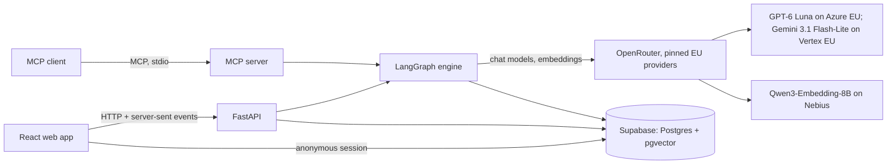
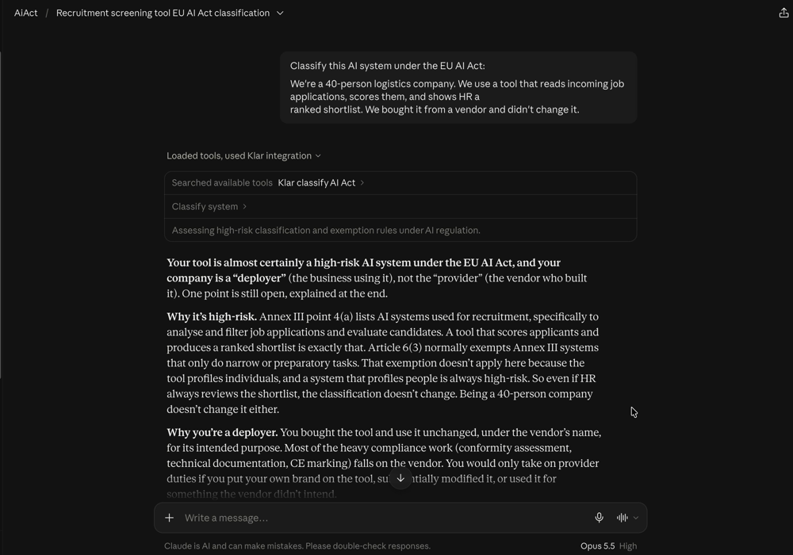

# Klar: AI Act Classification Assistant

The EU AI Act sorts AI systems into risk classes with very different obligations, and its timeline changed in July
2026. Small companies often can't tell which class their tools fall into, and the free checkers available are
questionnaires that give indicative answers without showing their reasoning. This assistant lets a company describe
its AI tools in plain words, in English or German. It checks each one against the Act in the Act's own order: scope,
prohibited practices, high-risk status and transparency duties. It returns a classification in which every step
cites the provision it relies on, and turns the result into a list of obligations with deadlines and draft
documents. When the facts or the law don't settle the answer, it says so instead of guessing. Its accuracy is
measured against labelled cases based on current law and published in this README. It gives guidance, not legal
advice.

**Showcase:** TODO(user): the link to this project's [showcase.turingcollege.com](https://showcase.turingcollege.com/)
entry goes here. **Measured accuracy:** 65.8% (100/152) risk-class accuracy on the held-out Commission examples,
false-low-risk rate 0.0% (0/56) (run 1, the figures the website shows; [details](#measured-accuracy)).

<!-- TODO(W2, screenshots): Result, Reviewer, Inventory, Documents and a phone view, captured from the running app,
go here (docs/showcase/). -->

## What it does, and what it is not

**What it does**

- **Classifies one AI system** from a plain-language description, then asks short key-fact questions that decide
  the outcome ("Does the tool rank, score or filter people?"). The result has a risk class (`out_of_scope`,
  `prohibited`, `high_risk`, `limited_risk`, `minimal_risk`), the company's role (provider, deployer, importer,
  distributor, including the Art. 25 switch from deployer to provider), the Annex point, the deciding facts and a
  cited decision for every step.
- **Says when it can't decide.** Next to the class, a result carries a status: `decided`,
  `needs_more_information` (a fact is missing, and the app asks for it) or `legally_ambiguous` (the facts are known
  but the law doesn't settle them; both readings are shown and the stricter one is the labelled working
  assumption). Each fact is tagged **stated**, **inferred** or **assumed**, instead of a confidence score.
- **Turns the result into work:** an obligations checklist with dates, an AI inventory of a company's tools, short
  deployer documents and vendor letters, and skeletons of the heavy provider documents (Annex IV technical
  documentation, Art. 9, 17 and 27) completed through a guided interview. Nothing is invented: a section the user
  hasn't supplied information for stays marked "to fill in", and every document is labelled DRAFT.
- **Compares law versions:** classify under the Act as amended by the Digital Omnibus (Regulation (EU) 2026/1744)
  or under the original text (see Limitations).
- **Answers questions** about a result, or general AI Act questions within its corpus, with citations.
- **Offers its tools to other AI agents** through an MCP server: the lookups (`search_ai_act`, `get_provision`,
  `list_obligations`) and the full classification (`classify_system`, on the caller's own OpenRouter key).

**What it is not**

- **Not legal advice.** Every result, document and tool output carries the "guidance, not legal advice" notice and
  the law version it used. High-risk, prohibited and ambiguous outcomes recommend legal review.
- **Not a compliance audit.** It keeps the checklist; it doesn't check the work.
- **Out of scope:** the obligations of general-purpose AI model providers (Chapter V, only flagged), the EU product
  laws behind Annex I (the tool names the law and asks the decisive question, but doesn't assess it), and national
  penalty rules.

## Architecture

One Python backend holds all the logic; the web app and the MCP server are its clients.



The engine (`backend/aiact/engine/`) is a LangGraph graph with a fixed check order that no path can skip:

```
facts → scope → prohibited → high_risk → transparency → role_obligations → finalize
```

`scope` and `prohibited` end a run early only when they matched and decided; an uncertain match goes on with the
stricter reading as the working assumption (decision 010). Every check node is wrapped by a citation check: each
citation must resolve in the corpus, and its quote is rebuilt from the corpus row. Retrieval fetches a provision by
its ID where the law says where to look, and otherwise searches the AI Act corpus (official texts and Commission
guidance, EN and DE) by meaning, with the benchmark's held-out examples filtered out (decisions 003, 012). The
hosted Supabase project in Frankfurt serves the app and the benchmark; a slim local Postgres serves the tests
(decision 034). The checks, retrieval, models, databases, tracing and frontend in detail:
[docs/ARCHITECTURE.md](docs/ARCHITECTURE.md).

## Setup from a clean clone

You need git, [uv](https://docs.astral.sh/uv/) (Python 3.12), Node 24 with corepack, the
[Supabase CLI](https://supabase.com/docs/guides/local-development/cli/getting-started) and Docker (for the local
test database).

```sh
git clone <this repo> && cd <repo>
git config core.hooksPath .githooks   # pre-commit keeps docs/DEPENDENCIES.md current
```

**Backend** (from `backend/`):

```sh
cp .env.example .env    # then fill in the keys below
uv sync
```

`backend/.env.example` is the one list of keys, each explained there. The tests need none of them: model calls
replay from `backend/tests/recordings/` and the network is blocked. To run the app you need `OPENROUTER_API_KEY`,
the model keys (`ENGINE_MODEL`, `ENGINE_PROVIDER`, `REFUSAL_MODEL`, `REFUSAL_PROVIDER`, `EMBEDDING_MODEL`,
`EMBEDDING_PROVIDER`) and the hosted database's `SUPABASE_URL`, `SUPABASE_SERVICE_KEY` and `DATABASE_URL`. The
model keys are empty in the example; the comment above each gives the decided value as an example (for the engine,
decision 004's `openai/gpt-6-luna-20260922` on `azure/eu`). `LANGSMITH_API_KEY` is optional.

**Frontend:** copy `frontend/.env.example` to `frontend/.env.local` and set `VITE_SUPABASE_URL` and
`VITE_SUPABASE_ANON_KEY` (the publishable key only: every `VITE_*` value ships in the public bundle). Install and
test as `frontend/README.md` says (`pnpm install`, then Playwright's Chromium for the browser tests).

**Tests:** start the local test database with `make db` (Postgres only), then run the checks CI runs, listed in
`CLAUDE.md` › Commands and in `.claude/foreman.json` (`checks`): ruff, pyright, `uv run pytest`, `uv run aiact deps
check` in `backend/`, and `pnpm lint`, `pnpm build`, `pnpm test` in `frontend/`. Live model tests are skipped
unless `-m live`.

`make db` applies `supabase/migrations/` and the obligations seed on its first start. `supabase stop` keeps the
data.

**Run the app:** `make dev` starts the API on `:8000` and the web app on `:5173` (Ctrl-C stops both). The app
reads and writes the hosted project in `backend/.env` and `frontend/.env.local`. To run it on a Supabase project
of your own (schema, corpus, embeddings, obligations seed), follow [docs/SETUP.md](docs/SETUP.md).

## Use it from another AI agent (MCP demo)

`aiact mcp serve` offers four tools over stdio: `search_ai_act`, `get_provision`, `list_obligations` and
`classify_system`. The first three are lookups; `classify_system` runs the full classification on the caller's own
OpenRouter key (`MCP_OPENROUTER_API_KEY`), never on the app's, and the key's spending limit is its only budget cap.
The Claude Desktop config is in [docs/SETUP.md](docs/SETUP.md#claude-desktop-mcp).

[](docs/demo/mcp-claude-desktop.md)

In the recorded demo (2026-10-13), Claude Desktop picks `classify_system` by itself for INIT's worked example
(a vendor's CV-ranking tool at a 40-person logistics company), asks before the paid call, gets high-risk under
Annex III 4(a) as the working assumption with the company as deployer, and sends the answer to the open scope
question back in a second call. About 80 s of server time and about $0.0075 per classification. Recording, steps
and timings: [docs/demo/mcp-claude-desktop.md](docs/demo/mcp-claude-desktop.md).

## Ethics and privacy

The main ethical risk is a wrong classification that a company trusts: calling a high-risk system low-risk can
leave people unprotected and the company exposed. The safeguards (INIT › Ethical considerations):

| Risk | Safeguard |
| --- | --- |
| Output mistaken for legal advice | The notice on every result, document and tool output; legal review recommended for high-risk, prohibited and ambiguous outcomes |
| False "low-risk" results | Uncertain outcomes instead of confident guesses; the stricter reading as the working assumption; the false-low-risk rate reported separately |
| Misleading descriptions | Key-fact questions decide the outcome; the deciding facts and evidence tags are shown on every result, with "this assessment is only as accurate as the description provided" |
| Wrong or invented citations | Every citation is checked to exist in the corpus and its quote is taken from the corpus |
| Draft documents trusted as finished | DRAFT label; no section filled with content the user didn't supply; vendor letters built only from the result |
| Outdated law | Every result states the law version and date; draft guidance is labelled as a draft |
| Translation errors | Citations quote the official text in each language; English-only guidance stays in English and is labelled so |
| The author is not a lawyer | Every own-case label cites the provision that settles it, or is "legally ambiguous"; no external legal review, stated openly |
| Label bias in test data | appliedAI is industrial and German-focused; results reported per benchmark and per business function |
| Over-reliance on automation | Step-by-step reasoning with evidence tags, so users can challenge each decision |
| The assistant is itself an AI system | Most likely limited-risk: it tells users it is an AI on every screen (Art. 50(1)) |

**Privacy** (INIT › Scope, Storage; decisions 013, 026, 027):

- **Anonymous sessions.** No account is needed. Each visitor gets an anonymous Supabase session; inventories,
  classifications, interview answers, the company profile and checklist ticks are stored in the database under
  row-level security, visible only to their owner.
- **Deletion.** "Delete my data" removes everything at once. Accounts inactive for 30 days are deleted with all
  their data by a daily job (decision 013). Data can be exported to a file and imported again. Each user's stored
  data and each import are capped at 4 MB (decision 027).
- **Less stored.** Q&A history stays in the browser session only, never in the database (decision 026).
- **The company profile is not an input to classification.** It drives the SME and small mid-cap notes and
  pre-fills answers to the establishment questions, but the engine scores the description alone (decision 026).
- **Personal data.** A check in the browser warns when a description seems to contain personal data (e-mail
  addresses, phone numbers, IBANs, likely names); nothing is sent for that check.
- **Processors.** Models are reached through OpenRouter, pinned to EU zero-data-retention endpoints on Microsoft
  Azure and Google Vertex AI, never used for training (decision 005). OpenRouter's own processing isn't limited to
  the EU, and the embedding host Nebius's region is still to be confirmed; the in-app Privacy page and "Your data"
  say so. DeepSeek and other providers EU data protection authorities have acted against are excluded.
- **Traces carry metadata only** outside development (see Architecture), and no real user input enters the
  evaluation. Traces go to LangSmith when a key is set; `backend/.env.example` points `LANGSMITH_ENDPOINT` at its
  EU endpoint (`eu.api.smith.langchain.com`), and an empty value means the SDK's default, the US region.

## Limitations

The main ones; every item, with its source, is in [docs/LIMITATIONS.md](docs/LIMITATIONS.md).

- **No external legal review** of the labels; a second model filtered them (Claude Haiku 4.5).
- **Labels were frozen per category, not before the engine,** each before the step that replays it (decision 017).
- **Own cases are development cases:** the engine was tuned on them (decision 018).
- **The headline rests on the draft high-risk guidelines** of 19 May 2026 (decision 021).
- **The original-text toggle covers the class, not the duties:** only the Art. 113 route dates change (decision 020).
- **Run-to-run spread** (headline 65.8% and 60.5%), false low risks in run 2 only, citation support 14.5–21.6%
  as judged with no hand-checked sample, RAGAS faithfulness about 0.80 (final.md › Limitations).
- **Art. 111(1) isn't modelled**, and Art. 111(2)'s per-product caveat rests on the Blue Guide (decision 022).
- **The EU link is read from the description only:** the company profile isn't a classification input (decision 026).
- **No prompt-injection framing or injection tests,** and no app-level spending cap beyond the OpenRouter key limit.
- **A refusal by both models gives no class** (decisions 029, 030, 033).

## Measured accuracy

All figures are quoted from [eval/reports/final.md](eval/reports/final.md), the final evaluation (story W1), which
quotes each one from a stored run by its id. Every run used the build frozen at commit `6f5fa50` (decision 024),
the GPT-6 Luna engine and the 19 May 2026 draft high-risk guidelines, on 2026-10-15. Run 2 repeats the sets whose
numbers vary from run to run; the difference between the columns is that variance. **The website (landing and
Method pages) shows run 1.** Own cases are development cases (decision 018): the held-out Commission examples
(Pile B) carry the headline. The contaminated cases are the two listed in decision 016.

**Headline.**

| Figure | Run 1 | Run 2 |
| --- | --- | --- |
| Risk-class accuracy, Commission Pile B held out | 65.8% (100/152), run `31baa80c-f3bc-4eaf-93d0-4280b5fa14e7` | 60.5% (92/152), run `3ed735c1-b796-421b-a01e-5d36faa93851` |
| … without the contaminated cases | 65.3% (98/150) | 60.7% (91/150) |
| False-low-risk rate, Commission Pile B | 0.0% (0/56) | 1.7% (1/59) |
| Citations that exist (at run time), Commission Pile B | 100.0% (147/147) | 100.0% (149/149) |
| Results the second model answered (the engine model's provider refused), Commission Pile B | 3 of 147 (2.0%) | 4 of 149 (2.7%) |
| Results refused by both models (not assessed), Commission Pile B | 0 of 147 (0.0%) | 0 of 149 (0.0%) |

Head-to-head against the Commission's AI Act Service Desk checker over the same 25 drawn cases (decision 036; run
`592089b8-1585-4f8f-a108-9d4ebbe8f38a`): Commission checker 84.0% (21/25), engine 76.0% (19/25); false-low-risk
rate 0.0% (0/10) for both.

**Risk-class accuracy, per benchmark.**

| Benchmark | Run 1 | Run 2 |
| --- | --- | --- |
| Commission Pile B, held out (headline) | 65.8% (100/152) `31baa80c-f3bc-4eaf-93d0-4280b5fa14e7` | 60.5% (92/152) `3ed735c1-b796-421b-a01e-5d36faa93851` |
| Own cases (development cases) | 84.6% (66/78) `d520e689-5c8b-463c-9155-42b2d7a2ab02` | 84.6% (66/78) `f5d98467-29ab-42c0-9d18-ecf3c4164939` |
| Soft-wording pairs | 66.7% (16/24) `c1746ef0-d8bf-4caa-84a0-b93a552dc99f` | 62.5% (15/24) `3539d1b0-b22d-403d-9c62-e08961b00384` |
| Consistency set | 90.0% (27/30) `76a3d43e-5f0e-4e17-9e65-8d5534cd85e2` | 86.7% (26/30) `acf079e8-cab4-4b24-b61f-101f7d6d0fa5` |
| Annex matching | 87.5% (42/48) `983fda65-4fdf-4afb-b553-bc0280c9ff49` | 87.5% (42/48) `918a061a-333b-41a3-aeae-26e24971bd45` |
| appliedAI (second benchmark, reported separately) | 62.7% (52/83) `f0e004fa-8f79-4c51-a9c7-6655a4529479` | not repeated |
| Academic benchmark (extra check, reported separately) | 87.2% (293/336) `a6de7ccb-1324-45ff-8eb0-52682e5677a5` | not repeated |
| Head-to-head draw (own and Pile B cases mixed) | 76.0% (19/25) `592089b8-1585-4f8f-a108-9d4ebbe8f38a` | not repeated |

**Baselines** (same cases, run 1):

| Classifier | Commission Pile B | Own cases (development cases) |
| --- | --- | --- |
| Engine (staged, cited) | 65.8% (100/152) `31baa80c-f3bc-4eaf-93d0-4280b5fa14e7` | 84.6% (66/78) `d520e689-5c8b-463c-9155-42b2d7a2ab02` |
| `baseline_luna`: same model, one prompt, no retrieval | 60.5% (92/152) `b2b88c38-5f2d-438e-8741-7e234ebb6cc5` | 75.6% (59/78) `1e490e70-6606-436a-902a-a92157456f06` |
| `baseline_jev`: Jev classifying the description | 51.3% (78/152) `bc908149-1726-49e2-ae14-67ffe7efae3a` | 74.4% (58/78) `dadf2f5a-32fd-4c14-9b2d-9ebbc4b33e06` |
| Baseline false-low-risk rate, `baseline_luna` / `baseline_jev` | 0.0% (0/61) / 13.1% (8/61) | 0.0% (0/31) / 17.6% (6/34) |

**Held-out vs in-corpus gap** (run 1): the same sets with the held-out examples retrievable.

| Set | Held-out run | Gap run | Gap |
| --- | --- | --- | --- |
| Commission Pile B | 65.8% (100/152) `31baa80c-f3bc-4eaf-93d0-4280b5fa14e7` | 71.1% (108/152) `2d0ad2ce-6ef3-4ffb-b928-f441e17a7fe2` | -5.3 pp |
| … without the contaminated cases | 65.3% (98/150) | 70.7% (106/150) | -5.3 pp |
| Own cases | 84.6% (66/78) `d520e689-5c8b-463c-9155-42b2d7a2ab02` | 84.6% (66/78) `22bf99b1-0e18-42d9-b558-2a401b66415b` | +0.0 pp |

The held-out runs' traces retrieved no held-out row. Annex point, role, ambiguity, citation-support,
evidence-tag, soft-wording, consistency, RAGAS and tool-call figures, the per-language, per-area and
per-business-function breakdowns, failures and cost ($12.06 for both runs) are in
[final.md](eval/reports/final.md).
