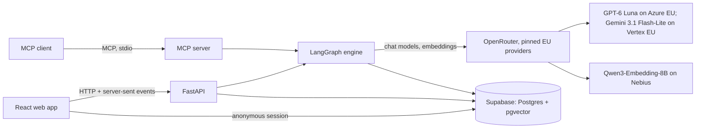

# Klar: AI Act Classification Assistant

The EU AI Act sorts AI systems into risk classes with very different obligations, and its timeline changed in July
2026. Small companies often can't tell which class their tools fall into, and the free checkers available are
questionnaires that give indicative answers without showing their reasoning. This assistant lets a company describe
its AI tools in plain words, in English or German. It checks each one against the Act in the Act's own order: scope,
prohibited practices, high-risk status and transparency duties. It returns a classification in which every step
cites the provision it relies on, and turns the result into a list of obligations with deadlines and draft
documents. When the facts or the law don't settle the answer, it says so instead of guessing. Its accuracy is
measured against labelled cases based on current law and published in this README. It gives guidance, not legal
advice.

## What it does, and what it is not

**What it does**

- **Classifies one AI system** from a plain-language description, then asks short key-fact questions that decide
  the outcome ("Does the tool rank, score or filter people?"). The result has a risk class (`out_of_scope`,
  `prohibited`, `high_risk`, `limited_risk`, `minimal_risk`), the company's role (provider, deployer, importer,
  distributor, including the Art. 25 switch from deployer to provider), the Annex point, the deciding facts and a
  cited decision for every step.
- **Says when it can't decide.** Next to the class, a result carries a status: `decided`,
  `needs_more_information` (a fact is missing, and the app asks for it) or `legally_ambiguous` (the facts are known
  but the law doesn't settle them; both readings are shown and the stricter one is the labelled working
  assumption). Each fact is tagged **stated**, **inferred** or **assumed**, instead of a confidence score.
- **Turns the result into work:** an obligations checklist with dates, an AI inventory of a company's tools, short
  deployer documents and vendor letters, and skeletons of the heavy provider documents (Annex IV technical
  documentation, Art. 9, 17 and 27) completed through a guided interview. Nothing is invented: a section the user
  hasn't supplied information for stays marked "to fill in", and every document is labelled DRAFT.
- **Compares law versions:** classify under the Act as amended by the Digital Omnibus (Regulation (EU) 2026/1744)
  or under the original text (see Limitations).
- **Answers questions** about a result, or general AI Act questions within its corpus, with citations.
- **Offers its tools to other AI agents** through an MCP server: the lookups (`search_ai_act`, `get_provision`,
  `list_obligations`) and the full classification (`classify_system`, on the caller's own OpenRouter key).

**What it is not**

- **Not legal advice.** Every result, document and tool output carries the "guidance, not legal advice" notice and
  the law version it used. High-risk, prohibited and ambiguous outcomes recommend legal review.
- **Not a compliance audit.** It keeps the checklist; it doesn't check the work.
- **Out of scope:** the obligations of general-purpose AI model providers (Chapter V, only flagged), the EU product
  laws behind Annex I (the tool names the law and asks the decisive question, but doesn't assess it), and national
  penalty rules.

## Architecture

One Python backend holds all the logic; the web app and the MCP server are its clients.



**The engine** (`backend/aiact/engine/`) is a LangGraph graph with a fixed check order that no path can skip:

```
facts → scope → prohibited → high_risk → transparency → role_obligations → finalize
```

- `facts` extracts the facts and their evidence tags. A description too thin to start (for example "We use AI in
  our shop.") goes straight to `finalize` with a "needs a description" outcome, and no check runs.
- `scope` (Art. 2–3) and `prohibited` (Art. 5) may end the run early, but only when they matched and decided; an
  uncertain match goes on with the stricter reading as the working assumption (decision 010).
- `high_risk` (Art. 6, Annex III, Annex I flagged), `transparency` (Art. 50) and `role_obligations` (Art. 16,
  23–26, the Art. 25 switch, the Art. 111(2) rules for systems already on the market) follow.
- **Citation check** (`engine/citations.py`): every check node is wrapped by a validator. Each citation a step
  makes must resolve in the corpus, in the language it quotes, under the run's law version and, for the amended
  text and guidance, on the run's date; a citation that resolves is rebuilt from the corpus row, so its quote is
  the corpus's own. A step citing something that doesn't resolve is run once more (a refused step is not). If a citation still doesn't
  resolve, the step keeps the citations that do and says a person must verify it, and a decided step becomes
  `needs_more_information`.
- `finalize` calls no model. It sets the class and status and collects the deciding facts and follow-up
  questions.
- If the model provider's content filter refuses a check, the request goes once to a second pinned EU model
  (decision 033). If that also fails, the result gives no class and says a person must review it (decisions 029,
  030).

**Retrieval over the AI Act corpus.** The corpus holds only official texts and Commission guidance, in English and
German where official: the AI Act (original and consolidated), the Digital Omnibus, and the guidelines on the AI
system definition, prohibited practices, high-risk classification (draft, May 2026) and Art. 50, plus the
transparency Code of Practice (`data/manifest.yaml`; parsed texts in `data/parsed/`). Where the law says where to
look, the engine fetches the provision by its ID. Otherwise it searches by meaning (pgvector, Qwen3-Embedding-8B
at 1,536 dimensions), with a lightly weighted keyword arm (Postgres full-text search) fused in to break ties
(decision 003): to match a description to
Annex III or Annex I points, to find similar Commission guideline examples, and to answer questions. The half of
the Commission's worked examples that forms the benchmark is filtered out of every search by default (decision
012).

**Models,** all through OpenRouter, each pinned to its EU zero-data-retention endpoint with fallbacks off
(decision 005): the engine runs on GPT-6 Luna (`openai/gpt-6-luna-20260922` on `azure/eu`, decision 004); refused
requests go to Gemini 3.1 Flash-Lite on `google-vertex/eu` (decision 033); embeddings come from Qwen3-Embedding-8B
on Nebius (decision 003). The evaluation uses Claude Haiku 4.5 as the label filter and Gemini 3.1 Flash-Lite for
RAGAS (decision 005).

**Databases** (decision 034 and its amendment):

- **Hosted** (Supabase Free plan, Frankfurt `eu-central-1`): the app, the benchmark runs and their stored results.
  - `backend/.env` (from `backend/.env.example`): `DATABASE_URL` is the session pooler's connection string with
    `?sslmode=require`, `SUPABASE_URL` and `SUPABASE_SERVICE_KEY` the project URL and secret key. Turn on the
    dashboard's Database settings > SSL Configuration > "Enforce SSL on incoming connections".
  - `frontend/.env.local` (from `frontend/.env.example`): `VITE_SUPABASE_URL` and the publishable key in
    `VITE_SUPABASE_ANON_KEY`.
- **Local** (the Supabase CLI's Postgres on `127.0.0.1:54322`): the backend tests, every worktree sharing it, as CI
  does. `make db` starts it slim, Postgres only:
  `supabase start -x gotrue,realtime,storage-api,imgproxy,kong,mailpit,postgrest,postgres-meta,studio,edge-runtime,logflare,vector,supavisor`.
  The tests use `TEST_DATABASE_URL` (default: that database) and never follow `DATABASE_URL`.

Schema changes: `supabase migration new <name>`, then apply it to both, `supabase migration up --local` and
`supabase db push` to the linked project (`supabase login` and `supabase link --project-ref <ref>` once).
`supabase config push` applies `supabase/config.toml`'s auth settings (anonymous sign-ins on) to the hosted
project. Never reset either database or drop its schema: the corpus in each is shared.

**Tracing.** LangSmith traces each classification when `LANGSMITH_API_KEY` is set. Outside development
(`AIACT_ENV` empty means production) a trace keeps metadata only: node names, timings, model ids and the run's
settings, never the description, prompt, answer or error text. `AIACT_ENV=development` traces the content too, on
a developer's own machine only.

**Frontend** (`frontend/`): Vite, React and TypeScript, Tailwind CSS and shadcn/ui, TanStack Router and Query, a
TypeScript client generated from the API's OpenAPI schema, react-i18next for English and German.

## Setup from a clean clone

You need git, [uv](https://docs.astral.sh/uv/) (Python 3.12), Node 24 with corepack, the
[Supabase CLI](https://supabase.com/docs/guides/local-development/cli/getting-started) and Docker (for the local
test database).

```sh
git clone <this repo> && cd <repo>
git config core.hooksPath .githooks   # pre-commit keeps docs/DEPENDENCIES.md current
```

**Backend** (from `backend/`):

```sh
cp .env.example .env    # then fill in the keys below
uv sync
```

`backend/.env.example` is the one list of keys, each explained there. The tests need none of them: model calls
replay from `backend/tests/recordings/` and the network is blocked. To run the app you need `OPENROUTER_API_KEY`,
the model keys (`ENGINE_MODEL`, `ENGINE_PROVIDER`, `REFUSAL_MODEL`, `REFUSAL_PROVIDER`, `EMBEDDING_MODEL`,
`EMBEDDING_PROVIDER`) and the hosted database's `SUPABASE_URL`, `SUPABASE_SERVICE_KEY` and `DATABASE_URL`. The
model keys are empty in the example; the comment above each gives the decided value as an example (for the engine,
decision 004's `openai/gpt-6-luna-20260922` on `azure/eu`). `LANGSMITH_API_KEY` is optional.

**Frontend:** copy `frontend/.env.example` to `frontend/.env.local` and set `VITE_SUPABASE_URL` and
`VITE_SUPABASE_ANON_KEY` (the publishable key only: every `VITE_*` value ships in the public bundle). Install and
test as `frontend/README.md` says (`pnpm install`, then Playwright's Chromium for the browser tests).

**Tests:** start the local test database with `make db` (Postgres only), then run the checks CI runs, listed in
`CLAUDE.md` › Commands and in `.claude/foreman.json` (`checks`): ruff, pyright, `uv run pytest`, `uv run aiact deps
check` in `backend/`, and `pnpm lint`, `pnpm build`, `pnpm test` in `frontend/`. Live model tests are skipped
unless `-m live`.

`make db` applies `supabase/migrations/` and the obligations seed on its first start. `supabase stop` keeps the
data.

**Run the app:** `make dev` starts the API on `:8000` and the web app on `:5173` (Ctrl-C stops both). The app
reads and writes the hosted project in `backend/.env` and `frontend/.env.local`.

**Use it from Claude Desktop (MCP).** Add the server to Claude Desktop's config (Settings › Developer › Edit
Config; on macOS `~/Library/Application Support/Claude/claude_desktop_config.json`) with absolute paths (`which
uv` for the first), then restart Claude Desktop:

```json
{
  "mcpServers": {
    "aiact": {
      "command": "/absolute/path/to/uv",
      "args": ["run", "--directory", "/absolute/path/to/repo/backend", "aiact", "mcp", "serve"],
      "env": { "MCP_OPENROUTER_API_KEY": "sk-or-v1-your-own-key" }
    }
  }
}
```

The server (`aiact mcp serve`, over stdio) reads the database and the model ids from `backend/.env`.
`classify_system` runs only on `MCP_OPENROUTER_API_KEY`, your own OpenRouter key, never on the app's
`OPENROUTER_API_KEY`, which embeds the lookups' search queries. A classification takes about a minute.

**A Supabase project of your own.** Create a project in an EU region, then from the repo root: `supabase link
--project-ref <ref>`, `supabase db push` (the schema) and `supabase config push` (anonymous sign-ins). Load the
legal texts from the committed `data/parsed/` with `uv run aiact corpus load` (free), embed them with
`uv run aiact corpus embed` (paid on your OpenRouter key: about 1.3 million tokens, $0.013 in decision 003's
Qwen3 run), and load the obligations table from `backend/` (`supabase db push` doesn't run the seed, and
`supabase db query -f` can't run this multi-statement file):

```sh
uv run python -c "import pathlib, psycopg; from aiact.settings import get_settings; psycopg.connect(get_settings().database_url.get_secret_value(), autocommit=True).execute(pathlib.Path('../supabase/seed/obligations.sql').read_text())"
```

It loads into `DATABASE_URL` from `backend/.env`, replacing the amended-text rows, so it is safe to rerun.

## Ethics and privacy

The main ethical risk is a wrong classification that a company trusts: calling a high-risk system low-risk can
leave people unprotected and the company exposed. The safeguards (INIT › Ethical considerations):

| Risk | Safeguard |
| --- | --- |
| Output mistaken for legal advice | The notice on every result, document and tool output; legal review recommended for high-risk, prohibited and ambiguous outcomes |
| False "low-risk" results | Uncertain outcomes instead of confident guesses; the stricter reading as the working assumption; the false-low-risk rate reported separately |
| Misleading descriptions | Key-fact questions decide the outcome; the deciding facts and evidence tags are shown on every result, with "this assessment is only as accurate as the description provided" |
| Wrong or invented citations | Every citation is checked to exist in the corpus and its quote is taken from the corpus |
| Draft documents trusted as finished | DRAFT label; no section filled with content the user didn't supply; vendor letters built only from the result |
| Outdated law | Every result states the law version and date; draft guidance is labelled as a draft |
| Translation errors | Citations quote the official text in each language; English-only guidance stays in English and is labelled so |
| The author is not a lawyer | Every own-case label cites the provision that settles it, or is "legally ambiguous"; no external legal review, stated openly |
| Label bias in test data | appliedAI is industrial and German-focused; results reported per benchmark and per business function |
| Over-reliance on automation | Step-by-step reasoning with evidence tags, so users can challenge each decision |
| The assistant is itself an AI system | Most likely limited-risk: it tells users it is an AI on every screen (Art. 50(1)) |

**Privacy** (INIT › Scope, Storage; decisions 013, 026, 027):

- **Anonymous sessions.** No account is needed. Each visitor gets an anonymous Supabase session; inventories,
  classifications, interview answers, the company profile and checklist ticks are stored in the database under
  row-level security, visible only to their owner.
- **Deletion.** "Delete my data" removes everything at once. Accounts inactive for 30 days are deleted with all
  their data by a daily job (decision 013). Data can be exported to a file and imported again. Each user's stored
  data and each import are capped at 4 MB (decision 027).
- **Less stored.** Q&A history stays in the browser session only, never in the database (decision 026).
- **The company profile is not an input to classification.** It drives the SME and small mid-cap notes and
  pre-fills answers to the establishment questions, but the engine scores the description alone (decision 026).
- **Personal data.** A check in the browser warns when a description seems to contain personal data (e-mail
  addresses, phone numbers, IBANs, likely names); nothing is sent for that check.
- **Processors.** Models are reached through OpenRouter, pinned to EU zero-data-retention endpoints on Microsoft
  Azure and Google Vertex AI, never used for training (decision 005). OpenRouter's own processing isn't limited to
  the EU, and the embedding host Nebius's region is still to be confirmed; the in-app Privacy page and "Your data"
  say so. DeepSeek and other providers EU data protection authorities have acted against are excluded.
- **Traces carry metadata only** outside development (see Architecture), and no real user input enters the
  evaluation. Traces go to LangSmith when a key is set; `backend/.env.example` points `LANGSMITH_ENDPOINT` at its
  EU endpoint (`eu.api.smith.langchain.com`), and an empty value means the SDK's default, the US region.

## Limitations known so far

- **No external legal review.** The labels of the own test cases are the author's, checked by a second model
  (Claude Haiku 4.5) whose disagreements were investigated; that filter catches mistakes and isn't validation.
- **Labels were frozen per category, not before the engine.** Each own-case category's labels were frozen before
  the engine step that replays it, and the whole set was tagged `labels-v1` later; every change after a freeze is
  logged in `eval/LABEL_CHANGES.md` (decision 017).
- **Own cases are development cases.** The engine's steps were tuned against them, so their accuracy is reported
  as "cases the engine was developed against"; the held-out Commission examples and the academic benchmark carry
  the headline (decision 018).
- **The headline benchmark rests on draft guidance.** It is built from the Commission's draft high-risk guidelines
  of 19 May 2026; if they are finalised, the benchmark stays frozen on the draft (decision 021).
- **The original-text toggle covers the class, not the duties.** Under the original text the class and route come
  from the original provisions and only the Art. 113 route dates change (2 August 2026 for Annex III, 2 August 2027
  for Annex I); the duty list stays the amended text's, with a notice saying so (decision 020 and its addendum).
- **Art. 111.** Art. 111(1) (components of the large-scale IT systems in Annex X) isn't modelled. The per-product
  caveat on Art. 111(2) results rests on the New Legislative Framework reading (the Commission's Blue Guide), which
  isn't in the corpus. The 2 August 2030 date for public-authority systems follows the article's "providers and
  deployers" over the English recital 177's "operators" (decision 022).
- **Q&A history** is kept only in the browser session; closing it loses the questions (decision 026).
- **Vendor letters are drafts** built only from the result's facts (decision 026).
- **The simplified technical documentation form** for SMEs and small mid-caps isn't published yet, so they get the
  full Annex IV skeleton with a note.
- **A provider refusal gives no class.** When both models' filters block a check, a person must review the system
  (decisions 029, 030, 033).
- **The problem wasn't validated with users.** The evidence comes from secondary sources; no user interviews or
  tests were run.
- **The hosted database is on the Free plan,** which pauses after 7 idle days: open the app before a demo (decision
  034).

## Measured accuracy

The numbers come with the final evaluation. The headline benchmark is run twice: once with the held-out
Commission examples excluded from retrieval (the reported number) and once with them retrievable, and both numbers
go here with the gap between them (INIT › Evaluation). The own cases are reported as development cases (decision
018), and the appliedAI and academic benchmarks separately. Each figure will name its stored run. Until that
evaluation is done, this README gives no accuracy figure.
