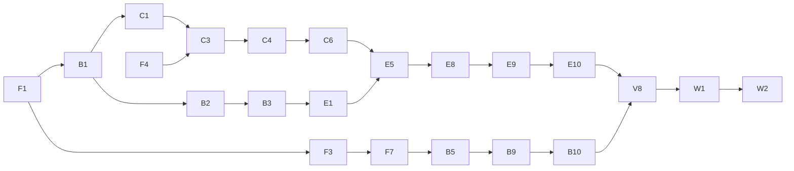

# Plan: AI Act Classification Assistant — Build Backlog

## Context
The repo is greenfield: `AE.CAP_afa.md` (course brief), `AI Act Classification Assistant — Capstone Init Document.md` (the full design, called **INIT** below) and an empty `README.md`. The design is settled; this plan turns it into atomic stories with dependencies, a critical path and parallel lanes, so that any story can be picked up with a fresh context (or handed to a subagent) with no loss of quality. The timeline is 10+ weeks, so the full MVP plus stretch goals is in scope.

INIT sets hard ordering rules that this backlog enforces:
- **Benchmark isolation:** the Commission example split must be **committed before any engine code exists**, and own-case labels are **frozen before the build** (INIT › Benchmark isolation, Label rules).
- **Engine and evaluation first.** Product features are views on the same result and come later (INIT › Risks: scope creep).
- **Week-one checks:** Luna smoke test, embedding comparison, token cost (INIT › Tech stack, Engine safety net).

---

## How to use this backlog

**First story to run is F0**, which copies this file into the repo as `docs/BACKLOG.md` so it survives context clears. After that, `docs/BACKLOG.md` is the source of truth. Tick stories off there (`[x]`) and add a one-line outcome note.

**Picking up a story with a fresh context:** read (1) `CLAUDE.md`, (2) the story, (3) the INIT sections named in its *Context* line, (4) the files listed in *Input*. Nothing else should be needed.

**Story format**
- **Deps:** stories that must be done first. **Parallel:** safe to run at the same time.
- **Type:** `agent` (can be delegated fully), `human` (needs the user: legal judgement, manual extraction, external tools), `mixed` (an agent drafts, the user reviews and approves).
- **Context:** INIT sections to read. **Input:** files/data consumed. **Output:** files produced. **DoD:** checkable definition of done.

**Global rules for every story**
- **Isolation:** any story in the Corpus lane (B1, C*) must **never read `eval/`**. Any benchmark story must never write to `data/` or the corpus tables. This is how INIT's leak rule is kept even when agents run in parallel.
- Python: `uv run ruff check`, `uv run pyright` and `uv run pytest` pass before a story is done. Tests that call models use recorded responses (F6), never live calls in CI.
- Any story touching Postgres loads the `supabase-postgres-best-practices` skill first; Supabase work loads the `supabase` skill.
- Library APIs (LangGraph, Docling, MCP SDK, RAGAS, FastAPI, TanStack) are checked through context7 before writing code.
- A story that makes a decision writes a short record to `docs/decisions/NNN-title.md` (what, options measured, numbers, choice).
- **Parallel agents use worktrees.** See `CLAUDE.md` › Parallel work for the full rules. In short: one worktree and one `story/<ID>-<slug>` branch per story; a worktree is created only after all its Deps are merged; the orchestrator alone ticks this backlog; every story is reviewed by `diff-reviewer` and passes the checks before it is merged; migrations are created with `supabase migration new`, and only one story at a time may change the schema; Corpus-lane worktrees leave out `eval/` with sparse checkout.
- **Migration names.** Names like `001_corpus.sql` in the stories below are logical names. The real files get the timestamp prefix from `supabase migration new` (for example `20261001120000_corpus.sql`).

---

## Critical path

**Critical path (longest chain):** F1 → B1 → C1 → C3 → C4 → C6 → E5 (high-risk node, the hardest step) → E8 → E9 → E10 → V8 (first headline run) → W1 → W2.
**Second chain that must converge on V8 in time:** F3 → F7 → B5/B4 → B9 → B10 (label freeze). It is human-heavy, so it should start in week 1.
**Hard gate:** B3 (split committed) must land before E1 opens.

## Parallel lanes (for agents)

| Lane | Stories | Notes |
| --- | --- | --- |
| Infra | F0, F1, F2, F4, F5, F6, X3 | F1 first; the rest fan out right after |
| Contract & eval | F3, F7, V1, V2, V3, V4 | Pure code; can run well ahead of the engine using dummy classifiers |
| Corpus | B1, C1, C2, C3, C4, C5, C6 | The critical path. Never reads `eval/` |
| Benchmark | B2–B12, V10 | Human-heavy. Agents draft, the user approves |
| Obligations | C7 | Independent after F3 and F4 |
| Engine | E1–E10 | E3, E4, E5, E6 and E7 are fully parallel once E1, C5, C6 (and C7 for E7) are done |
| Product | P1–P13 | After E10, except P2a, P3 and P4, which can start earlier |

## Waves (what to launch together)

| Wave | Launch in parallel | Gate to next wave |
| --- | --- | --- |
| 0 | F0, F1 | F1 done |
| 1 | F2, F3, F4, F6, B1, B11 (human, long) | F3 done → F7; F4 done → F5, C7; B1 done → B2, C1 |
| 2 | F5, F7, B2, C1, X3, C7, B12 | B2 → B3 |
| 3 | B3, C2, C3, V1, V2, B5a–e, B7 | B3 committed; C3 done |
| 4 | C4, C5, B4, B6, B8, E1, V4, V10 | C4 → C6 |
| 5 | C6, B9, X0, P2a, P3 | C6 done |
| 6 | V6 then X1; X2, E2, E3, E4, E5, E6, E7, B13, V3 | X2 decision; B10 frozen |
| 7 | E8 → E9 → E10 (serial), P4 scaffold | E10 done |
| 8 | V5, V7, V8, P1, P2b, P8 | V8 first numbers |
| 9 | P5, P7, V9, S2, then P6, P9, P10, P11, P12 | MVP feature-complete |
| 10 | P13, W0, W1, S1, S3, then W2, W3 | Submission |

---

## Phase 0 — Foundations

- [ ] **F0 · Put the backlog in the repo** · Deps: – · Type: agent
  Input: this plan file. Output: `docs/BACKLOG.md` (a copy of this plan), a `CLAUDE.md` holding the global rules above, the repo layout and the standard commands.
  DoD: both files committed; `CLAUDE.md` is under 100 lines and links to INIT and `docs/BACKLOG.md`.

- [ ] **F1 · Backend scaffold** · Deps: – · Type: agent
  Context: INIT › Tech stack (Dev tooling). Output: `backend/pyproject.toml` (uv, Python 3.12), package `backend/aiact/` with empty subpackages `schemas, corpus, retrieval, obligations, engine, eval, mcp, api, llm`, `backend/tests/`, Ruff and pyright config, `aiact/settings.py` (pydantic-settings reading `.env`), `.env.example` (OPENROUTER_API_KEY, SUPABASE_URL, SUPABASE_SERVICE_KEY, DATABASE_URL, LANGSMITH_API_KEY, model ids), `.gitignore` (including `.env`, `data/raw/`, `eval/private/`).
  DoD: `uv sync && uv run pytest && uv run ruff check && uv run pyright` all pass with one trivial test.

- [ ] **F2 · CI workflow** · Deps: F1 · Parallel: F3–F6 · Type: agent
  Output: `.github/workflows/ci.yml` running uv sync, ruff, pyright and pytest on push and PR. It gets a placeholder job for the isolation check (enabled in B13).
  DoD: the workflow passes on a pushed branch (or with `act`, if pushing is not wanted yet).

- [ ] **F3 · Result contract (Pydantic schemas)** · Deps: F1 · Parallel: F2, F4–F6 · Type: agent
  Context: INIT › How it works (Outcomes, Risk classes, Evidence tags, Deciding facts, Roles, Worked example), MCP tools. Output: `aiact/schemas/` with:
  - `RiskClass` (`out_of_scope`, `prohibited`, `high_risk`, `limited_risk`, `minimal_risk`), `Status` (`decided`, `needs_more_information`, `legally_ambiguous`), `EvidenceTag` (`stated`, `inferred`, `assumed`), `Role` (`provider`, `deployer`, `importer`, `distributor`), `LawVersion` (`original`, `amended`), `Language` (`en`, `de`)
  - `Citation` (provision_id, document_id, law_version, language, quote, english_only flag), `Fact` (text, evidence tag, source span), `OpenQuestion` (question, readings[2])
  - `StepResult` (step name, decision, facts used, citations, status, missing_fact or open_question)
  - `ClassificationResult` (extracted facts, steps, risk_class, status, role, role_switch_reason, annex_point, transparency_duties list, deciding_facts, obligations, law_version, as_of date, disclaimer, follow-up questions)
  - `DISCLAIMER` constants in EN and DE
  Validators: a `limited_risk` result has non-empty transparency duties; an uncertain status has its missing_fact or open_question set; a `prohibited` result has no steps after Art. 5.
  DoD: tests build INIT's worked example (recruitment tool → `high_risk`, deployer, Annex III 4(a)) as a valid `ClassificationResult`, and each validator rejects a bad case; `model_json_schema()` output is snapshot-tested.

- [ ] **F4 · Supabase local + corpus migration** · Deps: F1 · Parallel: F2, F3, F5, F6 · Type: agent
  Context: INIT › Legal corpus, Tech stack (Database). Output: `supabase/` (via `supabase init`), migration `001_corpus.sql`: `documents` (id, title, celex, doc_type law/guideline/code, status final/draft/consolidated, law_version, language, published_on, in_force_from, source_url, sha256), `provisions` (id, provision_id such as `art:6:3` or `annex:III:4:a` or `recital:53` or `guide:hr:ex:17`, document_id, language, parent_id, heading, text, valid_from, valid_to, `source_example_id` nullable, tsvector generated with the `english` or `german` config per language), `provision_embeddings` (provision_row_id, model, dims, vector(1536), HNSW cosine index). pgvector enabled.
  DoD: `supabase start && supabase db reset` applies cleanly; a pytest inserts and reads a provision and runs a vector and a keyword query.

- [ ] **F5 · Eval-records migration** · Deps: F4 · Type: agent
  Output: migration `002_eval.sql`: `eval_runs` (id, git_sha, benchmark, config json with model, embedding and retrieval settings, started_at, cost_usd, tokens), `eval_case_results` (run_id, case_id, predicted json, label json, per-metric scores, trace_id).
  DoD: migration applies; a round-trip test passes.

- [ ] **F6 · OpenRouter client + recorded responses** · Deps: F1 · Parallel: F2–F5 · Type: agent
  Context: INIT › Tech stack (Model access, Models, Embeddings, Billing). Output: `aiact/llm/` with a LangChain chat model factory over OpenRouter (model id from settings, provider routing, zero-data-retention and no-training flags where OpenRouter supports them) and an embeddings client (Qwen3-Embedding-8B, provider pinned to Nebius, `dimensions=1536`, query instruction prefix configurable, L2-normalise and assert). A record/replay fixture (for example pytest-recording or a small custom cache keyed by request hash) so CI never calls the network.
  DoD: one live test marked `@pytest.mark.live` (skipped by default) and the same test passing in replay mode in CI.

- [ ] **F7 · Eval case schema + loader** · Deps: F3 · Type: agent
  Context: INIT › Evaluation (Test sets, Label mapping, Label rules). Output: `aiact/eval/cases.py`: `BenchmarkCase` (id, set name, language, description, label: risk_class / status / role / annex_point, label_citation, `source_example_id`, notes, tags), a YAML/JSONL loader for `eval/cases/<set>/*.yaml`, and the appliedAI label mapping as code. Directory skeleton `eval/cases/{commission_b,own,soft_pairs,consistency,qa,academic}/` and `eval/private/` (gitignored).
  DoD: the loader validates example files; the appliedAI mapping is unit-tested for all four labels, including the `out_of_scope` → disagreement-review flag.

## Phase 1 — Benchmark before the engine

- [ ] **B1 · Fetch source documents** · Deps: F1 · Parallel: F2–F7 · Type: agent · Lane: Corpus
  Context: INIT › Legal corpus table. Output: `backend/aiact/corpus/fetch.py` and `data/manifest.yaml` (per document: id, URL, language, status, version, fetched_at, sha256); raw files in `data/raw/` (gitignored). Covers the AI Act original (EN, DE), the Omnibus 2026/1744 (EN, DE), the consolidated text 02024R1689-20260727 (EN, and DE if it exists), and the guidelines (definition, prohibited, high-risk draft, Art. 50) plus the Code of Practice, in EN and in DE where it exists.
  DoD: the script is re-runnable and idempotent (same sha256 means no change); the manifest records which DE versions exist and which don't (this closes the INIT open question on German texts).

- [ ] **B2 · Extract and count the Commission high-risk examples** · Deps: B1 · Type: mixed · Lane: Benchmark
  Context: INIT › Benchmark isolation 1–2, Open questions (count examples). Input: the draft high-risk guidelines PDF. Output: `eval/commission_examples/examples.jsonl` (example_id `hr-ex-001…`, Annex III area or Annex I, verdict high/not-high, page, original text) and `docs/decisions/001-commission-example-count.md` (counts per area and verdict).
  DoD: the user has checked the extraction against the PDF; the count is recorded, together with the resulting choice: split if there are about 40 or more examples, leave-one-out otherwise.

- [ ] **B3 · Commit the split (gate)** · Deps: B2 · Type: agent
  Output: `eval/split.py` (seeded, stratified by area × verdict) and `eval/split.json` (`{mode: split|loo, seed, pile_a: [...], pile_b: [...]}`).
  DoD: committed in a commit of its own **before any file under `aiact/engine/` exists** (check: `git log --diff-filter=A -- backend/aiact/engine` is empty at that commit). Every area appears in both piles, where there is more than one example.

- [ ] **B4 · Rewrite the Pile B examples as company descriptions** · Deps: B3, F7 · Type: mixed
  Context: INIT › Benchmark isolation 3. Output: `eval/cases/commission_b/*.yaml` (description written in a company's voice: size, bought or built, business context, some irrelevant detail; label, label_citation, source_example_id). In LOO mode this covers all examples.
  DoD: every Pile B example has a case; a script reports the maximum similarity between each case and its source example (embedding cosine plus longest shared n-gram), and no case shares more than an agreed threshold, for example an 8-word run; the user has approved every label.

- [ ] **B5a–e · Own cases, one sub-story per category** · Deps: F7 · Parallel: with each other and with B2–B4 · Type: mixed
  Context: INIT › Test sets (Own cases), Label rules, Omnibus details. Categories: **a** Art. 50 transparency (including the 50(2) grace period), **b** out-of-scope software (not an AI system under Art. 3(1), exclusions), **c** the December 2026 prohibitions plus the classic Art. 5 practices, **d** Art. 25 role switches, GPAI-based systems, importer and distributor, **e** Annex I flags. At least 25% of each category in German. Output: `eval/cases/own/<category>/*.yaml`.
  DoD: every label cites the provision or example that settles it, or is `legally_ambiguous`; the user has approved each file.

- [ ] **B6 · Soft-wording pairs** · Deps: F7, B5 · Type: mixed
  Output: `eval/cases/soft_pairs/` with 10–20 pairs (plain and softened wording of the same known high-risk system, linked by pair_id). DoD: approved by the user.

- [ ] **B7 · Q&A set** · Deps: F7 · Parallel: B5 · Type: mixed
  Output: `eval/cases/qa/` with 20–30 questions (EN and DE), each with the required provision_ids and a reference answer. DoD: approved by the user.

- [ ] **B8 · Consistency triples** · Deps: B5 · Type: mixed
  Output: `eval/cases/consistency/`: 3 paraphrases per system, LLM-generated and then checked by hand. DoD: approved by the user.

- [ ] **B9 · Second-model label filter** · Deps: B4, B5, F6 · Type: agent, then human
  Context: INIT › Label rules (Second-model filter). Output: `eval/label_filter.py` (Claude Haiku 4.5 via OpenRouter labels every case blind) and `eval/reports/label_disagreements.md`. The user resolves each disagreement.
  DoD: every disagreement has a written resolution (label kept or changed, with a reason).

- [ ] **B10 · Label freeze** · Deps: B9, B6, B7, B8 · Type: agent
  Output: git tag `labels-v1`, `eval/LABEL_CHANGES.md` (a log for later changes, with a review note per change), and a CI test that fails if a file under `eval/cases/` changes without a matching entry in `LABEL_CHANGES.md`.
  DoD: tag pushed; the test is in CI.

- [ ] **B11 · appliedAI dataset** · Deps: F7 · Parallel: everything · Type: human (agent helps with the format)
  Context: INIT › Test sets, Risks (licence). Output: `eval/private/appliedai.jsonl` (gitignored) and `docs/decisions/002-appliedai-licence.md` (fields, languages, licence statement found or not found).
  DoD: all ~106 cases extracted; only case IDs will ever be published.

- [ ] **B12 · Academic benchmark import** · Deps: F7 · Type: agent, plus a human spot-check
  Output: `eval/cases/academic/` converted from the davidath repo (CC BY 4.0, with attribution) and `eval/reports/academic_spotcheck.md` (about 20 cases checked).
  DoD: the loader validates every case; the spot-check is recorded.

- [ ] **B13 · Isolation check in CI** · Deps: B3, C3, F7 · Type: agent
  Context: INIT › Benchmark isolation 5. Output: `backend/tests/test_isolation.py`: (1) no `provisions.source_example_id` is in Pile B (or, in LOO mode, the retrieval filter is always applied), (2) no benchmark description has near-duplicate text in the corpus (embedding cosine above a threshold, and an n-gram check). The CI job from F2 is enabled.
  DoD: the check passes, and it fails when a Pile B example is deliberately injected into a test DB.

## Phase 2 — Corpus and retrieval

- [ ] **C1 · EUR-Lex HTML parser** · Deps: B1 · Type: agent · Lane: Corpus (critical)
  Context: INIT › Tech stack (Ingestion), Corpus rules. Input: `data/raw/*` HTML. Output: `aiact/corpus/eurlex.py` → `data/parsed/<doc>.<lang>.jsonl`, split into article › paragraph › point, annex › point, and recital, with stable `provision_id`s that are identical across EN and DE. The Omnibus is parsed as amending text (which provisions it changes and the dates).
  DoD: tests against known provisions (Art. 5(1)(a), Art. 6(3), Annex III 4(a), Art. 50(2), Recital 53) in both languages; the EN and DE provision_id sets match for each document.

- [ ] **C2 · Guideline PDF ingestion (Docling)** · Deps: B1, B3 · Parallel: C1 · Type: agent · Lane: Corpus
  Input: guideline PDFs; `eval/split.json` is the **only** file under `eval/` this story may read, and only its `pile_b` ID list. Output: `aiact/corpus/guidelines.py` → `data/parsed/guide-*.jsonl`: chunks by section, each worked example as its own chunk tagged with `source_example_id`; Pile B chunks are dropped in split mode and kept but tagged in LOO mode.
  DoD: the chunk count and dropped IDs are logged; a test asserts that no Pile B ID appears in the output in split mode.

- [ ] **C3 · Load the corpus into Postgres** · Deps: C1, C2, F4 · Type: agent · Lane: Corpus (critical)
  Output: `aiact/corpus/load.py` (upsert documents and provisions, set valid_from/valid_to for the original and amended versions, link EN and DE); a CLI `uv run aiact corpus load`.
  DoD: re-running changes nothing; row counts per document are printed and saved to `docs/corpus_stats.md`.

- [ ] **C4 · Embed the corpus** · Deps: C3, F6 · Type: agent · Lane: Corpus (critical)
  Output: `aiact/corpus/embed.py` (batching, model name recorded per row, skips rows already embedded with the same model); a CLI `aiact corpus embed --model qwen3|openai3l --dims 1536|1024`.
  DoD: every provision has a Qwen3 1536-d vector; the vectors are normalised; the cost is logged.

- [ ] **C5 · `get_provision`** · Deps: C3 · Parallel: C4 · Type: agent
  Context: INIT › MCP tools. Output: `aiact/retrieval/provisions.py`: `get_provision(provision_id, language, law_version|as_of)` → text, version, language, status, english_only flag, and the DISCLAIMER; a fallback to EN with the flag set when DE is missing.
  DoD: tests cover the original and amended text of an article changed by the Omnibus, and the fallback for a guideline that exists only in English.

- [ ] **C6 · `search_ai_act` (hybrid)** · Deps: C4 · Type: agent · Lane: Corpus (critical)
  Output: `aiact/retrieval/search.py`: vector and full-text search fused with RRF; filters for as_of date, law_version, language, doc_type, and `exclude_source_example_ids`; the query-side instruction is applied only to queries.
  DoD: tests show a softly worded tenant-rent query retrieves Annex III 5(b) in the top 5; a German query works; the exclude filter works.

- [ ] **C7 · Obligations table + `list_obligations`** · Deps: F3, F4 · Parallel: the whole Corpus lane · Type: mixed
  Context: INIT › Scope (Obligations checklist), Roles, Omnibus details, Situation (dates). Output: `supabase/seed/obligations.yaml` (role × risk class → duty, article ref, applies_from date, SME/small-mid-cap relief note), migration `003_obligations.sql`, and `aiact/obligations/list.py`.
  DoD: every row cites an article; hand-checked tests for deployer/high-risk (Art. 26 duties from 2 Dec 2027), provider/high-risk, limited-risk transparency, and importer/distributor; the user has reviewed the dates.

## Phase 3 — Week-one experiments

- [ ] **X0 · Annex-matching set** · Deps: F7 · Type: mixed
  Output: `eval/cases/annex_match/`: 30–50 informal descriptions → expected Annex III/I points, **written from scratch** (never from Commission examples). DoD: approved by the user.

- [ ] **X1 · Embedding comparison** · Deps: C6, X0, B7, V6 · Type: agent
  Output: `eval/experiments/embeddings.py` and `docs/decisions/003-embeddings.md`: RAGAS context recall and precision for Qwen3 at 1536-d, Qwen3 at 1024-d and OpenAI 3-large, on the Annex-matching and Q&A sets, with results stored in `eval_runs`.
  DoD: a decision is recorded with the numbers; the default in settings is updated if it changes.

- [ ] **X2 · Engine model smoke test** · Deps: F3, F6, C5, C6, B4 · Type: agent
  Context: INIT › Engine safety net. Output: `eval/experiments/smoke.py`, a single-prompt classifier with tool calls to `get_provision` and `search_ai_act` and structured output as `ClassificationResult`, run with GPT-6 Luna and with Gemini 3.1 Flash-Lite on 20 headline cases; `docs/decisions/004-engine-model.md`.
  DoD: the rate of broken outputs or tool calls and the accuracy are recorded for both models; the INIT rule is applied (Luna is dropped if more than 10% broken or clearly worse); the engine model is set in settings.

- [ ] **X3 · OpenRouter feature and cost check** · Deps: F6 · Type: agent
  Output: `docs/decisions/005-openrouter.md`: whether prompt caching works for the chosen models, which EU routes and ZDR options exist, the context window, and token use for one sample classification; the spending cap is set (the user sets it in the OpenRouter dashboard).
  DoD: every question in INIT › Open questions about OpenRouter has an answer.

## Phase 4 — Engine

- [ ] **E1 · Graph skeleton** · Deps: F3, **B3 committed** · Type: agent
  Context: INIT › How it works (flowchart). Output: `aiact/engine/graph.py` (a LangGraph StateGraph with the nodes facts → scope → prohibited → high_risk → transparency → role_obligations → finalize; `out_of_scope` and `prohibited` short-circuit to finalize; the order is fixed) and `aiact/engine/state.py`. Nodes are stubs that read scripted outputs.
  DoD: tests cover every routing path with stub nodes; no path can skip a check.

- [ ] **E2 · Fact extraction and key-fact questions** · Deps: E1, F6 · Type: agent
  Output: `aiact/engine/nodes/facts.py` and a prompt file: facts with evidence tags, a source span for each stated fact, and key-fact questions for inferred or assumed facts; EN and DE.
  DoD: replay tests on 5 cases; every `stated` fact has a span that exists in the description.

- [ ] **E3 · Scope node (Art. 2–3)** · Deps: E1, C5, C6 · Parallel: E4–E7 · Type: agent
  Output: `nodes/scope.py`, which fetches Art. 3(1) and Art. 2 and searches the definition guidelines. DoD: replay tests on the B5b out-of-scope cases pass.

- [ ] **E4 · Prohibited node (Art. 5)** · Deps: E1, C5, C6 · Parallel: E3, E5–E7 · Type: agent
  Output: `nodes/prohibited.py`, which always fetches Art. 5 and applies date logic to the December 2026 prohibitions against `as_of`. DoD: replay tests on the B5c cases pass, including one case dated before 2 December 2026 and one after.

- [ ] **E5 · High-risk node (Art. 6, Annex III, Annex I flag)** · Deps: E1, C5, C6 · Parallel: E3, E4, E6, E7 · Type: agent · **critical**
  Output: `nodes/high_risk.py`: Annex III matching through search, analogy against Pile A examples (in LOO mode the exclude filter comes from the case), the Art. 6(3) filter with the profiling rule, and an Annex I flag that names the product law and asks the decisive question.
  DoD: replay tests on INIT's worked example and on 5 own cases; a test proves the exclude filter is passed through.

- [ ] **E6 · Transparency node (Art. 50)** · Deps: E1, C5, C6 · Parallel · Type: agent
  Output: `nodes/transparency.py`: a list of duties that stack on top of any class, and the 50(2) grace period for systems placed on the market before 2 August 2026. DoD: replay tests on the B5a cases pass.

- [ ] **E7 · Role and obligations node** · Deps: E1, C7 · Parallel · Type: agent
  Output: `nodes/role_obligations.py`: the Art. 25 switch checks (own brand, substantial modification, change of purpose), GPAI-based systems (flag the model provider's duties), importer and distributor, and a call to `list_obligations`. DoD: replay tests on the B5d cases pass.

- [ ] **E8 · Finalize and aggregate** · Deps: E2–E7 · Type: agent · **critical**
  Output: `nodes/finalize.py`: the overall status, the stricter reading as the labelled working assumption when uncertain, deciding facts, law version, as_of date, disclaimer, and follow-up questions collected from all steps. DoD: tests on constructed ambiguous and needs-info states.

- [ ] **E9 · Citation existence validator** · Deps: E8, C5 · Type: agent · **critical**
  Output: `aiact/engine/citations.py`: every citation must resolve through `get_provision`; an unknown citation triggers one repair retry of that step, and if it still fails the step becomes `needs_more_information` with an error flag. DoD: tests show 100% of citations exist in replay runs; an injected fake citation is caught.

- [ ] **E10 · `classify_system` public API** · Deps: E8, E9 · Type: agent · **critical**
  Output: `aiact/engine/__init__.py`: `classify_system(description, language, law_version="amended", as_of=today, answers={}, exclude_source_example_ids=[]) -> ClassificationResult`, with LangSmith tracing (metadata only in production mode) and streaming of step events.
  DoD: live run on INIT's worked example gives the expected result; the replay test is in CI; cost per case is logged.

## Phase 4b — Evaluation harness (the early parts run in parallel with the engine)

- [ ] **V1 · Eval runner** · Deps: F5, F7 · Parallel: C*, E* · Type: agent
  Output: `aiact/eval/runner.py` and a CLI `aiact eval run --set <name> --classifier engine|baseline_* --subset N --exclude-mode heldout|all`, writing to `eval_runs` and `eval_case_results`, with concurrency and a cost cap. DoD: runs end to end with a dummy classifier.

- [ ] **V2 · Deterministic metrics** · Deps: F3, F7 · Parallel · Type: agent
  Context: INIT › Metrics. Output: `aiact/eval/metrics.py`: risk-class accuracy (with the appliedAI mapping), false-low-risk rate, Annex point accuracy, role accuracy, uncertain-outcome precision and recall (needs-info separate), downgrade rate, consistency, citation existence. A report generator produces a markdown table from a run_id. DoD: every metric is unit-tested on fixtures.

- [ ] **V3 · Baselines** · Deps: V1, F6 · Type: agent
  Output: `aiact/eval/baselines.py`: Luna without retrieval or staged checks, and Jev classifying directly. DoD: both run through V1 on a 5-case subset.

- [ ] **V4 · Judge + judge validation** · Deps: F6 · Type: mixed
  Context: INIT › Judge. Output: `aiact/eval/judge.py` (Jev returns yes/no with a probability; unsure cases go to Claude Haiku 4.5 with a written reason) and `eval/judge_validation/` (about 50 hand-labelled EN and DE cases, labelled by the user); `docs/decisions/006-judge.md` (agreement and calibration).
  DoD: the validation report exists; the unsure threshold is chosen.

- [ ] **V5 · Judged metrics** · Deps: V4, E10 · Type: agent
  Output: citation support, evidence-tag accuracy and a Q&A support scorer, plugged into V1. DoD: scores appear in the run report.

- [ ] **V6 · RAGAS retrieval metrics** · Deps: C6, B7 · Type: agent
  Output: `aiact/eval/ragas_metrics.py`: context precision and recall, and faithfulness, via Gemini 3.1 Flash-Lite. DoD: runs on the Q&A set; the numbers are stored.

- [ ] **V7 · Tool-call correctness** · Deps: E10 · Type: agent
  Output: a checker over LangSmith traces (for example, the prohibited step fetched Art. 5). DoD: the rate is reported per step.

- [ ] **V8 · First headline run + gap run** · Deps: E10, V1, V2, B10 · Type: agent · **critical**
  Context: INIT › Benchmark isolation 4, Budget rules. Output: `eval/reports/run-<date>.md` with the headline sets run with held-out examples excluded and with all examples retrievable, the baselines, and the per-metric table.
  DoD: the numbers are stored; the failure cases are listed, grouped by step, to guide the engine fixes.

- [ ] **V9 · appliedAI run + disagreement review** · Deps: V8, B11 · Type: human-led
  Output: `eval/reports/appliedai_review.md` (a verdict per disagreement: engine error, outdated label, or ambiguous; Annex I reported separately; accuracy before and after excluding outdated labels).

- [ ] **V10 · Head-to-head with an existing checker** · Deps: B10 · Parallel: everything after the freeze · Type: human
  Output: `eval/reports/head_to_head.md` (20–30 headline cases run by hand through the FLI or Commission checker, with the raw answers). The engine column is filled in after V8.

## Phase 5 — Product surfaces

- [ ] **P1 · FastAPI** · Deps: E10 · Type: agent
  Output: `aiact/api/` with `POST /classify` (SSE step events and the final result), `GET /provisions/{id}`, `GET /obligations`, `POST /qa`, the OpenAPI schema exported to `frontend/openapi.json`, and rate limiting. DoD: httpx tests with the engine in replay mode.

- [ ] **P2a · MCP server with the lookup tools** · Deps: C5, C6, C7 · Parallel: the engine · Type: agent
  Output: `aiact/mcp/server.py` (official MCP Python SDK, stdio) with `search_ai_act`, `get_provision` and `list_obligations`, each result carrying the law version and the disclaimer. DoD: tested with the MCP inspector; pytest runs the tools in-process.

- [ ] **P2b · MCP `classify_system`** · Deps: P2a, E10 · Type: agent
  Output: the fourth tool, with a bring-your-own OpenRouter key. DoD: a demo from one MCP client (the user picks it; INIT open question) is recorded in the README.

- [ ] **P3 · User data + RLS** · Deps: F4 · Parallel: the engine · Type: agent
  Context: INIT › Scope (Storage), Ethical considerations (Confidential information). Output: migration `004_user_data.sql` (inventories, systems, classifications, interview_answers, all keyed by `auth.uid()` from anonymous sign-in; RLS on every table), a delete-my-data RPC, a pg_cron cleanup of inactive anonymous data (retention period set by the user), and export/import JSON.
  DoD: RLS tests show user A cannot read user B's rows; delete and cleanup are tested.

- [ ] **P4 · Frontend scaffold** · Deps: – (the client is generated after P1) · Type: agent
  Output: `frontend/` (Vite, React, TS, Tailwind, shadcn/ui, TanStack Router and Query, react-i18next with EN and DE, React Hook Form with Zod, a generated API client, Supabase anonymous auth, ESLint, Prettier, Vitest). DoD: `pnpm build && pnpm test` pass; the language switch works.

- [ ] **P5 · Classification UI** · Deps: P4, P1 · Type: agent
  Output: a description form; live step progress; a follow-up question loop (answers are added and the engine re-runs); a summary view (plain language and to-do list, with steps collapsed) and a reviewer view (every step expanded with its fact, evidence tag and quoted provision); the disclaimer and AI disclosure (Art. 50(1)). DoD: Vitest component tests pass; a manual run of the worked example looks right. Load the `frontend-design` skill.

- [ ] **P6 · AI inventory** · Deps: P5, P3 · Type: agent
  Output: add and classify many systems, an overview table, a company-level summary (the stricter reading flagged). DoD: component and API tests.

- [ ] **P7 · Q&A with citations** · Deps: C6, P1 · Type: agent
  Output: `aiact/qa/` (a retrieval-grounded answer that cites provisions, steers away from "are we compliant?", and stays within the corpus) and the UI panel. DoD: V6 faithfulness on the Q&A set is recorded.

- [ ] **P8 · Document drafting backend** · Deps: E10 · Type: agent
  Context: INIT › Documentation drafting. Output: `aiact/docs/`: short deployer documents generated from facts; skeleton templates (Annex IV, Art. 17, Art. 9, Art. 27) listing every required section with its quoted requirement; the three automatic checks (all sections present, no content the user did not supply, pre-filled facts match the result); a DRAFT label and the disclaimer. DoD: all three checks are tested, including a failing case for each.

- [ ] **P9 · Guided interview + Word/PDF export** · Deps: P8, P3, P5 · Type: agent
  Output: interview endpoints and UI; answers written up as prose; `.docx` and PDF export from Python. DoD: an end-to-end test fills one skeleton, and the automatic checks pass.

- [ ] **P10 · Original vs amended toggle** · Deps: E10, P5 · Type: agent
  Output: a UI toggle, plus a diff view that shows which steps changed and why (citing the Omnibus). DoD: a test case whose outcome differs between the two versions shows the difference.

- [ ] **P11 · German completeness** · Deps: P5–P10 · Type: mixed
  Output: every UI string, question, notice and skeleton in DE; citations quote the DE official text, and English-only guidance is labelled. DoD: an i18n key-coverage test passes; the user has reviewed the DE copy.

- [ ] **P12 · Privacy surface** · Deps: P5 · Type: agent
  Output: a warning when a description contains personal data, a privacy notice naming OpenRouter, the model providers and the Nebius host, and a delete-my-data button. DoD: component tests.

- [ ] **P13 · Playwright e2e** · Deps: P5, P6, P9 · Type: agent
  Output: e2e tests for classifying the worked example, the inventory, one document, and delete-my-data (backend in replay mode). DoD: runs in CI.

## Phase 6 — Wrap-up and stretch

- [ ] **W0 · Freshness check before the build freezes** · Deps: – (run in week 9) · Type: agent
  Output: `docs/decisions/007-freshness.md`: are the high-risk guidelines final? Has the simplified tech-doc form been published? Confirm the Bitkom 69% figure. If the guidelines changed: re-run B2–B4 as a logged label change and re-ingest.

- [ ] **W1 · Final evaluation (2 full runs)** · Deps: V5–V10, P7 · Type: agent
  Output: `eval/reports/final.md` with every INIT metric, per benchmark, per language and per business function, the gap number, and head-to-head.

- [ ] **S2 · Premium comparison** · Deps: V8 · Type: agent
  Output: Claude Sonnet 5 on 25 cases, added to the report.

- [ ] **S1 · Stretch: fixed order vs free agent** · Deps: V8, P2a · Type: agent
  Output: a free agent with only the lookup tools, run on the headline set; accuracy, skipped checks (Art. 5) and cost compared.

- [ ] **S3 · Stretch: deployment** · Deps: MVP done · Type: mixed
  Output: EU hosting, real accounts (upgrade from anonymous sessions), MCP over HTTP, a GDPR data policy.

- [ ] **W2 · README + showcase** · Deps: W1 · Type: mixed
  Output: the README paragraph from INIT, architecture, setup, measured accuracy tables, limitations, and the showcase link near the top.

- [ ] **W3 · Presentation** · Deps: W2 · Type: mixed
  Output: a 10-minute deck on the six points from `AE.CAP_afa.md`, with an SCR framing.

---

## Verification
- Per story: its DoD, plus ruff, pyright and pytest passing, plus CI green.
- Milestone checks: after C6, the retrieval tests and X1 numbers are in `docs/decisions/`; after E10, the live worked example matches INIT; after V8, the headline report exists with both the held-out and the all-retrievable numbers; at W1, every metric in INIT › Metrics has a number in `eval/reports/final.md`.
- The isolation test (B13) and the label-freeze test (B10) stay green in CI from the moment they land.
