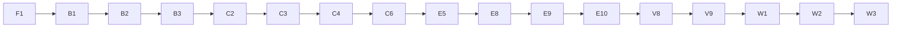

# Plan: AI Act Classification Assistant — Build Backlog

## Context
The repo is greenfield: `AE.CAP_afa.md` (course brief), `AI Act Classification Assistant — Capstone Init Document.md` (the full design, called **INIT** below) and an empty `README.md`. The design is settled; this plan turns it into atomic stories with dependencies, a critical path and parallel lanes, so that any story can be picked up with a fresh context (or handed to a subagent) with no loss of quality. The timeline is 10+ weeks, so the full MVP plus stretch goals is in scope.

INIT sets hard ordering rules that this backlog enforces:
- **Benchmark isolation:** the Commission example split must be **committed before any engine code exists**, and own-case labels are **frozen before the build** (INIT › Benchmark isolation, Label rules).
- **Engine and evaluation first.** Product features are views on the same result and come later (INIT › Risks: scope creep).
- **Week-one checks:** Luna smoke test, embedding comparison, token cost (INIT › Tech stack, Engine safety net).

---

## How to use this backlog

**First story to run is F0**, which copies this file into the repo as `docs/BACKLOG.md` so it survives context clears. After that, `docs/BACKLOG.md` is the source of truth. Tick stories off there (`[x]`) and add a one-line outcome note.

**Picking up a story with a fresh context:** read (1) `CLAUDE.md`, (2) the story, (3) the INIT sections named in its *Context* line, (4) the files listed in *Input*. Nothing else should be needed. Where a new file goes is fixed by `docs/LAYOUT.md`; every *Output* path fits it.

**Story format**
- **Deps:** stories that must be done first. **Parallel:** safe to run at the same time.
- **Type:** `agent` (can be delegated fully), `human` (needs the user: legal judgement, manual extraction, external tools), `mixed` (an agent drafts, the user reviews and approves).
- **Context:** INIT sections to read. **Input:** files/data consumed. **Output:** files produced. **DoD:** checkable definition of done.

**Global rules for every story**
- **Isolation:** any story in the Corpus lane (B1, C*) must **never read `eval/`**. Any benchmark story must never write to `data/` or the corpus tables. This is how INIT's leak rule is kept even when agents run in parallel.
- Python: `uv run ruff check`, `uv run pyright` and `uv run pytest` pass before a story is done. Tests that call models use recorded responses (F6), never live calls in CI.
- Any story touching Postgres loads the `supabase-postgres-best-practices` skill first; Supabase work loads the `supabase` skill.
- Library APIs (LangGraph, Docling, MCP SDK, RAGAS, FastAPI, TanStack) are checked through context7 before writing code.
- A story that makes a decision writes a short record to `docs/decisions/NNN-title.md` (what, options measured, numbers, choice).
- **Parallel agents use worktrees.** See `CLAUDE.md` › Parallel work for the full rules. In short: one worktree and one `story/<ID>-<slug>` branch per story; a worktree is created only after all its Deps are merged; the orchestrator alone ticks this backlog; every story is reviewed by `diff-reviewer` and passes the checks before it is merged; migrations are created with `supabase migration new`, and only one story at a time may change the schema; Corpus-lane worktrees leave out `eval/` with sparse checkout.
- **Migration names.** Names like `001_corpus.sql` in the stories below are logical names. The real files get the timestamp prefix from `supabase migration new` (for example `20261001120000_corpus.sql`).

---

## Critical path

Computed from the Deps by `python3 ~/.claude/skills/work-breakdown/scripts/backlog.py graph` (the `work-breakdown` skill's helper), with sizes weighted and E5 tagged `Size: L`. Re-run it after any change to the Deps; don't edit this by hand.

**Critical path (longest chain):** F1 → B1 → B2 → B3 → C2 → C3 → C4 → C6 → E5 (high-risk node, the hardest step) → E8 → E9 → E10 → V8 (first headline run) → V9 → W1 → W2 → W3. The split (B2, B3) is on the path, because C2 needs the Pile B list before the corpus can be loaded. V9 is `human`, so your time is on the path there.
**Second chain that must converge on V8 in time:** F3 → F7 → B5/B4 → B9 → B10 (label freeze). It is human-heavy, so it should start in week 1.
**Hard gate:** B3 (split committed) must land before E1 opens.

## Parallel lanes (for agents)

| Lane | Stories | Notes |
| --- | --- | --- |
| Infra | F0, F1, F8, F2, F4, F5, F6, X3 | F1 first; the rest fan out right after (F2 waits for F8) |
| Contract & eval | F3, F7, V1, V2, V3, V4 | Pure code; can run well ahead of the engine using dummy classifiers |
| Corpus | B1, C1, C2, C3, C4, C5, C6 | The critical path. Never reads `eval/` |
| Benchmark | B2–B12, V10 | Human-heavy. Agents draft, the user approves |
| Obligations | C7 | Independent after F3 and F4 |
| Engine | E1–E10 | E3, E4, E5, E6 and E7 are fully parallel once E1, C5, C6 (and C7 for E7) are done |
| Product | P1–P13 | After E10, except P2a, P3 and P4, which can start earlier |

## Waves (what to launch together)

| Wave | Launch in parallel | Gate to next wave |
| --- | --- | --- |
| 0 | F0, F1 | F1 done |
| 1 | F8, F3, F4, F6, B1, B11 (human, long) | F8 done → F2; F3 done → F7; F4 done → F5, C7; B1 done → B2, C1 |
| 2 | F2, F5, F7, B2, C1, X3, C7, B12 | B2 → B3 |
| 3 | B3, C2, C3, V1, V2, B5a–e, B7 | B3 committed; C3 done |
| 4 | C4, C5, B4, B6, B8, E1, V4, V10 | C4 → C6 |
| 5 | C6, B9, X0, P2a, P3 | C6 done |
| 6 | V6 then X1; X2, E2, E3, E4, E5, E6, E7, B13, V3 | X2 decision; B10 frozen |
| 7 | E8 → E9 → E10 (serial), P4 scaffold | E10 done |
| 8 | V5, V7, V8, P1, P2b, P8 | V8 first numbers |
| 9 | P5, P7, V9, S2, then P6, P9, P10, P11, P12 | MVP feature-complete |
| 10 | P13, W0, W1, S1, S3, then W2, W3 | Submission |

---

## Tooling — Claude Code setup

The hooks, skills, agents and scoped rules are in `.claude/` (see `CLAUDE.md` › Tooling). Two items wait for later stories:

- [x] **T1 · `/eval` skill** · Deps: V1 · Type: agent
  Context: INIT › Evaluation (Metrics, Budget rules), Benchmark isolation 4. Input: the `aiact evaluate run` CLI from V1, and `eval_runs`. Output: `.claude/skills/eval/SKILL.md`. The skill runs a benchmark with a subset size, a cost cap and a held-out/all mode, refuses a full run without the user's go-ahead, and writes `eval/reports/run-<date>.md` quoting only stored numbers (with run_ids).
  DoD: a dry run on a 3-case subset works end to end through the skill; the report cites its run_id.
  **Outcome:** /eval skill runs aiact evaluate run with an explicit subset, cost cap and heldout/all mode; needs the user's own yes for a full run (no subset or >30) or a paid classifier; never commits; appends aiact evaluate report output verbatim to eval/reports/run-<date>.md. 3-case dummy dry run b83767b2.

- [x] **T2 · Permission allowlist** · Deps: F2, F3, F4 (a few stories have run) · Type: agent
  Output: an allowlist in `.claude/settings.json` built with the `fewer-permission-prompts` skill from real session history (for example `uv run`, `supabase`, `git worktree` and read-only git commands). Never allow `git push`, force operations or anything that reads secrets.
  DoD: the user has reviewed the allowlist; parallel workers run a story without read-only permission prompts.
  **Outcome:** 19-entry read-only allowlist in .claude/settings.json (exact check commands, backlog reads, local supabase migration list and advisors, context7); no push, force, install, db reset, pytest/pyright wildcards or secret-printing commands; reviewed by the user. Parallel-run observation pending on the next wave.

## Phase 0 — Foundations

- [x] **F0 · Put the backlog in the repo** · Deps: – · Type: agent
  Input: this plan file. Output: `docs/BACKLOG.md` (a copy of this plan), a `CLAUDE.md` holding the global rules above, the repo layout and the standard commands.
  DoD: both files committed; `CLAUDE.md` is under 100 lines and links to INIT and `docs/BACKLOG.md`.
  **Outcome:** docs/BACKLOG.md and CLAUDE.md committed (997862b, 62db1f9); Tooling section added

- [x] **F1 · Backend scaffold** · Deps: – · Type: agent
  Context: INIT › Tech stack (Dev tooling). Output: `backend/pyproject.toml` (uv, Python 3.12), package `backend/aiact/` with empty subpackages `schemas, corpus, retrieval, obligations, eval, mcp, api, llm` (**not** `engine`: E1 creates it after the B3 gate, and a hook blocks it before then), `backend/tests/`, Ruff and pyright config, `aiact/settings.py` (pydantic-settings reading `.env`), `aiact/cli.py` (the `aiact` console script with empty `corpus` and `eval` command groups; F1 picks the CLI library), `.env.example` (OPENROUTER_API_KEY, SUPABASE_URL, SUPABASE_SERVICE_KEY, DATABASE_URL, LANGSMITH_API_KEY, model ids), `.gitignore` (including `.env`, `data/raw/`, `eval/private/`).
  DoD: `uv sync && uv run pytest && uv run ruff check && uv run pyright` all pass with one trivial test.
  **Outcome:** uv/Py3.12 backend with a Typer aiact CLI (empty corpus and eval groups), pydantic-settings reading the backend env file (AIACT_DATA_DIR resolved against backend/), model ids empty until X1–X3 confirm them, live marker deselected by default; ruff, pyright, pytest (6) green

- [x] **F2 · CI workflow** · Deps: F1, F8 · Parallel: F3–F7 · Type: agent
  Output: `.github/workflows/ci.yml` running uv sync, ruff, pyright, pytest and `aiact deps check` (F8) on push and PR. It gets a placeholder job for the isolation check (enabled in B13).
  DoD: the workflow passes on a pushed branch (or with `act`, if pushing is not wanted yet).
  Notes from merged stories: db-marked tests FAIL (not skip) when `CI` is set, so the job must run `supabase start` (or a Postgres+pgvector service with `supabase/migrations/*.sql` applied), or deselect with `-m "not db"`. Run `uv run --project backend aiact deps check` after `uv sync` (offline). pytest already has `--block-network` (localhost allowed). Consider a `.python-version` file.
  **Outcome:** CI (.github/workflows/ci.yml): uv sync --locked, deps check, ruff, pyright, pytest against a Postgres-only supabase start built from the migrations (db tests run under CI=true); disabled isolation job for B13; backend/.python-version 3.12. Green on GitHub (run 36406630736).

- [x] **F3 · Result contract (Pydantic schemas)** · Deps: F1 · Parallel: F2, F4–F6 · Type: agent
  Context: INIT › How it works (Outcomes, Risk classes, Evidence tags, Deciding facts, Roles, Worked example), MCP tools. Output: `aiact/schemas/` with:
  - `RiskClass` (`out_of_scope`, `prohibited`, `high_risk`, `limited_risk`, `minimal_risk`), `Status` (`decided`, `needs_more_information`, `legally_ambiguous`), `EvidenceTag` (`stated`, `inferred`, `assumed`), `Role` (`provider`, `deployer`, `importer`, `distributor`), `LawVersion` (`original`, `amended`), `Language` (`en`, `de`)
  - `Citation` (provision_id, document_id, law_version, language, quote, english_only flag), `Fact` (text, evidence tag, source span), `OpenQuestion` (question, readings[2])
  - `StepResult` (step name, decision, facts used, citations, status, missing_fact or open_question)
  - `ClassificationResult` (extracted facts, steps, risk_class, status, role, role_switch_reason, annex_point, transparency_duties list, deciding_facts, obligations, law_version, as_of date, disclaimer, follow-up questions)
  - `DISCLAIMER` constants in EN and DE
  Validators: a `limited_risk` result has non-empty transparency duties; an uncertain status has its missing_fact or open_question set; a `prohibited` result has no steps after Art. 5.
  DoD: tests build INIT's worked example (recruitment tool → `high_risk`, deployer, Annex III 4(a)) as a valid `ClassificationResult`, and each validator rejects a bad case; `model_json_schema()` output is snapshot-tested.
  **Outcome:** aiact/schemas/ holds the frozen result contract (enums incl. DocumentStatus; Citation/Fact/OpenQuestion/FollowUpQuestion; StepResult with typed missing_fact and error code; minimal Obligation; ClassificationResult with check-order, early-end-only-when-settled, derived status, role-iff-role-step, class-field and follow-up validators) and approved EN/DE disclaimers; decision 010 (+addendum); worked example and JSON Schema snapshot tested

- [x] **F4 · Supabase local + corpus migration** · Deps: F1 · Parallel: F2, F3, F5, F6 · Type: agent
  Context: INIT › Legal corpus, Tech stack (Database). Output: `supabase/` (via `supabase init`), migration `001_corpus.sql`: `documents` (id, title, celex, doc_type law/guideline/code, status final/draft/consolidated, law_version, language, published_on, in_force_from, source_url, sha256), `provisions` (id, provision_id such as `art:6:3` or `annex:III:4:a` or `recital:53` or `guide:hr:ex:17`, document_id, language, parent_id, heading, text, valid_from, valid_to, `source_example_id` nullable, tsvector generated with the `english` or `german` config per language), `provision_embeddings` (provision_row_id, model, dims, vector(1536), HNSW cosine index). pgvector enabled.
  DoD: `supabase start && supabase db reset` applies cleanly; a pytest inserts and reads a provision and runs a vector and a keyword query.
  **Outcome:** Corpus migration 20260927171942_corpus.sql: documents keyed (doc_key, law_version, language) with Omnibus as is_amending; time-sliced provisions (no overlaps, reload-safe parent FK, content_sha256); untyped embeddings keyed (model, dims) with partial HNSW for Qwen3-1536; RLS on, no Data API grants; decision 009 (versions, as_of, reload rules); db tests fail under CI

- [x] **F5 · Eval-records migration** · Deps: F4 · Type: agent
  Output: migration `002_eval.sql`: `eval_runs` (id, git_sha, benchmark, config json with model, embedding and retrieval settings, started_at, cost_usd, tokens), `eval_case_results` (run_id, case_id, predicted json, label json, per-metric scores, trace_id).
  DoD: migration applies; a round-trip test passes.
  **Outcome:** Migration 20260928093526_eval_records.sql (timestamped, not 002_eval.sql): eval_runs (uuid id, 40-hex git_sha, config must hold model/embedding/retrieval keys, cost_usd/tokens) and eval_case_results (PK run_id+case_id, cascade, scores = metric→number/bool/null via strict jsonpath, trace_id); server-only (RLS on, no grants); 13 db tests incl. round trip.

- [x] **F6 · OpenRouter client + recorded responses** · Deps: F1 · Parallel: F2–F5 · Type: agent
  Context: INIT › Tech stack (Model access, Models, Embeddings, Billing). Output: `aiact/llm/` with a LangChain chat model factory over OpenRouter (model id from settings, provider routing, zero-data-retention and no-training flags where OpenRouter supports them) and an embeddings client (Qwen3-Embedding-8B, provider pinned to Nebius, `dimensions=1536`, query instruction prefix configurable, L2-normalise and assert). A record/replay fixture (for example pytest-recording or a small custom cache keyed by request hash) so CI never calls the network.
  DoD: one live test marked `@pytest.mark.live` (skipped by default) and the same test passing in replay mode in CI.
  **Outcome:** aiact.llm: chat factory by role (langchain-openrouter) and OpenRouterEmbeddings (Qwen3-8B pinned to Nebius, 1536-d, raw norm checked), both sending data_collection=deny and zdr=true; replay via pytest-recording from tests/recordings/<module path>/ with the network blocked (only live-marked tests connect); Gemini Flash-Lite allowed in the user's guardrail on 2026-09-28

- [x] **F7 · Eval case schema + loader** · Deps: F3 · Type: agent
  Context: INIT › Evaluation (Test sets, Label mapping, Label rules). Output: `aiact/eval/cases.py`: `BenchmarkCase` (id, set name, language, description, label: risk_class / status / role / annex_point, label_citation, `source_example_id`, notes, tags), a YAML/JSONL loader for `eval/cases/<set>/*.yaml`, and the appliedAI label mapping as code. Directory skeleton `eval/cases/{commission_b,own,soft_pairs,consistency,qa,academic}/` and `eval/private/` (gitignored).
  DoD: the loader validates example files; the appliedAI mapping is unit-tested for all four labels, including the `out_of_scope` → disagreement-review flag.
  Notes from merged stories: Result contract rules to respect: decision 010 + addendum (early ends only when the stopping step is settled; status derived from steps; `FollowUpQuestion` slug ids). `Obligation` in `aiact/schemas/obligations.py` is a placeholder for C7.
  **Outcome:** aiact/eval/cases.py: BenchmarkCase + CaseLabel (label_citation is a list; cite-or-ambiguous enforced for commission_b/own/soft_pairs/consistency), YAML/JSONL loaders checking set_name and duplicate ids, score_appliedai (raw appliedAI labels mapped at scoring; out_of_scope-for-low flagged for review); eval/cases/* folders; eval/private stays untracked. Q&A and annex_match shapes left to B7/X0.

- [x] **F8 · Dependency manifest** · Deps: F1 · Parallel: F3–F7 · Type: agent
  Context: INIT › Tech stack (Dev tooling), Risks (licence). Input: `backend/pyproject.toml`, `backend/uv.lock`. Output: `backend/aiact/deps.py` with a CLI group `aiact deps generate|check`; `docs/DEPENDENCIES.md`, generated and never edited by hand (a header saying so and naming the command; a table of direct deps with group runtime/dev, version constraint, locked version, licence and one-line summary; a table of every transitive package with locked version, licence and the direct deps that pull it in); `.githooks/pre-commit` (runs `generate` and stages the file when `pyproject.toml` or `uv.lock` is staged) and `.githooks/pre-push` (runs `check`), enabled with `git config core.hooksPath .githooks`, documented in `CLAUDE.md` › Commands. Versions and the dependency graph come from `uv.lock` (`tomllib`); licence and summary come from installed package metadata (`importlib.metadata`), `unknown` when missing. The output is deterministic (sorted, no timestamps) and leaves room for P4 to add a frontend section from the pnpm lockfile.
  DoD: `check` exits 0 on a fresh file and non-zero with a clear message after a dependency is added without regenerating (tested on a fixture lockfile); running `generate` twice gives no diff; `uv add <pkg>` then a commit updates the file through the pre-commit hook; a push with a stale file is refused by the pre-push hook.
  **Outcome:** aiact deps generate|check renders docs/DEPENDENCIES.md from uv.lock plus a committed licence cache (docs/dependency-licences.json, from installed metadata or PyPI), so check is offline and platform-independent; .githooks pre-commit regenerates, pre-merge-commit stops a stale merge, pre-push refuses uncommitted/stale dependency files

## Phase 1 — Benchmark before the engine

- [x] **B1 · Fetch source documents** · Deps: F1 · Parallel: F2–F7 · Type: agent · Lane: Corpus
  Context: INIT › Legal corpus table. Output: `backend/aiact/corpus/fetch.py` and `data/manifest.yaml` (per document: id, URL, language, status, version, fetched_at, sha256); raw files in `data/raw/` (gitignored). Covers the AI Act original (EN, DE), the Omnibus 2026/1744 (EN, DE), the consolidated text 02024R1689-20260727 (EN, and DE if it exists), and the guidelines (definition, prohibited, high-risk draft, Art. 50) plus the Code of Practice, in EN and in DE where it exists.
  DoD: the script is re-runnable and idempotent (same sha256 means no change); the manifest records which DE versions exist and which don't (this closes the INIT open question on German texts).
  **Outcome:** aiact corpus fetch downloads 15 of 20 document/language versions (laws as XHTML via Cellar, decision 008; guidelines as Commission PDFs) into the shared data/raw; German exists for the Act, Omnibus, consolidated text and definition/prohibited guidelines, while the high-risk draft (3 parts), Art. 50 guidelines and Code of Practice are English only; failed fetches are recorded as unknown (available: null); a re-run leaves data/manifest.yaml byte-identical

- [x] **B2 · Extract and count the Commission high-risk examples** · Deps: B1 · Type: mixed · Lane: Benchmark
  Context: INIT › Benchmark isolation 1–2, Open questions (count examples). Input: the draft high-risk guidelines PDF. Output: `eval/commission_examples/examples.jsonl` (example_id `hr-ex-001…`, Annex III area or Annex I, verdict high/not-high, page, original text) and `docs/decisions/001-commission-example-count.md` (counts per area and verdict).
  DoD: the user has checked the extraction against the PDF; the count is recorded, together with the resulting choice: split if there are about 40 or more examples, leave-one-out otherwise.
  Notes from merged stories: The draft high-risk guidelines are three EN-only PDFs in `data/raw/`: `guide-high-risk-general.en.pdf`, `guide-high-risk-annex-i.en.pdf`, `guide-high-risk-annex-iii.en.pdf` (ids in `data/manifest.yaml`).
  **Outcome:** 307 examples extracted and reviewed by the user (12 Annex I + 295 Annex III; 122 high / 185 not_high; 1 legally_ambiguous; 15 with verdict-flipping variants). Decision 001 accepted: split, with a mechanical counting rule and a 79-list anchor table for C2; Pile B size left open for B3.

- [x] **B3 · Commit the split (gate)** · Deps: B2 · Type: agent
  Output: `backend/aiact/eval/split.py` (`aiact evaluate split`: seeded, stratified by area × verdict), which writes `eval/split.json` (`{mode: split|loo, seed, pile_a: [...], pile_b: [...]}`).
  DoD: committed in a commit of its own **before any file under `aiact/engine/` exists** (check: `git log --diff-filter=A -- backend/aiact/engine` is empty at that commit). Every area appears in both piles, where there is more than one example.
  Notes from merged stories: B2 (decision 001, accepted): mode `split`, 307 examples (hr-ex-001…307), stratify by `area` × `verdict` (18 strata, each ≥ 4). OPEN QUESTION to settle with the user first: Pile B size (a half split means ~150 examples for B4 to rewrite and the user to approve). Once split.json is committed the IDs are frozen.
  **Outcome:** eval/split.json committed alone (2692490) before any engine file: half split, seed 20260928, Pile A 154 / Pile B 153 of 307, every area x verdict stratum in both piles; aiact evaluate split refuses to change it; test pins the frozen IDs, not a fresh run (decision 011).

- [ ] **B4 · Rewrite the Pile B examples as company descriptions** · Deps: B3, F7 · Type: mixed
  Context: INIT › Benchmark isolation 3. Output: `eval/cases/commission_b/*.yaml` (description written in a company's voice: size, bought or built, business context, some irrelevant detail; label, label_citation, source_example_id). In LOO mode this covers all examples.
  DoD: every Pile B example has a case; `backend/aiact/eval/similarity.py` (`aiact evaluate similarity`) reports the maximum similarity between each case and its source example (embedding cosine plus longest shared n-gram), and no case shares more than an agreed threshold, for example an 8-word run; the user has approved every label.
  Notes from merged stories: B2 (001): carry `accepted_bases`, `label_status` and `flip_variants` from examples.jsonl into the cases; hr-ex-307 becomes a `legally_ambiguous` case. Write each description WITHOUT the row's flip-variant feature, and expect the engine to ask about or flag it (user product rule); a flip-variant row may also yield a variant case with the variant's verdict. hr-ex-283: describe all three steps. Annex I high rows carry the Art. 6(1) third-party-assessment note. F7 follow-up lands here: extend `BenchmarkCase` for any-of basis/citation matching (bare `art_6_3_filter` matches any lettered entry; a lettered answer matches the same letter or the bare form) and a `label_status` field.
  **From V2 (merged):** add `accepted_bases` and the flip-variant provisions to the case model so `metrics.basis_matches` and `flags_flip_variant` can be wired into `case_scores`/`summarize` (tested helpers, not yet reached).

- [ ] **B5a–e · Own cases, one sub-story per category** · Deps: F7 · Parallel: with each other and with B2–B4 · Type: mixed
  Context: INIT › Test sets (Own cases), Label rules, Omnibus details. Categories: **a** Art. 50 transparency (including the 50(2) grace period), **b** out-of-scope software (not an AI system under Art. 3(1), exclusions), **c** the December 2026 prohibitions plus the classic Art. 5 practices, **d** Art. 25 role switches, GPAI-based systems, importer and distributor, **e** Annex I flags. At least 25% of each category in German. Output: `eval/cases/own/<category>/*.yaml`.
  DoD: every label cites the provision or example that settles it, or is `legally_ambiguous`; the user has approved each file.
  Notes from merged stories: F7: cases are `BenchmarkCase` in `aiact/eval/cases.py`; `label_citation` is a list; a label that isn't `legally_ambiguous` needs a citation, an ambiguous one needs `notes` (the open question and both readings: checked in review, not by the schema).
  **Outcome (B5d):** 13 own cases in eval/cases/own/d/ (7 EN, 6 DE; 2 legally_ambiguous) covering Art. 25(1)(a)/(b)/(c), GPAI-based systems, importer and distributor; expected obligations tagged obligation:<article> (unsettled conditions kept, user rule 2026-09-29), plus gpai_based, also_role:deployer and role_switch tags; each file approved by the user 2026-09-29.
  **Rules from B5d's review (user, 2026-09-29), for B5a/b/c/e:** (1) a conditional duty whose condition the facts don't settle is kept as an `obligation:` tag and named in `notes`; one the facts rule out is left out (E7's node does the same). (2) The class describes the system, whoever bears its Art. 50 duties: a deployer of a system with Art. 50 duties is `limited_risk` (own-d-07). (3) Folder names: B5d used `own/d/`; the F7 fixture uses descriptive names (`own/transparency/`), so the remaining sub-stories should pick one convention and B10 should align them. (4) Keep facts unambiguous where a label depends on them (own-d-01 now states who runs the system).

- [ ] **B6 · Soft-wording pairs** · Deps: F7, B5 · Type: mixed
  Output: `eval/cases/soft_pairs/` with 10–20 pairs (plain and softened wording of the same known high-risk system, linked by pair_id). DoD: approved by the user.
  Notes from merged stories: F7: `BenchmarkCase` has no `pair_id` and rejects unknown fields; link pairs with a `pair:<id>` tag (as the fixtures do) or add the field in `cases.py`. B2 (001): the 15 rows with `flip_variants` in eval/commission_examples/examples.jsonl are ready-made base/variant pairs (e.g. place-based vs person-based crime prediction, 6(a)/6(d); onboarding chatbot vs performance-review feed, 4(a)/4(b); 283 step-(i)-only → Art. 6(3)(d); 244/245 → prohibited under Art. 5). Cite the Commission's own "however" sentence for the variant.
  **From V2 (merged):** tag the softened description of each pair `wording:soft`; the downgrade-rate metric finds pairs only by that tag and reports 0/0 otherwise.

- [ ] **B7 · Q&A set** · Deps: F7 · Parallel: B5 · Type: mixed
  Output: `eval/cases/qa/` with 20–30 questions (EN and DE), each with the required provision_ids and a reference answer. DoD: approved by the user.
  Notes from merged stories: F7: `CaseSet` has no `qa` member and Q&A items don't fit `BenchmarkCase`; add a Q&A item model (question, required provision_ids, reference answer) and a loader entry in `aiact/eval/cases.py`. The `eval/cases/qa/` folder exists.

- [ ] **B8 · Consistency triples** · Deps: B5 · Type: mixed
  Output: `eval/cases/consistency/`: 3 paraphrases per system, LLM-generated and then checked by hand. DoD: approved by the user.
  **From V2 (merged):** tag every paraphrase of a triple `triple:<id>`; the consistency metric groups only by that tag and reports 0/0 otherwise.

- [ ] **B9 · Second-model label filter** · Deps: B4, B5, F6 · Type: agent, then human
  Context: INIT › Label rules (Second-model filter). Output: `backend/aiact/eval/label_filter.py` (`aiact evaluate label-filter`: Claude Haiku 4.5 via OpenRouter labels every case blind) and `eval/reports/label_disagreements.md`. The user resolves each disagreement.
  DoD: every disagreement has a written resolution (label kept or changed, with a reason).
  Notes from merged stories: X3 (005): pin Haiku 4.5 to `google-vertex/europe` (or `amazon-bedrock/eu-west-1`) with `allow_fallbacks=False`. Vertex Haiku rejects `response_format: json_object`: use a JSON schema (structured outputs). Haiku caches only with a top-level `cache_control`; check `langchain-openrouter` passes it through. About $0.02 per cold call (~10x Luna).

- [ ] **B10 · Label freeze** · Deps: B9, B6, B7, B8 · Type: agent
  Output: git tag `labels-v1`, `eval/LABEL_CHANGES.md` (a log for later changes, with a review note per change), and a CI test that fails if a file under `eval/cases/` changes without a matching entry in `LABEL_CHANGES.md`.
  DoD: tag pushed; the test is in CI.
  Notes from merged stories: F2: add the label-freeze check as a new job in `.github/workflows/ci.yml`.
  **From B12 (merged):** the freeze covers `eval/cases/academic_overrides.yaml` and the generated `eval/cases/academic/*.yaml`; `eval/LABEL_CHANGES.md` already exists (started by B12) — extend it rather than creating it. The academic importer refuses any source but the pinned sha256, so a re-import can't change labels silently.

- [ ] **B11 · appliedAI dataset** · Deps: F7 · Parallel: everything · Type: human (agent helps with the format)
  Context: INIT › Test sets, Risks (licence). Output: `eval/private/appliedai.jsonl` (gitignored) and `docs/decisions/002-appliedai-licence.md` (fields, languages, licence statement found or not found).
  DoD: all ~106 cases extracted; only case IDs will ever be published.
  Notes from merged stories: F7: keep the experts' raw label (`high`/`prohibited`/`low`/`unclear`) with set_name `appliedai` in `eval/private/appliedai.jsonl`; `load_jsonl` and `score_appliedai` map it at scoring time. Add a helper that reads Annex II references as Annex I, and agree a tag for Annex I cases (INIT reports them separately). `eval/private/` is gitignored and untracked: create it locally.

- [x] **B12 · Academic benchmark import** · Deps: F7 · Type: agent, plus a human spot-check
  Output: `eval/cases/academic/` converted from the davidath repo (CC BY 4.0, with attribution) and `eval/reports/academic_spotcheck.md` (about 20 cases checked).
  DoD: the loader validates every case; the spot-check is recorded.
  **Outcome:** 339 davidath scenarios (CC BY 4.0, commit d323167) imported with aiact evaluate academic-import from a sha256-pinned source; the user's 20-case spot-check applied through target-checked overrides (17 agree, 3 changed to legally_ambiguous, logged in eval/LABEL_CHANGES.md); academic set scores limited+minimal as one low bucket; 95 rule-/template-based low cases also accept out_of_scope, with a disagreement-review row.

- [ ] **B13 · Isolation check in CI** · Deps: B3, C3, F7 · Type: agent
  Context: INIT › Benchmark isolation 5. Output: `backend/tests/test_isolation.py`: (1) no `provisions.source_example_id` is in Pile B (or, in LOO mode, the retrieval filter is always applied), (2) no benchmark description has near-duplicate text in the corpus (embedding cosine above a threshold, and an n-gram check). The CI job from F2 is enabled.
  DoD: the check passes, and it fails when a Pile B example is deliberately injected into a test DB.
  Notes from merged stories: F2: the `isolation` job in `.github/workflows/ci.yml` exists with `if: false` and runs `pytest -q tests/test_isolation.py`; remove the `if: false`. B2 (001): the isolation test must confirm every `pile_b` hr-ex ID was found and dropped by C2; C2's derivation can be checked against the 79-row anchor table in docs/decisions/001.
  **Decision 012 (overrides check 1):** Pile B rows exist in `provisions`, tagged. Check behaviour instead: every search entry point applies the Pile B exclusion by default; a default search (including a query copied from a Pile B example) never returns a Pile B row; every `pile_b` ID is tagged. The near-duplicate check runs against the retrievable corpus.
  **From B12's isolation audit:** the academic cases' `Domain:` lines quote Annex III area headings verbatim, so an n-gram check against `data/parsed/` matches them (94 hits, all statutory wording copied from the Act into the benchmark). Allow verbatim statutory headings, or check only the non-Domain fields, so they aren't false positives. Include the academic descriptions in the near-duplicate check.
  **From C2's review:** hr-ex-064 (Pile A) is repeated word for word in the running text (para. (183), p. 39, section chunk `guide:guide-high-risk-annex-iii:sec:59`), so the guidelines do repeat examples in prose; the near-duplicate check must catch a Pile B example repeated that way. C2's own leak test matches only whole lines of 40 or more characters, so use sub-line windows or n-grams. Measure the Commission-written passages near Pile B examples that decision 001 keeps in the corpus (after C2's re-chunking: annex-iii `para:102` has an inline "Example:" close to hr-ex-269, 0.375 6-gram coverage; `para:152` paraphrases hr-ex-031 sentence by sentence, verdict included, with only a 12-word verbatim run, so an n-gram check alone misses it; use the embedding check too) and report them; if too close, that is a change to decision 001. Footnote reference numbers may remain in corpus text but are stripped from the benchmark copy (001 rule 7), so normalise digits before matching.

## Phase 2 — Corpus and retrieval

- [x] **C1 · EUR-Lex HTML parser** · Deps: B1 · Type: agent · Lane: Corpus (critical)
  Context: INIT › Tech stack (Ingestion), Corpus rules. Input: `data/raw/*` HTML. Output: `aiact/corpus/eurlex.py` → `data/parsed/<doc>.<lang>.jsonl`, split into article › paragraph › point, annex › point, and recital, with stable `provision_id`s that are identical across EN and DE. The Omnibus is parsed as amending text (which provisions it changes and the dates).
  DoD: tests against known provisions (Art. 5(1)(a), Art. 6(3), Annex III 4(a), Art. 50(2), Recital 53) in both languages; the EN and DE provision_id sets match for each document.
  Notes from merged stories: Input list: `data/manifest.yaml` (B1). Raw file = `$AIACT_DATA_DIR/raw/<entry.file>`, set only when `available: true`; `available: null` means a failed fetch (re-run `aiact corpus fetch`, never treat as absent). Laws carry `celex`; the Omnibus is `32026R1744`. Verify each file's sha256 against the manifest before parsing (raw dir is shared across worktrees). Laws are Cellar XHTML identical to EUR-Lex (decision 008). DE exists for the Act, Omnibus and consolidated text.
  **Outcome:** aiact corpus parse writes data/parsed/<doc>.<lang>.jsonl for the Act, Omnibus and consolidated text (1486/152/1421 provisions, EN and DE ids identical); a restarted subparagraph list goes under sub<n> as a whole (art:43:1:sub2:a-d); Omnibus carries 72 amendment records (action, targets, in force 2026-07-27, dates) resolved against AI Act ids with no truncations; rows are nested (parent text includes children).

- [x] **C2 · Guideline PDF ingestion (Docling)** · Deps: B1, B3 · Parallel: C1 · Type: agent · Lane: Corpus
  Input: guideline PDFs; `eval/split.json` is the **only** file under `eval/` this story may read, and only its `pile_b` ID list. Output: `aiact/corpus/guidelines.py` → `data/parsed/guide-*.jsonl`: chunks by section, each worked example as its own chunk tagged with `source_example_id`; Pile B chunks are dropped in split mode and kept but tagged in LOO mode.
  DoD: the chunk count and dropped IDs are logged; a test asserts that no Pile B ID appears in the output in split mode.
  Notes from merged stories: Select guideline PDFs by `kind == "pdf"` in the manifest, not by `guide-*` id (the Code of Practice id is `code-of-practice-transparency`). The high-risk draft is 3 documents (see B2). PDF language is trusted from the registry: check it once Docling text exists. DE exists only for the definition and prohibited guidelines. B2 (decision 001, in docs/, readable): assign `hr-ex-NNN` to guideline examples with 001's counting rules 1–3 (heading line beginning a)/b)/c) and containing "Practical example"; exactly the two named extra lists; one bullet = one example; the named unbulleted gas/heating/electricity paragraphs; Section 5 lists what is NOT counted) and check the result against 001's anchor table (first/last ID and row count per list, total 307). Read only the `pile_b` IDs from eval/split.json. Any example you can't map is an isolation gap.

  **Decision 012 (accepted, overrides the Output/DoD above):** Pile B chunks are KEPT, tagged with `source_example_id`, not dropped. DoD test: every `pile_b` ID is present and tagged; no Pile B example text is untagged. Log the chunk count and the tagged Pile B IDs.
  **Outcome:** aiact corpus guidelines turns the 9 PDF entries into data/parsed; prose chunks are keyed on printed paragraph numbers (guide:<doc>:para:<n>, the longest confirmed chain, so quoted numbers become text), so EN/DE share IDs (prohibited 434/434, definition 65/65); all 307 hr-ex examples match decision 001's 79-list anchor table; the 153 Pile B examples are kept and tagged is_held_out (decision 012); Docling sits in an optional ingest group that CI skips.
- [x] **C3 · Load the corpus into Postgres** · Deps: C1, C2, F4 · Type: agent · Lane: Corpus (critical)
  Output: `aiact/corpus/load.py` (upsert documents and provisions, set valid_from/valid_to for the original and amended versions, link EN and DE); a CLI `uv run aiact corpus load`.
  DoD: re-running changes nothing; row counts per document are printed and saved to `docs/corpus_stats.md`.
  Notes from merged stories: Follow decision 009: upsert documents on `(doc_key, law_version, language)` (nulls not distinct); `doc_key` = manifest id; the Omnibus is `is_amending`; when a document's sha256 changes, replace its provisions in one transaction, unchanged means skip; amended document carries the full history with slices from 2024-08-01 split at Omnibus dates parsed by C1; `valid_from` is required. C1: split the consolidated time slices at the Omnibus `amendment.in_force_from` (2026-07-27); decide whether the deferred application dates in `amendment.dates` (e.g. 2026-12-02 for Art. 5(1)(ba)/(bb)) affect `as_of` lookups. Rows are nested (a unit's `text` includes its children; `kind` and `parent_id` give the tree).
  **From C2's review:** `provisions` has `source_example_id` but no held-out flag, and C6 may not read `eval/`, so the flag must reach the DB. Add a migration for `is_held_out` (or an equivalent) and load it from the `data/parsed/guide-*.jsonl` rows (the one-schema-story rule applies). Guideline rows carry `source_example_id` and `is_held_out`. Link EN and DE guideline sections by `provision_id` only once C2's fix for language-independent section IDs is merged (check that paired chunks start at the same paragraph).
  C2 known limit: footnote bodies are attached to whichever paragraph precedes them on the page, so they differ between EN and DE (e.g. EN prohibited `para:49` holds footnotes 41–43, DE puts 43 in `para:51`); a citation to a paragraph can return a neighbour's footnote.
  C2 known limits (from its final review): the numbering keeps the longest confirmed chain, so a quoted run of 2 or more numbers in a document's last paragraphs, or just before a part boundary, can still take over the tail. On a tie the later copy of a repeated number wins. C2's contiguity test takes its upper bound from the data. So have the loader check each guideline's last `para:<n>` against the printed last paragraph (prohibited 433, definition 64, annex-iii 447, general 451, annex-i 62) and fail loudly on a mismatch. Docling now sits in the `ingest` group: re-parsing needs `uv sync --group ingest`.
  **Outcome:** aiact corpus load loads 15 documents / 9,083 provision rows; 974 provisions time-sliced at the Omnibus's 2026-07-27; pinned corrigenda (EN Art. 1 title, Art. 108; DE Art. 3(40)) apply from the start in both the original and the amended document, and points next to an inserted or deleted point are split (decision 014, accepted with option B); adds is_held_out and load_sha256, a lock per document and a report of documents missing from the manifest; a re-run changes nothing; counts in docs/corpus_stats.md.

- [ ] **C4 · Embed the corpus** · Deps: C3, F6 · Type: agent · Lane: Corpus (critical)
  Output: `aiact/corpus/embed.py` (batching, model name recorded per row, skips rows already embedded with the same model); a CLI `aiact corpus embed --model qwen3|openai3l --dims 1536|1024`.
  DoD: every provision has a Qwen3 1536-d vector; the vectors are normalised; the cost is logged.
  Notes from merged stories: Skip a provision only if `(provision_row_id, model, dims)` exists AND `content_sha256` matches the provision's (decision 009). Only the `qwen/qwen3-embedding-8b` / 1536 arm has a partial HNSW index; each new (model, dims) arm needs its own partial index (new migration). F6 found Nebius returns vectors already normalised. C1: parent rows include their children's text: embed leaves only (or dedupe) to avoid duplicate vectors. X3 (005): Qwen3-Embedding-8B is pinned to `nebius`; `text-embedding-3-large` has no EU endpoint (ZDR via `azure`, no region pin).
  **From C3:** 487 provisions per language have two slices with identical text (children split with their parent, decision 014): embed each distinct `content_sha256` once and reuse the vector.

- [ ] **C5 · `get_provision`** · Deps: C3 · Parallel: C4 · Type: agent
  Context: INIT › MCP tools. Output: `aiact/retrieval/provisions.py`: `get_provision(provision_id, language, law_version|as_of)` → text, version, language, status, english_only flag, and the DISCLAIMER; a fallback to EN with the flag set when DE is missing.
  DoD: tests cover the original and amended text of an article changed by the Omnibus, and the fallback for a guideline that exists only in English.
  Notes from merged stories: Lookup rule (decision 009): `(d.law_version = $v or d.law_version is null) and not d.is_amending`; `as_of` resolves only against the amended document; `original` is an explicit view, never a fallback. C1: provision ids follow `.claude/rules/corpus.md` and the `eurlex.py` docstring: points of an article without numbered paragraphs sit under the article (`art:3:14`), annex sections are included (`annex:VIII:B:7`), a restarted list goes under `sub<n>` as a whole (`art:43:1:sub2:a`).
  **From V2 (merged):** citations resolve on the manifest `doc_key` (e.g. `ai-act-consolidated`), provision_id, language and law_version (aiact/eval/citation_index.py). The F3 worked example uses document_id `ai-act-consolidated-2026-07-27`, which is not a doc_key: align it.
  **From C3:** `as_of` lookups use `valid_from`/`valid_to` (one boundary, 2026-07-27, decision 014); recitals exist only in the `law_version = 'original'` document. The parsed `kind` and a guideline's `page` aren't stored (no columns); add them if citations need them. Both documents carry the pinned corrigenda (decision 014, option B).

- [ ] **C6 · `search_ai_act` (hybrid)** · Deps: C4 · Type: agent · Lane: Corpus (critical)
  Output: `aiact/retrieval/search.py`: vector and full-text search fused with RRF; filters for as_of date, law_version, language, doc_type, and `exclude_source_example_ids`; the query-side instruction is applied only to queries.
  DoD: tests show a softly worded tenant-rent query retrieves Annex III 5(b) in the top 5; a German query works; the exclude filter works.
  Notes from merged stories: Use the decision-009 lookup rule so guidance (law_version null) stays searchable. Vector queries must use the index's cast and predicate and `set local hnsw.iterative_scan = relaxed_order`. Exclude filter: `source_example_id is null or not (source_example_id = any(...))`. The German stemmer is uneven (System→syst, Systeme→system): consider prefix queries. C1: parent rows include their children's text: search leaves, or dedupe hits by `parent_id`.

  **Decision 012:** exclude the Pile B IDs by default in every search; turning it off is an explicit opt-in used only by the gap run (V8), never by the engine, API, MCP or Q&A. Test that a default search never returns a Pile B row.
  **From C3:** the held-out flag is `provisions.is_held_out` (153 rows, all `hr-ex-*`); every search must filter `is_held_out = false` by default and lift it only for `--exclude-mode all` (decision 012). No index on the flag (about 1.7% of rows; filter after the HNSW/GIN scan).
- [x] **C7 · Obligations table + `list_obligations`** · Deps: F3, F4 · Parallel: the whole Corpus lane · Type: mixed
  Context: INIT › Scope (Obligations checklist), Roles, Omnibus details, Situation (dates). Output: `supabase/seed/obligations.yaml` (role × risk class → duty, article ref, applies_from date, SME/small-mid-cap relief note), migration `003_obligations.sql`, and `aiact/obligations/list.py`.
  DoD: every row cites an article; hand-checked tests for deployer/high-risk (Art. 26 duties from 2 Dec 2027), provider/high-risk, limited-risk transparency, and importer/distributor; the user has reviewed the dates.
  Notes from merged stories: Replace or extend the placeholder `Obligation` model in `aiact/schemas/obligations.py`. Point `[db.seed] sql_paths` in `supabase/config.toml` at the seed. Schema-changing: run it alone.
  **Outcome:** Obligations table: 54 YAML entries -> 106 rows (Annex III and Annex I route dates, applies_if conditions, SME/SMC relief, informational distributor rows for prohibited systems, Art. 86 and conditional Art. 26(10)), timestamped migration 20260928135941_obligations.sql (RLS on, no grants), generated SQL seed, list_obligations returning an ObligationList that carries its law version; hand-checked tests. User reviewed the dates on 2026-09-28.

## Phase 3 — Week-one experiments

- [ ] **X0 · Annex-matching set** · Deps: F7 · Type: mixed
  Output: `eval/cases/annex_match/`: 30–50 informal descriptions → expected Annex III/I points, **written from scratch** (never from Commission examples). DoD: approved by the user.
  Notes from merged stories: F7: add `annex_match` to `CaseSet` in `aiact/eval/cases.py` and create `eval/cases/annex_match/`; `CaseLabel.annex_point` holds one point, so allow several if needed.

- [ ] **X1 · Embedding comparison** · Deps: C6, X0, B7, V6 · Type: agent
  Output: `backend/aiact/eval/experiments/embeddings.py` and `docs/decisions/003-embeddings.md`: RAGAS context recall and precision for Qwen3 at 1536-d, Qwen3 at 1024-d and OpenAI 3-large, on the Annex-matching and Q&A sets, with results stored in `eval_runs`.
  DoD: a decision is recorded with the numbers; the default in settings is updated if it changes.
  Notes from merged stories: Make the embedding query instruction a setting (e.g. `EMBEDDING_QUERY_INSTRUCTION`); the current default in `aiact/llm/embeddings.py` is a placeholder. Model/provider settings are still empty in the env example.

- [ ] **X2 · Engine model smoke test** · Deps: F3, F6, C5, C6, B4 · Type: agent
  Context: INIT › Engine safety net. Output: `backend/aiact/eval/experiments/smoke.py`, a single-prompt classifier with tool calls to `get_provision` and `search_ai_act` and structured output as `ClassificationResult`, run with GPT-6 Luna and with Gemini 3.1 Flash-Lite on 20 headline cases; `docs/decisions/004-engine-model.md`.
  DoD: the rate of broken outputs or tool calls and the accuracy are recorded for both models; the INIT rule is applied (Luna is dropped if more than 10% broken or clearly worse); the engine model is set in settings.
  Notes from merged stories: Structured output: cross-field validators aren't in the JSON Schema, so contract failures count as broken outputs (decision 010 addendum). Gemini 3.1 Flash-Lite was allowed in the user's OpenRouter guardrail on 2026-09-28. Slugs checked by F6: `openai/gpt-6-luna` (pinned `openai/gpt-6-luna-20260922`), `google/gemini-3.1-flash-lite`. X3 (005): add a provider-order setting per role (e.g. `ENGINE_PROVIDER=azure/eu`) passed through `provider_preferences(order, allow_fallbacks=False)`; EU endpoints are used only when pinned by full slug. Luna: ~6k in + ~1.7k out per classification, $0.0018 cold / $0.0009 cached. The key has $9.95 left (the user handles the cap).

- [x] **X3 · OpenRouter feature and cost check** · Deps: F6 · Type: agent
  Output: `docs/decisions/005-openrouter.md`: whether prompt caching works for the chosen models, which EU routes and ZDR options exist, the context window, and token use for one sample classification; the spending cap is set (the user sets it in the OpenRouter dashboard).
  DoD: every question in INIT › Open questions about OpenRouter has an answer.
  Notes from merged stories: Already known from F6: GPT-6 Luna works with `zdr` + `data_collection: deny` via Azure (an `azure/eu` endpoint exists) and spends reasoning tokens; Qwen3-Embedding-8B on Nebius honours `dimensions=1536` and returns normalised vectors; ZDR endpoints are listed at `GET https://openrouter.ai/api/v1/endpoints/zdr`; F6's recording calls cost about $0.00002.
  **Outcome:** 005 accepted: caching works on EU no-retention routes (Luna azure/eu, Flash-Lite vertex/eu, Haiku vertex/europe with cache_control); one classification ~6k in + ~1.7k out = $0.0018 cold / $0.0009 cached on Luna; models with an EU ZDR endpoint pinned by full slug, allow_fallbacks=False (+10%), data residency is the deciding rule; Jev router forwards to Luna (V3/V4 must rethink); key cap $35 with $9.95 left, handled by the user.

## Phase 4 — Engine

- [x] **E1 · Graph skeleton** · Deps: F3, **B3 committed** · Type: agent
  Context: INIT › How it works (flowchart). Output: `aiact/engine/graph.py` (a LangGraph StateGraph with the nodes facts → scope → prohibited → high_risk → transparency → role_obligations → finalize; `out_of_scope` and `prohibited` short-circuit to finalize; the order is fixed) and `aiact/engine/state.py`. Nodes are stubs that read scripted outputs.
  DoD: tests cover every routing path with stub nodes; no path can skip a check.
  Notes from merged stories: X3 (005): order prompts with the fixed instructions and retrieved provisions first and the user's description last, so the shared prefix is cached (Luna on `azure/eu` caches automatically).
  **Outcome:** build_graph(EngineNodes): fixed 7-node LangGraph, early exit only after scope/prohibited on a matched step that can_end_run (decision 010); scripted_nodes(Script) stubs; 45 tests over 36 routing combinations plus exact-edge and all-paths checks; adds langgraph (forces websockets 16.1.1).

- [x] **E2 · Fact extraction and key-fact questions** · Deps: E1, F6 · Type: agent
  Output: `aiact/engine/nodes/facts.py` and `aiact/engine/prompts/facts.md`: facts with evidence tags, a source span for each stated fact, and key-fact questions for inferred or assumed facts; EN and DE.
  DoD: replay tests on 5 cases; every `stated` fact has a span that exists in the description.
  Notes from merged stories: B2 (001), USER PRODUCT RULE: when a described system matches a guideline example that has a verdict-flipping "however / if" feature, the engine must ask a key-fact follow-up question about that feature or flag it (a user may describe the base version while the real system has the feature). Examples: personal-data enrichment (AML, 6(e)); deception hints from facial landmarks (7(a)); admissibility recommendations (8(a)); content changes (8(a)); new content or voter targeting (8(b)); general social scoring or crime prediction (Art. 5(1)(c)/(d)).
  **Outcome:** FactExtractor (aiact/engine/nodes/facts.py, prompts/facts.md): stated facts get a whole-word span from a verbatim quote, an unfound quote downgrades the fact to inferred with a confirm question (ids from the fact's text); key-fact questions ask the Act's own flip conditions, never a Pile B feature (decision 015); pinned to ENGINE_PROVIDER; structured-output helpers in aiact/llm/structured.py; 5 recorded EN/DE replays.

- [ ] **E3 · Scope node (Art. 2–3)** · Deps: E1, C5, C6 · Parallel: E4–E7 · Type: agent
  Output: `aiact/engine/nodes/scope.py`, which fetches Art. 3(1) and Art. 2 and searches the definition guidelines. DoD: replay tests on the B5b out-of-scope cases pass.
  **From E2 (decision 015):** no prompt line may paraphrase a Pile B example's deciding feature or share a 5-word run with any Pile B field (text, lead_in, use_case, flip_variants); run decision 015's leak-check command on every new prompt. Pin the engine model with `require_setting(settings.engine_provider, "ENGINE_PROVIDER")` and no fallbacks, and reuse `aiact.llm.structured` (a third copy of the pinning code should become an `engine_chat_model` helper).

- [ ] **E4 · Prohibited node (Art. 5)** · Deps: E1, C5, C6 · Parallel: E3, E5–E7 · Type: agent
  Output: `aiact/engine/nodes/prohibited.py`, which always fetches Art. 5 and applies date logic to the December 2026 prohibitions against `as_of`. DoD: replay tests on the B5c cases pass, including one case dated before 2 December 2026 and one after.
  **Follow-up from C7's date review (user, 2026-09-28):** law-enforcement users are in scope. Cover the Art. 5(2)–(7) conditions for real-time remote biometric identification (the Art. 5(1)(h) exceptions: authorisation, necessity, notification) rather than treating every 5(1)(h) case as a plain ban.
  **From B12's spot-check (user, 2026-09-28):** for workplace or education monitoring (webcams, voice, keystrokes), ask whether the system infers emotions: a yes makes it prohibited under Art. 5(1)(f) (academic-0096). For Art. 5(1)(a)/(b), treat the significant-harm condition as a deciding fact: flag it as needing information or legally ambiguous when the description can't settle it (academic-0005).
  **From E2 (decision 015):** no prompt line may paraphrase a Pile B example's deciding feature or share a 5-word run with any Pile B field (text, lead_in, use_case, flip_variants); run decision 015's leak-check command on every new prompt. Pin the engine model with `require_setting(settings.engine_provider, "ENGINE_PROVIDER")` and no fallbacks, and reuse `aiact.llm.structured` (a third copy of the pinning code should become an `engine_chat_model` helper).

- [ ] **E5 · High-risk node (Art. 6, Annex III, Annex I flag)** · Deps: E1, C5, C6 · Size: L · Parallel: E3, E4, E6, E7 · Type: agent · **critical**
  Output: `aiact/engine/nodes/high_risk.py`: Annex III matching through search, analogy against Pile A examples (in LOO mode the exclude filter comes from the case), the Art. 6(3) filter with the profiling rule, and an Annex I flag that names the product law and asks the decisive question.
  DoD: replay tests on INIT's worked example and on 5 own cases; a test proves the exclude filter is passed through.
  **From B12's spot-check (user, 2026-09-28):** key-fact questions where Annex III depends on who deploys or what a decision means: ask whether a benefits/pension scheme is public or private (5(a) needs a public authority; academic-0136); ask whether a scholarship or funding decision decides admission (3(a)/(c)) or only funds students already admitted (academic-0150); for Annex III 7, state the assumption "used by or on behalf of a competent public authority" in the deciding facts (academic-0116).
  **From E2 (decision 015):** no prompt line may paraphrase a Pile B example's deciding feature or share a 5-word run with any Pile B field (text, lead_in, use_case, flip_variants); run decision 015's leak-check command on every new prompt. Pin the engine model with `require_setting(settings.engine_provider, "ENGINE_PROVIDER")` and no fallbacks, and reuse `aiact.llm.structured` (a third copy of the pinning code should become an `engine_chat_model` helper).

- [ ] **E6 · Transparency node (Art. 50)** · Deps: E1, C5, C6 · Parallel · Type: agent
  Output: `aiact/engine/nodes/transparency.py`: a list of duties that stack on top of any class, and the 50(2) grace period for systems placed on the market before 2 August 2026. DoD: replay tests on the B5a cases pass.
  **From E2 (decision 015):** no prompt line may paraphrase a Pile B example's deciding feature or share a 5-word run with any Pile B field (text, lead_in, use_case, flip_variants); run decision 015's leak-check command on every new prompt. Pin the engine model with `require_setting(settings.engine_provider, "ENGINE_PROVIDER")` and no fallbacks, and reuse `aiact.llm.structured` (a third copy of the pinning code should become an `engine_chat_model` helper).

- [ ] **E7 · Role and obligations node** · Deps: E1, C7 · Parallel · Type: agent
  Output: `aiact/engine/nodes/role_obligations.py`: the Art. 25 switch checks (own brand, substantial modification, change of purpose), GPAI-based systems (flag the model provider's duties), importer and distributor, and a call to `list_obligations`. DoD: replay tests on the B5d cases pass.
  **Follow-up from C7's date review (user, 2026-09-28):** filter conditional duties by `applies_if` from the facts. Law-enforcement coverage still missing from the table: Art. 49(4) (registration in the non-public section of the EU database); add it with a hand-checked test. C7 already has Art. 26(10) and Art. 86 as conditional rows.

- [ ] **E8 · Finalize and aggregate** · Deps: E2–E7 · Type: agent · **critical**
  Output: `aiact/engine/nodes/finalize.py`: the overall status, the stricter reading as the labelled working assumption when uncertain, deciding facts, law version, as_of date, disclaimer, and follow-up questions collected from all steps. DoD: tests on constructed ambiguous and needs-info states.
  **From E2:** question ids come from the model and vary between runs; E8 needs stable ids to score flip variants (consider a fixed id vocabulary for common facts). hr-ex-226's enrichment/profiling feature is no longer asked about in the facts prompt (decision 015), so its variant depends on the high-risk check alone.
  **From E7's B5d replay (user, 2026-09-29: E7 checks role only; score these end to end):** own-d-10: label provider via Art. 3(3) with no switch, but the node reaches provider via Art. 25(1)(a) (basis and citation differ). own-d-12: label legally_ambiguous, but the node returns needs_more_information asking about substantial_modification; decide whether "not foreseen" is a legal question or a missing fact. own-d-13: label switch 25(1)(c), but the node reports 25(1)(b) because the model answered both and (b) comes first in the Act; decide whether all fired switches are reported.

- [ ] **E9 · Citation existence validator** · Deps: E8, C5 · Type: agent · **critical**
  Output: `aiact/engine/citations.py`: every citation must resolve through `get_provision`; an unknown citation triggers one repair retry of that step, and if it still fails the step becomes `needs_more_information` with an error flag. DoD: tests show 100% of citations exist in replay runs; an injected fake citation is caught.
  **From V2 (merged):** emit the manifest `doc_key` as `Citation.document_id`; the eval citation check (aiact/eval/citation_index.py) counts anything else as missing. Consider reusing its exact rule.

- [ ] **E10 · `classify_system` public API** · Deps: E8, E9 · Type: agent · **critical**
  Output: `aiact/engine/__init__.py`: `classify_system(description, language, law_version="amended", as_of=today, answers={}, exclude_source_example_ids=[]) -> ClassificationResult`, with LangSmith tracing (metadata only in production mode) and streaming of step events.
  DoD: live run on INIT's worked example gives the expected result; the replay test is in CI; cost per case is logged.
  **From V1:** replace the `engine` stub in `runner.CLASSIFIERS` with an adapter over `classify_system` that reports cost, tokens and trace_id, and raises `ClassifierFailedError(cost_usd, tokens, cause)` when a paid run fails late.
  **From E2:** `EngineInput.answers` is not used yet: answers aren't fed back to the facts node, and a fact resting on an answer can't be `stated` (SourceSpan points only into the description); decide how answers enter. `FactsOutcome` carries no cost or tokens; the V1 runner needs per-node cost aggregation.

## Phase 4b — Evaluation harness (the early parts run in parallel with the engine)

- [x] **V1 · Eval runner** · Deps: F5, F7 · Parallel: C*, E* · Type: agent
  Output: `aiact/eval/runner.py` and a CLI `aiact evaluate run --set <name> --classifier engine|baseline_* --subset N --exclude-mode heldout|all`, writing to `eval_runs` and `eval_case_results`, with concurrency and a cost cap. DoD: runs end to end with a dummy classifier.
  Notes from merged stories: F5: `eval_runs.id` is a uuid; `config` must hold the keys `model`, `embedding`, `retrieval` (null allowed); `scores` maps metric → number/bool/null (strict). Consider `finished_at`/status on `eval_runs` and per-case cost/error columns (a new migration: the one-schema-story rule applies). Both tables are server-only (RLS on, no grants).
  **Outcome:** aiact evaluate run (runner.py + records.py): seeded subset, thread-pool concurrency, cost cap checked before each case that also counts spend on failed cases (ClassifierFailedError); heldout uses B3's Split (Pile B excluded, decision 012), all = gap run; label = full BenchmarkCase dump, predicted = ClassificationResult dump or {error}; in-flight cases recorded once when a run stops; run status in config.outcome, per-case cost/tokens/is_error in scores (no migration); dummy run end to end against Postgres.

- [x] **V2 · Deterministic metrics** · Deps: F3, F7 · Parallel · Type: agent
  Context: INIT › Metrics. Output: `aiact/eval/metrics.py`: risk-class accuracy (with the appliedAI mapping), false-low-risk rate, Annex point accuracy, role accuracy, uncertain-outcome precision and recall (needs-info separate), downgrade rate, consistency, citation existence. A report generator produces a markdown table from a run_id. DoD: every metric is unit-tested on fixtures.
  Notes from merged stories: F7: `score_appliedai` marks unclear + `needs_more_information` as both `is_counted_separately` and `needs_disagreement_review`; decide whether these cases leave the accuracy denominator (INIT: "reported separately"). B2 (001): score a result's basis under the `accepted_bases` rule (bare `art_6_3_filter` matches any lettered entry; a lettered answer matches the same letter or the bare form; anything else exact). Report `legally_ambiguous` rows (hr-ex-307) under uncertain-outcome handling, not plain accuracy. Score whether the engine asked about or flagged a row's flip-variant feature (user product rule).
  **From V1 (merged):** pass your scorer as `run_benchmark(..., scorer)`; the score keys `cost_usd`, `tokens`, `is_error` are reserved (per case) and must be left out of the metric tables. V1 already stores `label` = full BenchmarkCase dump and `predicted` = ClassificationResult dump or `{error}`, matching report.py. Add a scoring-failed marker to a case whose scorer raised (today it is stored with `is_error: false` and no metric scores, counted in `cases_scored`).
  **Outcome:** aiact/eval/metrics.py (per-case scores + run metrics: risk-class accuracy with the appliedAI mapping, false-low-risk, Annex point, role, uncertain-outcome P/R with NMI-on-ambiguous counted only on its own row, downgrade, consistency, citation existence; accepted_bases and flip-variant helpers not yet wired) and report.py (aiact evaluate report <run_id>, reads run-time scores only); exact citation index on (doc_key, provision, language, law_version); metric_scorer wired into aiact evaluate run; scoring_error marker; db test fixture always rolls back.

- [x] **V3 · Baselines** · Deps: V1, F6 · Type: agent
  Output: `aiact/eval/baselines.py`: Luna without retrieval or staged checks, and Jev classifying directly. DoD: both run through V1 on a 5-case subset.
  Notes from merged stories: X3 (005): don't use `typesafe/jev-router` for the Jev baseline (it can route to Luna, the engine model). `typesafe/jev-1.13` refuses chat completions and works only through `/api/alpha/decisions`; check it can classify a description, or drop the baseline.
  **From V1:** register the `baseline_*` classifiers in `runner.CLASSIFIERS`; a baseline that fails after paying raises `ClassifierFailedError(cost_usd, tokens)` so the cap counts it.
  **Outcome:** aiact/eval/baselines.py: baseline_luna (ENGINE_MODEL, requires ENGINE_PROVIDER, always pinned with no fallbacks per decision 005; provider stored in eval_runs.config) and baseline_jev (typesafe/jev-1.13 choice questions via the new aiact.llm.decisions client); both in runner.CLASSIFIERS, broken outputs raise ClassifierFailedError; 5-case academic runs 60fd4d11 (Jev, risk class 4/5) and 7ed48e52 (Luna, 5/5).

- [ ] **V4 · Judge + judge validation** · Deps: F6 · Type: mixed
  Context: INIT › Judge. Output: `aiact/eval/judge.py` (Jev returns yes/no with a probability; unsure cases go to Claude Haiku 4.5 with a written reason) and `eval/judge_validation/` (about 50 hand-labelled EN and DE cases, labelled by the user); `docs/decisions/006-judge.md` (agreement and calibration).
  DoD: the validation report exists; the unsure threshold is chosen.
  Notes from merged stories: Jev's OpenRouter slug is unclear: the model list shows only `typesafe/jev-router`, the ZDR list has `typesafe/jev-1.13-20260917`. Judge backup: `anthropic/claude-haiku-4.5`. X3 (005): `typesafe/jev-router` forwarded a request to Luna, which breaks the different-company rule; `jev-1.13` works only through `/api/alpha/decisions`. Rethink Jev or fall back to Claude Haiku 4.5 (Vertex: JSON schema, not `json_object`; top-level `cache_control`).

- [ ] **V5 · Judged metrics** · Deps: V4, E10 · Type: agent
  Output: citation support, evidence-tag accuracy and a Q&A support scorer, plugged into V1. DoD: scores appear in the run report.
  **From E7's B5d replay (user, 2026-09-29: E7 checks role only; score these end to end):** own-d-10: label provider via Art. 3(3) with no switch, but the node reaches provider via Art. 25(1)(a) (basis and citation differ). own-d-12: label legally_ambiguous, but the node returns needs_more_information asking about substantial_modification; decide whether "not foreseen" is a legal question or a missing fact. own-d-13: label switch 25(1)(c), but the node reports 25(1)(b) because the model answered both and (b) comes first in the Act; decide whether all fired switches are reported.

- [ ] **V6 · RAGAS retrieval metrics** · Deps: C6, B7 · Type: agent
  Output: `aiact/eval/ragas_metrics.py`: context precision and recall, and faithfulness, via Gemini 3.1 Flash-Lite. DoD: runs on the Q&A set; the numbers are stored.

- [ ] **V7 · Tool-call correctness** · Deps: E10 · Type: agent
  Output: `aiact/eval/tool_calls.py`, a checker over LangSmith traces (for example, the prohibited step fetched Art. 5). DoD: the rate is reported per step.

- [ ] **V8 · First headline run + gap run** · Deps: E10, V1, V2, B10 · Type: agent · **critical**
  Context: INIT › Benchmark isolation 4, Budget rules. Output: `eval/reports/run-<date>.md` with the headline sets run with held-out examples excluded and with all examples retrievable, the baselines, and the per-metric table.
  DoD: the numbers are stored; the failure cases are listed, grouped by step, to guide the engine fixes.
  **From V1:** before the first real run, consider a migration adding `eval_runs.status`/`finished_at` and per-case `cost_usd`/`tokens`/`error` columns (today in `config.outcome` and reserved scores); the one-schema-story rule applies. The CLI needs `DATABASE_URL` set (no fallback to the local Supabase URL).
  **From V2:** the downgrade rate "with and without key-fact questions" (INIT › Metrics) comes from two runs, not one metric; plan both. Consider a /decision record for V2's denominator rules (module docstring of metrics.py).

  **Decision 012:** the gap run is `--exclude-mode all`, which turns C6's default Pile B exclusion off; the reported number keeps it on.
  **From T1:** run through `/eval`. `aiact evaluate report` prints neither the run's status and exclude mode nor `git_dirty`, so a dirty run's block shows a commit it may not match: print all three (or name a dirty run in the purpose line). In the skill's step 3, check `git status` before a run and let the user choose between committing and running dirty. Consider a stored-run command for the held-out vs all gap so reports can quote it. `backend/.env` has no `DATABASE_URL` yet.
- [ ] **V9 · appliedAI run + disagreement review** · Deps: V8, B11 · Type: human (an agent runs the benchmark and drafts the table)
  Output: `eval/reports/appliedai_review.md` (a verdict per disagreement: engine error, outdated label, or ambiguous; Annex I reported separately; accuracy before and after excluding outdated labels).
  DoD: every disagreement has a verdict written by the user; accuracy before and after excluding outdated labels is reported with its run_id; Annex I cases are listed separately.

- [ ] **V10 · Head-to-head with an existing checker** · Deps: B10 · Parallel: everything after the freeze · Type: human
  Output: `eval/reports/head_to_head.md` (20–30 headline cases run by hand through the FLI or Commission checker, with the raw answers). The engine column is filled in after V8.
  DoD: 20–30 cases are saved with the checker's raw answers and the date run; after V8, the engine column is filled from a stored run_id; both scores are reported, whichever way they fall.

## Phase 5 — Product surfaces

**Design reference (every frontend story reads this first).** The user's UI/UX mockup is a claude.ai Design canvas, "AI Act Classification Assistant — UI/UX": https://claude.ai/artifact/9f2ghnteUy1kbPyUa63PEv (owned by the user; read it with the Artifact tool's `read` action, list its files with `scope: "files"`, and read the `project/*.dc.html` artboards; don't use a web fetch). It is the reference design. Use it and edit it (with the user) rather than inventing a new look; the `frontend-design` skill only fills gaps it doesn't cover.
- Artboards → stories: `Brand` (tokens, P4), `Main` (landing page, P5), `Classify` ("Describe a tool", P5), `Result` (summary view, P5), `Reviewer` (reviewer view, P5), `Inventory` (P6), `Documents` (draft documents, P9).
- Brand (from `Brand.dc.html`): working name **Klar**, "AI Act classification you can check." Colours: Mist `#E6ECF3` ground, Ink `#0F1B2D` text, Slate `#4A5670` muted, Lens blue `#2D4BE0` accent. Type: Geist for the product UI, Newsreader (serif) for everything the Act says: quoted provisions and the class itself. Frosted-glass panels (the recipe is on the Brand board). The logo is four stacked panes, one per check in the Act's order (Scope, Prohibited, High-risk, Transparency).
- Risk classes and statuses are pills that always carry a word, never colour alone: Prohibited red, High-risk orange, Limited risk blue, Minimal risk green, Out of scope grey, Legally ambiguous purple, Needs more information dashed outline.
- If the canvas changes, the canvas wins over this summary; update this note in the same story.

- [ ] **P1 · FastAPI** · Deps: E10 · Type: agent
  Output: `aiact/api/` with `POST /classify` (SSE step events and the final result), `GET /provisions/{id}`, `GET /obligations`, `POST /qa`, the OpenAPI schema exported to `frontend/openapi.json`, and rate limiting. DoD: httpx tests with the engine in replay mode.

- [ ] **P2a · MCP server with the lookup tools** · Deps: C5, C6, C7 · Parallel: the engine · Type: agent
  Output: `aiact/mcp/server.py` (official MCP Python SDK, stdio) with `search_ai_act`, `get_provision` and `list_obligations`, each result carrying the law version and the disclaimer. DoD: tested with the MCP inspector; pytest runs the tools in-process.

- [ ] **P2b · MCP `classify_system`** · Deps: P2a, E10 · Type: agent
  Output: the fourth tool, with a bring-your-own OpenRouter key. DoD: a demo from one MCP client (the user picks it; INIT open question) is recorded in the README.

- [x] **P3 · User data + RLS** · Deps: F4 · Parallel: the engine · Type: agent
  Context: INIT › Scope (Storage), Ethical considerations (Confidential information). Output: migration `004_user_data.sql` (inventories, systems, classifications, interview_answers, all keyed by `auth.uid()` from anonymous sign-in; RLS on every table), a delete-my-data RPC, a pg_cron cleanup of inactive anonymous data (retention period set by the user), and export/import JSON.
  DoD: RLS tests show user A cannot read user B's rows; delete and cleanup are tested.
  **Outcome:** migration *_user_data.sql: owner-only RLS on 4 tables (composite FKs keep children under their owner); server-owned activity timestamps (updated_at always now(), created_at capped), so no client can block the daily pg_cron purge of anonymous users inactive for 30 days (decision 013); delete/export/import RPCs (invoker, authenticated only), import keeps dates and order; 256 kB cap on classifications.result; anonymous sign-ins on; 23 db tests.

- [ ] **P4 · Frontend scaffold** · Deps: – (the client is generated after P1) · Type: agent
  Context: Design reference (above), `Brand` artboard. Output: `frontend/` (Vite, React, TS, Tailwind, shadcn/ui, TanStack Router and Query, react-i18next with EN and DE, React Hook Form with Zod, a generated API client, Supabase anonymous auth, ESLint, Prettier, Vitest), with the Brand board's colours, fonts, glass panel and risk-class pills set up as Tailwind theme tokens and shared components. DoD: `pnpm build && pnpm test` pass; the language switch works; the tokens match the Brand board; `docs/DEPENDENCIES.md` (F8) also lists the frontend packages from the pnpm lockfile, and `aiact deps check` covers them.

- [ ] **P5 · Classification UI** · Deps: P4, P1 · Type: agent
  Context: Design reference (above), artboards `Main`, `Classify`, `Result`, `Reviewer`. Output: the landing page; a description form; live step progress; a follow-up question loop (answers are added and the engine re-runs); a summary view (plain language and to-do list, with steps collapsed) and a reviewer view (every step expanded with its fact, evidence tag and quoted provision); the disclaimer and AI disclosure (Art. 50(1)). DoD: Vitest component tests pass; a manual run of the worked example looks right and matches the artboards. Load the `frontend-design` skill for anything the artboards don't cover.

- [ ] **P6 · AI inventory** · Deps: P5, P3 · Type: agent
  Context: Design reference (above), `Inventory` artboard. Output: add and classify many systems, an overview table, a company-level summary (the stricter reading flagged). DoD: component and API tests.
  **From P3's review:** export and import go through `public.export_my_data()` / `public.import_my_data(jsonb)`. Two schema follow-ups, each a new migration (the one-schema-story rule applies): (1) `private.stamp_timestamps()` caps `created_at` at `now()` but sets no lower limit, so a client can store `-infinity` or year 0001, which breaks sorting, the export and date decoding (psycopg fails on it); add a lower limit, e.g. no earlier than the owner's `auth.users.created_at`. (2) The 5 MB import cap can reject a genuine export (results may be up to 256 kB each, so about 170 typical or 20 maximum-size classifications exceed it); raise the cap to match the largest export, and add a round-trip test at that size.

- [ ] **P7 · Q&A with citations** · Deps: C6, P1 · Type: agent
  Output: `aiact/qa/` (a retrieval-grounded answer that cites provisions, steers away from "are we compliant?", and stays within the corpus) and the UI panel. DoD: V6 faithfulness on the Q&A set is recorded.

- [ ] **P8 · Document drafting backend** · Deps: E10 · Type: agent
  Context: INIT › Documentation drafting. Output: `aiact/drafting/`: short deployer documents generated from facts; skeleton templates (Annex IV, Art. 17, Art. 9, Art. 27) listing every required section with its quoted requirement; the three automatic checks (all sections present, no content the user did not supply, pre-filled facts match the result); a DRAFT label and the disclaimer. DoD: all three checks are tested, including a failing case for each.

- [ ] **P9 · Guided interview + Word/PDF export** · Deps: P8, P3, P5 · Type: agent
  Context: Design reference (above), `Documents` artboard. Output: interview endpoints and UI; answers written up as prose; `.docx` and PDF export from Python. DoD: an end-to-end test fills one skeleton, and the automatic checks pass.

- [ ] **P10 · Original vs amended toggle** · Deps: E10, P5 · Type: agent
  Output: a UI toggle, plus a diff view that shows which steps changed and why (citing the Omnibus). DoD: a test case whose outcome differs between the two versions shows the difference.

- [ ] **P11 · German completeness** · Deps: P5–P10 · Type: mixed
  Output: every UI string, question, notice and skeleton in DE; citations quote the DE official text, and English-only guidance is labelled. DoD: an i18n key-coverage test passes; the user has reviewed the DE copy.

- [ ] **P12 · Privacy surface** · Deps: P5 · Type: agent
  Output: a warning when a description contains personal data, a privacy notice naming OpenRouter, the model providers and the Nebius host, and a delete-my-data button. DoD: component tests.
  Notes from merged stories: X3 (005): OpenRouter's own processing is global on this plan (`eu.openrouter.ai` needs Business). Name the EU providers: Azure EU (Luna), Google Vertex EU (Flash-Lite, Haiku, Sonnet), Nebius (embeddings; EU per INIT, no region tag).
  **From P3 (security audit):** state the 30-day deletion of inactive anonymous data (decision 013). Anonymous visitors share the `authenticated` role with real accounts: any table or bucket that should need a real account adds a restrictive policy on `(auth.jwt()->>'is_anonymous')::boolean is false`. The browser writes `classifications` rows itself, so a user can forge their own result. If those rows are ever shown as authoritative (exports, reports), write them from the backend and grant the browser SELECT and DELETE only.

- [ ] **P13 · Playwright e2e** · Deps: P5, P6, P9 · Type: agent
  Output: e2e tests for classifying the worked example, the inventory, one document, and delete-my-data (backend in replay mode). DoD: runs in CI.

## Phase 6 — Wrap-up and stretch

- [ ] **W0 · Freshness check before the build freezes** · Deps: – (run in week 9) · Type: agent
  Output: `docs/decisions/007-freshness.md`: are the high-risk guidelines final? Has the simplified tech-doc form been published? Confirm the Bitkom 69% figure. If the guidelines changed: re-run B2–B4 as a logged label change and re-ingest.
  DoD: each of the three questions is answered with a source link and the date checked; if the guidelines changed, the follow-up label changes are logged in `eval/LABEL_CHANGES.md` and the re-ingestion is added to the backlog as a new story.
  Notes from merged stories: B2 (001): if the Commission has adopted final high-risk guidelines, the examples and their hr-ex numbering may change; 001 covers the 2026-05-19 draft only.

- [ ] **W1 · Final evaluation (2 full runs)** · Deps: V5–V10, P7 · Type: agent
  Output: `eval/reports/final.md` with every INIT metric, per benchmark, per language and per business function, the gap number, and head-to-head.
  DoD: every metric in INIT › Metrics has a number with its run_id; both full runs are stored in `eval_runs`; the total cost is recorded and is within the budget.

- [ ] **S2 · Premium comparison** · Deps: V8 · Type: agent
  Output: Claude Sonnet 5 on 25 cases, added to the report.
  DoD: 25 cases run with Claude Sonnet 5; a comparison table (accuracy, cost) is added to the report with its run_id.

- [ ] **S1 · Stretch: fixed order vs free agent** · Deps: V8, P2a · Type: agent
  Output: `aiact/eval/experiments/free_agent.py`, a free agent with only the lookup tools, run on the headline set; accuracy, skipped checks (Art. 5) and cost compared.
  DoD: both arms ran on the same headline set, with stored run_ids; the report compares accuracy, skipped checks (especially Art. 5), and cost and tool calls per case.

- [ ] **S3 · Stretch: deployment** · Deps: MVP done · Type: mixed
  Output: EU hosting, real accounts (upgrade from anonymous sessions), MCP over HTTP, a GDPR data policy.
  DoD: the app is reachable at a public URL hosted in an EU region; anonymous sessions upgrade to real accounts in a tested flow; the GDPR data policy is published and the user has reviewed it.
  **From P3 (security audit):** anonymous sign-in is on with no captcha (`[auth.captcha]` commented out; only `anonymous_users = 30`/h per IP), and there is no per-user row cap: enable Turnstile or hCaptcha, and consider a row quota. Email sign-up needs no confirmation (`enable_confirmations = false`, 6-char passwords), so anyone can escape the 30-day purge (decision 013) with a permanent account: require confirmation and set a retention for permanent users, or turn email sign-up off until real accounts exist. `config.toml` covers only local; apply the same auth settings on the hosted project, and after the first hosted purge check `cron.job_run_details` (`postgres` must be able to delete from `auth.users`).

- [ ] **W2 · README + showcase** · Deps: W1 · Type: mixed
  Output: the README paragraph from INIT, architecture, setup, measured accuracy tables, limitations, and the showcase link near the top.
  DoD: the README contains INIT's paragraph, the showcase link near the top, and setup steps that work from a clean clone (checked); its accuracy tables match `eval/reports/final.md`; the user has reviewed it.

- [ ] **W3 · Presentation** · Deps: W2 · Type: mixed
  Output: a 10-minute deck on the six points from `AE.CAP_afa.md`, with an SCR framing.
  DoD: the deck covers all six points from `AE.CAP_afa.md` in 10 minutes or less (timed run-through); the user has reviewed it.

---

## Verification
- Per story: its DoD, plus ruff, pyright and pytest passing, plus CI green.
- Milestone checks: after C6, the retrieval tests and X1 numbers are in `docs/decisions/`; after E10, the live worked example matches INIT; after V8, the headline report exists with both the held-out and the all-retrievable numbers; at W1, every metric in INIT › Metrics has a number in `eval/reports/final.md`.
- The isolation test (B13) and the label-freeze test (B10) stay green in CI from the moment they land.
