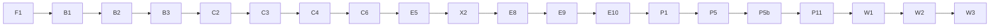

# Plan: AI Act Classification Assistant — Build Backlog
Reviewed: 2026-09-30 (foreman:backlog-reviewer, whole backlog; decisions 017–024)

## Context
The repo is greenfield: `AE.CAP_afa.md` (course brief), `AI Act Classification Assistant — Capstone Init Document.md` (the full design, called **INIT** below) and an empty `README.md`. The design is settled; this plan turns it into atomic stories with dependencies, a critical path and parallel lanes, so that any story can be picked up with a fresh context (or handed to a subagent) with no loss of quality. The timeline is 10+ weeks, so the full MVP plus stretch goals is in scope.

INIT sets hard ordering rules that this backlog enforces:
- **Benchmark isolation:** the Commission example split must be **committed before any engine code exists**, and own-case labels are **frozen before the build** (INIT › Benchmark isolation, Label rules). Since the engine was started before every own category was written, each category is frozen before the node that replays it (decision 017; B10a enforces it in CI).
- **Engine and evaluation first.** Product features are views on the same result and come later (INIT › Risks: scope creep).
- **Week-one checks:** Luna smoke test, embedding comparison, token cost (INIT › Tech stack, Engine safety net).

---

## How to use this backlog

**First story to run is F0**, which copies this file into the repo as `docs/BACKLOG.md` so it survives context clears. After that, `docs/BACKLOG.md` is the source of truth. Tick stories off there (`[x]`) and add a one-line outcome note.

**Picking up a story with a fresh context:** read (1) `CLAUDE.md`, (2) the story, (3) the INIT sections named in its *Context* line, (4) the files listed in *Input*. Nothing else should be needed. Where a new file goes is fixed by `docs/LAYOUT.md`; every *Output* path fits it.

**Story format**
- **Deps:** stories that must be done first. **Parallel:** safe to run at the same time.
- **Type:** `agent` (can be delegated fully), `human` (needs the user: legal judgement, manual extraction, external tools), `mixed` (an agent drafts, the user reviews and approves).
- **Context:** INIT sections to read. **Input:** files/data consumed. **Output:** files produced. **DoD:** checkable definition of done.

**Global rules for every story**
- **Isolation:** any story in the Corpus lane (B1, C*) must **never read `eval/`**. Any benchmark story must never write to `data/` or the corpus tables. This is how INIT's leak rule is kept even when agents run in parallel.
- The checks in `.claude/foreman.json` › `checks` (the only list) pass before a story is done. Tests that call models use recorded responses (F6), never live calls in CI.
- Any story touching Postgres loads the `supabase-postgres-best-practices` skill first; Supabase work loads the `supabase` skill.
- Library APIs (LangGraph, Docling, MCP SDK, RAGAS, FastAPI, TanStack) are checked through context7 before writing code.
- A story that makes a decision writes a short record to `docs/decisions/NNN-title.md` (what, options measured, numbers, choice).
- **Parallel agents use worktrees.** Run with the `foreman` plugin; see `CLAUDE.md` › Story workflow and › Project rules for parallel work. In short: one worktree and one `story/<ID>-<slug>` branch per story; a worktree is created only after all its Deps are merged; the orchestrator alone ticks this backlog; every story is reviewed by the `reviewers` in `.claude/foreman.json` and passes its `checks` before it is merged; migrations are created with `supabase migration new`, and only one story at a time may change the schema; Corpus-lane worktrees leave out `eval/` with sparse checkout.
- **Migration names.** Names like `001_corpus.sql` in the stories below are logical names. The real files get the timestamp prefix from `supabase migration new` (for example `20261001120000_corpus.sql`).
- **Generated API client and locale files.** Product stories that change the API regenerate `frontend/openapi.json` and `frontend/src/api/` and add strings to `frontend/src/i18n/locales/{en,de}.json`. On a merge conflict, regenerate the client (`pnpm gen:api`) and merge the locale keys; never merge generated files by hand.
- **Paid budget.** The €50 total (INIT › Budget rules) is shared by every paid story (B9, X1a, X2, V4, V5, V6, V8, V9, S2, W1): each records its spend in its Outcome note, and the orchestrator raises the remaining key balance with the user before V8.

---

## Critical path

Computed from the Deps by the foreman plugin's `backlog.py plan`, with sizes weighted and E5 tagged `Size: L`. Re-run it after any change to the Deps; don't edit this by hand.

**Critical path (longest chain, after the 2026-09-30 review):** F1 → B1 → B2 → B3 → C2 → C3 → C4 → C6 (done) → E5 (high-risk node, the hardest step) → X2 (engine model smoke test) → E8 → E9 → E10 → P1 → P5 → P5b → P11 → W1 (build freeze, decision 024) → W2 → W3. The product stories are on the path now because W1 waits for them; V8 and V9 run beside it.
**Second chain that must converge on V8 in time:** F3 → F7 → F7b → B4 → B9 → B10b (label tag). It is human-heavy (B4 is `Size: L`).
**Hard gate:** B3 (split committed) must land before E1 opens.

## Parallel lanes (for agents)

| Lane | Stories | Notes |
| --- | --- | --- |
| Infra | F0, F1, F8, F2, F4, F5, F6, X3 | F1 first; the rest fan out right after (F2 waits for F8) |
| Contract & eval | F3, F7, V1, V2, V3, V4 | Pure code; can run well ahead of the engine using dummy classifiers |
| Corpus | B1, C1, C2, C3, C4, C5, C6, C8 | The critical path (C8 is off it). Never reads `eval/` |
| Benchmark | F7b, B2–B12, V10a | Human-heavy. Agents draft, the user approves |
| Obligations | C7 | Independent after F3 and F4 |
| Engine | E1–E11 | E3, E4, E5, E6 and E7 are fully parallel once E1, C5, C6 (and C7 for E7) are done |
| Product | P1–P13 | After E10, except P2a, P3 and P4, which can start earlier |

## Waves (what to launch together)

Run `python3 <foreman>/scripts/backlog.py plan` for the current waves; a hand-written table went stale (backlog review, 2026-09-30).

---

## Tooling — Claude Code setup

The workflow comes from the `foreman` plugin (config in `.claude/foreman.json`); the project's own skills, agent and scoped rules are in `.claude/` (see `CLAUDE.md` › Project tooling). Two items wait for later stories:

- [x] **T1 · `/eval` skill** · Deps: V1 · Type: agent
  Context: INIT › Evaluation (Metrics, Budget rules), Benchmark isolation 4. Input: the `aiact evaluate run` CLI from V1, and `eval_runs`. Output: `.claude/skills/eval/SKILL.md`. The skill runs a benchmark with a subset size, a cost cap and a held-out/all mode, refuses a full run without the user's go-ahead, and writes `eval/reports/run-<date>.md` quoting only stored numbers (with run_ids).
  DoD: a dry run on a 3-case subset works end to end through the skill; the report cites its run_id.
  **Outcome:** /eval skill runs aiact evaluate run with an explicit subset, cost cap and heldout/all mode; needs the user's own yes for a full run (no subset or >30) or a paid classifier; never commits; appends aiact evaluate report output verbatim to eval/reports/run-<date>.md. 3-case dummy dry run b83767b2.

- [x] **T2 · Permission allowlist** · Deps: F2, F3, F4 (a few stories have run) · Type: agent
  Output: an allowlist in `.claude/settings.json` built with the `fewer-permission-prompts` skill from real session history (for example `uv run`, `supabase`, `git worktree` and read-only git commands). Never allow `git push`, force operations or anything that reads secrets.
  DoD: the user has reviewed the allowlist; parallel workers run a story without read-only permission prompts.
  **Outcome:** 19-entry read-only allowlist in .claude/settings.json (exact check commands, backlog reads, local supabase migration list and advisors, context7); no push, force, install, db reset, pytest/pyright wildcards or secret-printing commands; reviewed by the user. Parallel-run observation pending on the next wave.

- [x] **T3 · Workflow config from the backlog review** · Deps: E5 · Type: mixed
  Why: the backlog review (2026-09-30) found config gaps; no tooling changes while E5's worker is in flight. Output: in `.claude/foreman.json`: (1) `decisions.reserved` adds 002 (B11), 004 (X2), 007 (W0); (2) a `lanes.Engine` entry with the deny list below, and `Lane: Engine` on E4, E6, E8, E9, E10, E11; (3) a frontend check in `checks` (`cd frontend && corepack pnpm lint && corepack pnpm build && corepack pnpm test`), matched by the P5 CI job. Update the CLAUDE.md lines that describe them.
  DoD: the user has seen the settings diff; the lane guard blocks a read of the Commission cases on an Engine story branch; the checks pass on main.
  **Engine deny list:** `eval/commission_examples`, `eval/cases/commission_b` and `eval/split.json`; own cases stay readable for replay tests (decision 015's leak came from an Engine worker).
  **From B10a (merged):** add `.github/workflows/label-freeze.yml` and `aiact evaluate label-freeze` to the `enforced_by` list of the labels-frozen guardrail in .claude/foreman.json.
  **Outcome (2026-10-01):** Engine lane (3 denied paths) on E4, E6, E8–E11; frontend check added to `checks`; decisions 002/004/007 reserved; label-freeze added to its guardrail plus a new Engine-isolation guardrail. The guard blocked all three paths on a probe branch; the checks pass on main; a sparse Engine worktree passes all but 5 tests, which read the denied files.

## Phase 0 — Foundations

- [x] **F0 · Put the backlog in the repo** · Deps: – · Type: agent
  Input: this plan file. Output: `docs/BACKLOG.md` (a copy of this plan), a `CLAUDE.md` holding the global rules above, the repo layout and the standard commands.
  DoD: both files committed; `CLAUDE.md` is under 100 lines and links to INIT and `docs/BACKLOG.md`.
  **Outcome:** docs/BACKLOG.md and CLAUDE.md committed (997862b, 62db1f9); Tooling section added

- [x] **F1 · Backend scaffold** · Deps: – · Type: agent
  Context: INIT › Tech stack (Dev tooling). Output: `backend/pyproject.toml` (uv, Python 3.12), package `backend/aiact/` with empty subpackages `schemas, corpus, retrieval, obligations, eval, mcp, api, llm` (**not** `engine`: E1 creates it after the B3 gate, and a hook blocks it before then), `backend/tests/`, Ruff and pyright config, `aiact/settings.py` (pydantic-settings reading `.env`), `aiact/cli.py` (the `aiact` console script with empty `corpus` and `eval` command groups; F1 picks the CLI library), `.env.example` (OPENROUTER_API_KEY, SUPABASE_URL, SUPABASE_SERVICE_KEY, DATABASE_URL, LANGSMITH_API_KEY, model ids), `.gitignore` (including `.env`, `data/raw/`, `eval/private/`).
  DoD: `uv sync && uv run pytest && uv run ruff check && uv run pyright` all pass with one trivial test.
  **Outcome:** uv/Py3.12 backend with a Typer aiact CLI (empty corpus and eval groups), pydantic-settings reading the backend env file (AIACT_DATA_DIR resolved against backend/), model ids empty until X1–X3 confirm them, live marker deselected by default; ruff, pyright, pytest (6) green

- [x] **F2 · CI workflow** · Deps: F1, F8 · Parallel: F3–F7 · Type: agent
  Output: `.github/workflows/ci.yml` running uv sync, ruff, pyright, pytest and `aiact deps check` (F8) on push and PR. It gets a placeholder job for the isolation check (enabled in B13).
  DoD: the workflow passes on a pushed branch (or with `act`, if pushing is not wanted yet).
  Notes from merged stories: db-marked tests FAIL (not skip) when `CI` is set, so the job must run `supabase start` (or a Postgres+pgvector service with `supabase/migrations/*.sql` applied), or deselect with `-m "not db"`. Run `uv run --project backend aiact deps check` after `uv sync` (offline). pytest already has `--block-network` (localhost allowed). Consider a `.python-version` file.
  **Outcome:** CI (.github/workflows/ci.yml): uv sync --locked, deps check, ruff, pyright, pytest against a Postgres-only supabase start built from the migrations (db tests run under CI=true); disabled isolation job for B13; backend/.python-version 3.12. Green on GitHub (run 36406630736).

- [x] **F3 · Result contract (Pydantic schemas)** · Deps: F1 · Parallel: F2, F4–F6 · Type: agent
  Context: INIT › How it works (Outcomes, Risk classes, Evidence tags, Deciding facts, Roles, Worked example), MCP tools. Output: `aiact/schemas/` with:
  - `RiskClass` (`out_of_scope`, `prohibited`, `high_risk`, `limited_risk`, `minimal_risk`), `Status` (`decided`, `needs_more_information`, `legally_ambiguous`), `EvidenceTag` (`stated`, `inferred`, `assumed`), `Role` (`provider`, `deployer`, `importer`, `distributor`), `LawVersion` (`original`, `amended`), `Language` (`en`, `de`)
  - `Citation` (provision_id, document_id, law_version, language, quote, english_only flag), `Fact` (text, evidence tag, source span), `OpenQuestion` (question, readings[2])
  - `StepResult` (step name, decision, facts used, citations, status, missing_fact or open_question)
  - `ClassificationResult` (extracted facts, steps, risk_class, status, role, role_switch_reason, annex_point, transparency_duties list, deciding_facts, obligations, law_version, as_of date, disclaimer, follow-up questions)
  - `DISCLAIMER` constants in EN and DE
  Validators: a `limited_risk` result has non-empty transparency duties; an uncertain status has its missing_fact or open_question set; a `prohibited` result has no steps after Art. 5.
  DoD: tests build INIT's worked example (recruitment tool → `high_risk`, deployer, Annex III 4(a)) as a valid `ClassificationResult`, and each validator rejects a bad case; `model_json_schema()` output is snapshot-tested.
  **Outcome:** aiact/schemas/ holds the frozen result contract (enums incl. DocumentStatus; Citation/Fact/OpenQuestion/FollowUpQuestion; StepResult with typed missing_fact and error code; minimal Obligation; ClassificationResult with check-order, early-end-only-when-settled, derived status, role-iff-role-step, class-field and follow-up validators) and approved EN/DE disclaimers; decision 010 (+addendum); worked example and JSON Schema snapshot tested

- [x] **F4 · Supabase local + corpus migration** · Deps: F1 · Parallel: F2, F3, F5, F6 · Type: agent
  Context: INIT › Legal corpus, Tech stack (Database). Output: `supabase/` (via `supabase init`), migration `001_corpus.sql`: `documents` (id, title, celex, doc_type law/guideline/code, status final/draft/consolidated, law_version, language, published_on, in_force_from, source_url, sha256), `provisions` (id, provision_id such as `art:6:3` or `annex:III:4:a` or `recital:53` or `guide:hr:ex:17`, document_id, language, parent_id, heading, text, valid_from, valid_to, `source_example_id` nullable, tsvector generated with the `english` or `german` config per language), `provision_embeddings` (provision_row_id, model, dims, vector(1536), HNSW cosine index). pgvector enabled.
  DoD: `supabase start && supabase db reset` applies cleanly; a pytest inserts and reads a provision and runs a vector and a keyword query.
  **Outcome:** Corpus migration 20260927171942_corpus.sql: documents keyed (doc_key, law_version, language) with Omnibus as is_amending; time-sliced provisions (no overlaps, reload-safe parent FK, content_sha256); untyped embeddings keyed (model, dims) with partial HNSW for Qwen3-1536; RLS on, no Data API grants; decision 009 (versions, as_of, reload rules); db tests fail under CI

- [x] **F5 · Eval-records migration** · Deps: F4 · Type: agent
  Output: migration `002_eval.sql`: `eval_runs` (id, git_sha, benchmark, config json with model, embedding and retrieval settings, started_at, cost_usd, tokens), `eval_case_results` (run_id, case_id, predicted json, label json, per-metric scores, trace_id).
  DoD: migration applies; a round-trip test passes.
  **Outcome:** Migration 20260928093526_eval_records.sql (timestamped, not 002_eval.sql): eval_runs (uuid id, 40-hex git_sha, config must hold model/embedding/retrieval keys, cost_usd/tokens) and eval_case_results (PK run_id+case_id, cascade, scores = metric→number/bool/null via strict jsonpath, trace_id); server-only (RLS on, no grants); 13 db tests incl. round trip.

- [x] **F6 · OpenRouter client + recorded responses** · Deps: F1 · Parallel: F2–F5 · Type: agent
  Context: INIT › Tech stack (Model access, Models, Embeddings, Billing). Output: `aiact/llm/` with a LangChain chat model factory over OpenRouter (model id from settings, provider routing, zero-data-retention and no-training flags where OpenRouter supports them) and an embeddings client (Qwen3-Embedding-8B, provider pinned to Nebius, `dimensions=1536`, query instruction prefix configurable, L2-normalise and assert). A record/replay fixture (for example pytest-recording or a small custom cache keyed by request hash) so CI never calls the network.
  DoD: one live test marked `@pytest.mark.live` (skipped by default) and the same test passing in replay mode in CI.
  **Outcome:** aiact.llm: chat factory by role (langchain-openrouter) and OpenRouterEmbeddings (Qwen3-8B pinned to Nebius, 1536-d, raw norm checked), both sending data_collection=deny and zdr=true; replay via pytest-recording from tests/recordings/<module path>/ with the network blocked (only live-marked tests connect); Gemini Flash-Lite allowed in the user's guardrail on 2026-09-28

- [x] **F7 · Eval case schema + loader** · Deps: F3 · Type: agent
  Context: INIT › Evaluation (Test sets, Label mapping, Label rules). Output: `aiact/eval/cases.py`: `BenchmarkCase` (id, set name, language, description, label: risk_class / status / role / annex_point, label_citation, `source_example_id`, notes, tags), a YAML/JSONL loader for `eval/cases/<set>/*.yaml`, and the appliedAI label mapping as code. Directory skeleton `eval/cases/{commission_b,own,soft_pairs,consistency,qa,academic}/` and `eval/private/` (gitignored).
  DoD: the loader validates example files; the appliedAI mapping is unit-tested for all four labels, including the `out_of_scope` → disagreement-review flag.
  Notes from merged stories: Result contract rules to respect: decision 010 + addendum (early ends only when the stopping step is settled; status derived from steps; `FollowUpQuestion` slug ids). `Obligation` in `aiact/schemas/obligations.py` is a placeholder for C7.
  **Outcome:** aiact/eval/cases.py: BenchmarkCase + CaseLabel (label_citation is a list; cite-or-ambiguous enforced for commission_b/own/soft_pairs/consistency), YAML/JSONL loaders checking set_name and duplicate ids, score_appliedai (raw appliedAI labels mapped at scoring; out_of_scope-for-low flagged for review); eval/cases/* folders; eval/private stays untracked. Q&A and annex_match shapes left to B7/X0.

- [x] **F7b · Case schema extensions** · Deps: F7 · Type: agent
  Why: B4, B5a/c, B6, B7 and X0 each planned a change to `backend/aiact/eval/cases.py` in the same waves (backlog review, 2026-09-30); one story makes them all. Output: in `aiact/eval/cases.py` and its tests, `accepted_bases`, `label_status` and any-of basis/citation matching (the rule under B4); `flip_variants` on the case; `pair_id` (B6); `key_fact_answers` (question id or topic → answer; decision 019); a `business_function` field (W1 reports per business function); `CaseSet.annex_match` and several points in `CaseLabel.annex_point`, with `ANNEX_POINT_PATTERN` accepting Annex I ids (`annex:I:A:11`, `annex:I:B:21`) and the fixture `tests/fixtures/cases/own/ambiguous.yaml` moved off the pre-Omnibus `annex:I:1` (X0's schema note); a Q&A item model (question, required provision_ids, reference answer, `answerable`) with a loader entry (B7's note); a `source_example_id` rule for cases derived from a Pile A example (B6). Wire `metrics.basis_matches` and `flags_flip_variant` into `case_scores` and `summarize` (V2's note on B4).
  DoD: the loader validates every committed case file unchanged; each new field has a valid and an invalid fixture; the two metrics are reached in `summarize` (a test on fixtures); Annex I ids pass the pattern.
  **Outcome:** BenchmarkCase gains accepted_bases, label_status, flip_variants, pair_id, key_fact_answers, business_function; annex_point is a tuple with an Annex I-aware pattern; ANNEX_MATCH set, QAItem + load_qa_items, derived_from_pile_a (tested against eval/split.json); any-of basis and label-citation accuracy (decision 001's bare/lettered Art. 6(3) rule) and flip-variant flagging in case_scores, summarize and the report; bases come from the high-risk finding (annex_point), a high-risk answer without a point counts as a listed basis; the loader rejects repeated YAML keys (merge keys allowed) and non-.yaml files (.gitkeep, .DS_Store, *.md allowed).

- [x] **F8 · Dependency manifest** · Deps: F1 · Parallel: F3–F7 · Type: agent
  Context: INIT › Tech stack (Dev tooling), Risks (licence). Input: `backend/pyproject.toml`, `backend/uv.lock`. Output: `backend/aiact/deps.py` with a CLI group `aiact deps generate|check`; `docs/DEPENDENCIES.md`, generated and never edited by hand (a header saying so and naming the command; a table of direct deps with group runtime/dev, version constraint, locked version, licence and one-line summary; a table of every transitive package with locked version, licence and the direct deps that pull it in); `.githooks/pre-commit` (runs `generate` and stages the file when `pyproject.toml` or `uv.lock` is staged) and `.githooks/pre-push` (runs `check`), enabled with `git config core.hooksPath .githooks`, documented in `CLAUDE.md` › Commands. Versions and the dependency graph come from `uv.lock` (`tomllib`); licence and summary come from installed package metadata (`importlib.metadata`), `unknown` when missing. The output is deterministic (sorted, no timestamps) and leaves room for P4 to add a frontend section from the pnpm lockfile.
  DoD: `check` exits 0 on a fresh file and non-zero with a clear message after a dependency is added without regenerating (tested on a fixture lockfile); running `generate` twice gives no diff; `uv add <pkg>` then a commit updates the file through the pre-commit hook; a push with a stale file is refused by the pre-push hook.
  **Outcome:** aiact deps generate|check renders docs/DEPENDENCIES.md from uv.lock plus a committed licence cache (docs/dependency-licences.json, from installed metadata or PyPI), so check is offline and platform-independent; .githooks pre-commit regenerates, pre-merge-commit stops a stale merge, pre-push refuses uncommitted/stale dependency files

## Phase 1 — Benchmark before the engine

- [x] **B1 · Fetch source documents** · Deps: F1 · Parallel: F2–F7 · Type: agent · Lane: Corpus
  Context: INIT › Legal corpus table. Output: `backend/aiact/corpus/fetch.py` and `data/manifest.yaml` (per document: id, URL, language, status, version, fetched_at, sha256); raw files in `data/raw/` (gitignored). Covers the AI Act original (EN, DE), the Omnibus 2026/1744 (EN, DE), the consolidated text 02024R1689-20260727 (EN, and DE if it exists), and the guidelines (definition, prohibited, high-risk draft, Art. 50) plus the Code of Practice, in EN and in DE where it exists.
  DoD: the script is re-runnable and idempotent (same sha256 means no change); the manifest records which DE versions exist and which don't (this closes the INIT open question on German texts).
  **Outcome:** aiact corpus fetch downloads 15 of 20 document/language versions (laws as XHTML via Cellar, decision 008; guidelines as Commission PDFs) into the shared data/raw; German exists for the Act, Omnibus, consolidated text and definition/prohibited guidelines, while the high-risk draft (3 parts), Art. 50 guidelines and Code of Practice are English only; failed fetches are recorded as unknown (available: null); a re-run leaves data/manifest.yaml byte-identical

- [x] **B2 · Extract and count the Commission high-risk examples** · Deps: B1 · Type: mixed · Lane: Benchmark
  Context: INIT › Benchmark isolation 1–2, Open questions (count examples). Input: the draft high-risk guidelines PDF. Output: `eval/commission_examples/examples.jsonl` (example_id `hr-ex-001…`, Annex III area or Annex I, verdict high/not-high, page, original text) and `docs/decisions/001-commission-example-count.md` (counts per area and verdict).
  DoD: the user has checked the extraction against the PDF; the count is recorded, together with the resulting choice: split if there are about 40 or more examples, leave-one-out otherwise.
  Notes from merged stories: The draft high-risk guidelines are three EN-only PDFs in `data/raw/`: `guide-high-risk-general.en.pdf`, `guide-high-risk-annex-i.en.pdf`, `guide-high-risk-annex-iii.en.pdf` (ids in `data/manifest.yaml`).
  **Outcome:** 307 examples extracted and reviewed by the user (12 Annex I + 295 Annex III; 122 high / 185 not_high; 1 legally_ambiguous; 15 with verdict-flipping variants). Decision 001 accepted: split, with a mechanical counting rule and a 79-list anchor table for C2; Pile B size left open for B3.

- [x] **B3 · Commit the split (gate)** · Deps: B2 · Type: agent
  Output: `backend/aiact/eval/split.py` (`aiact evaluate split`: seeded, stratified by area × verdict), which writes `eval/split.json` (`{mode: split|loo, seed, pile_a: [...], pile_b: [...]}`).
  DoD: committed in a commit of its own **before any file under `aiact/engine/` exists** (check: `git log --diff-filter=A -- backend/aiact/engine` is empty at that commit). Every area appears in both piles, where there is more than one example.
  Notes from merged stories: B2 (decision 001, accepted): mode `split`, 307 examples (hr-ex-001…307), stratify by `area` × `verdict` (18 strata, each ≥ 4). OPEN QUESTION to settle with the user first: Pile B size (a half split means ~150 examples for B4 to rewrite and the user to approve). Once split.json is committed the IDs are frozen.
  **Outcome:** eval/split.json committed alone (2692490) before any engine file: half split, seed 20260928, Pile A 154 / Pile B 153 of 307, every area x verdict stratum in both piles; aiact evaluate split refuses to change it; test pins the frozen IDs, not a fresh run (decision 011).

- [x] **B4a · Similarity check tool** · Deps: B3, F7 · Type: agent
  Output: `backend/aiact/eval/similarity.py` (`aiact evaluate similarity`): the maximum similarity between each case and its source example (embedding cosine plus longest shared n-gram), with an agreed threshold (for example an 8-word run). DoD: tests on a planted near-copy and a clean rewrite.
  **Outcome:** `aiact evaluate similarity` fails a sourced case at a shared run of 8+ words with its example's text or lead-in (decision 025, user 2026-10-01, to revisit once B4's rewrites exist); the cosine comes from eval/isolation/embeddings.json and is only reported unless --max-cosine is set (then a missing vector fails, naming the missing side); exits 2 when nothing is sourced or an input is invalid; shares longest_shared_words, ExampleText, parse_cache and yaml_cases with isolation.py (isolation outputs hash-identical to before); no paid calls.

- [ ] **B4 · Rewrite the Pile B examples as company descriptions** · Deps: B3, F7b, B4a · Size: L · Type: mixed
  Context: INIT › Benchmark isolation 3. Output: `eval/cases/commission_b/*.yaml` (description written in a company's voice: size, bought or built, business context, some irrelevant detail; label, label_citation, source_example_id). In LOO mode this covers all examples.
  DoD: every Pile B example has a case; `aiact evaluate similarity` (B4a) passes for every case; the user has approved every label; the loader validates every file; `AIACT_REQUIRE_CORPUS=1 uv run pytest tests/test_isolation.py` passes with `eval/isolation/embeddings.json` regenerated.
  **Backlog review (2026-09-30)):** 153 rewrites, each label approved by the user: work in batches by Annex area (Annex I, then Annex III 1–8), one commit per batch, so the story can be paused and reviewed. The case-model changes below now land in F7b.
  Notes from merged stories: B2 (001): carry `accepted_bases`, `label_status` and `flip_variants` from examples.jsonl into the cases; hr-ex-307 becomes a `legally_ambiguous` case. Write each description WITHOUT the row's flip-variant feature, and expect the engine to ask about or flag it (user product rule); a flip-variant row may also yield a variant case with the variant's verdict. hr-ex-283: describe all three steps. Annex I high rows carry the Art. 6(1) third-party-assessment note. F7 follow-up lands here: extend `BenchmarkCase` for any-of basis/citation matching (bare `art_6_3_filter` matches any lettered entry; a lettered answer matches the same letter or the bare form) and a `label_status` field.
  **From V2 (merged):** add `accepted_bases` and the flip-variant provisions to the case model so `metrics.basis_matches` and `flags_flip_variant` can be wired into `case_scores`/`summarize` (tested helpers, not yet reached).
  **From C6's isolation audit:** hr-ex-290 shares 22 of its 58 words with visible `guide:guide-high-risk-annex-iii:para:419`; both quote Recital 61, so it is statutory wording, not a leak. The rewrite of hr-ex-290 must not reuse Recital 61's phrasing ("purely ancillary administrative activities…", "anonymisation or pseudonymisation of judicial decisions…").
  **Decision 016:** the cases rewritten from hr-ex-269 and hr-ex-031 are contaminated (the corpus retells them in annex-iii para:102 and para:152). Write them as usual and keep their `source_example_id`, so the eval code can flag them.
  **From B13 (merged):** after adding or changing cases, run `uv run aiact evaluate isolation-embed` (a fraction of a cent) and commit `eval/isolation/embeddings.json`; the local isolation test fails when a case text has no vector (CI doesn't check this). Run `AIACT_REQUIRE_CORPUS=1 uv run pytest -q tests/test_isolation.py` before finishing: no case may repeat a retrievable row (6-gram coverage 0.5, a 30+ word run, cosine 0.9).
  **B13's margin:** the closest benchmark text today scores cosine 0.894 against a retrievable row (limit 0.9). A rewrite of a Pile B system can cross 0.9 on topic alone: if it does, check the pair by hand before changing the text or the limit.
  **From B10a (merged):** before finishing, run `uv run aiact evaluate label-freeze --base main` (CI runs it too): any change to an approved case needs a new row in eval/LABEL_CHANGES.md naming its id; new cases need none. A bulk row ("<N> <prefix> cases …") must match its count exactly and never covers a label change.
  **From B4a (merged):** Run `uv run aiact evaluate similarity` (from backend/) on every rewrite; it must pass at the 8-word limit (decision 025). It exits 2 until a case with a source_example_id exists. Run `aiact evaluate isolation-embed` first so cosines show; the cosine is for the reviewer, and --max-cosine is optional (record the value and why in your report).
  **From F7b (merged):** Rewrites carry accepted_bases, label_status and flip_variants from their Commission row. examples.jsonl's flip variants use a free-text `provision` (e.g. "Annex III 7(c) or 1(b)"); convert each to `provision_ids` (e.g. annex:III:7:c). Also extend label-freeze's CASE_LABEL_FIELDS to accepted_bases, label_status and flip_variants, so changes to them are freeze-checked once B4's labels are approved.

- [ ] **B5a–e · Own cases, one sub-story per category** · Deps: F7, F7b · Parallel: with each other and with B2–B4 · Type: mixed
  Context: INIT › Test sets (Own cases), Label rules, Omnibus details. Categories: **a** Art. 50 transparency (including the 50(2) grace period), **b** out-of-scope software (not an AI system under Art. 3(1), exclusions), **c** the December 2026 prohibitions plus the classic Art. 5 practices, **d** Art. 25 role switches, GPAI-based systems, importer and distributor, **e** Annex I flags. At least 25% of each category in German. Output: `eval/cases/own/<category>/*.yaml`.
  DoD: every label cites the provision or example that settles it, or is `legally_ambiguous`; the user has approved each file; at least 25% of the category is German (counted); the loader validates every file; `eval/isolation/embeddings.json` is regenerated and `AIACT_REQUIRE_CORPUS=1 uv run pytest tests/test_isolation.py` passes.
  Notes from merged stories: F7: cases are `BenchmarkCase` in `aiact/eval/cases.py`; `label_citation` is a list; a label that isn't `legally_ambiguous` needs a citation, an ambiguous one needs `notes` (the open question and both readings: checked in review, not by the schema).
  **Outcome (B5d):** 13 own cases in eval/cases/own/d/ (7 EN, 6 DE; 2 legally_ambiguous) covering Art. 25(1)(a)/(b)/(c), GPAI-based systems, importer and distributor; expected obligations tagged obligation:<article> (unsettled conditions kept, user rule 2026-09-29), plus gpai_based, also_role:deployer and role_switch tags; each file approved by the user 2026-09-29.
  **Rules from B5d's review (user, 2026-09-29), for B5a/b/c/e:** (1) a conditional duty whose condition the facts don't settle is kept as an `obligation:` tag and named in `notes`; one the facts rule out is left out (E7's node does the same). (2) The class describes the system, whoever bears its Art. 50 duties: a deployer of a system with Art. 50 duties is `limited_risk` (own-d-07). (3) Folder names: B5d used `own/d/`; the F7 fixture uses descriptive names (`own/transparency/`), so the remaining sub-stories should pick one convention and B10 should align them. (4) Keep facts unambiguous where a label depends on them (own-d-01 now states who runs the system).
  **From B13 (merged):** after adding or changing cases, run `uv run aiact evaluate isolation-embed` (a fraction of a cent) and commit `eval/isolation/embeddings.json`; the local isolation test fails when a case text has no vector (CI doesn't check this). Run `AIACT_REQUIRE_CORPUS=1 uv run pytest -q tests/test_isolation.py` before finishing: no case may repeat a retrievable row (6-gram coverage 0.5, a 30+ word run, cosine 0.9).
  **Outcome (B5b):** B5b: 13 own cases in eval/cases/own/b/ (7 EN, 6 DE; 1 legally_ambiguous) covering Art. 3(1) non-AI software (rules, filters, averages, heuristics), the Art. 2(1)/(3)/(6)/(8)/(10)/(12) exclusions and two cases where an exclusion doesn't hold; out_of_scope cases have role null; Art. 2(10) personal use is out_of_scope (exception to rule 2); each file approved by the user 2026-09-30.
  **Rules from B5b/B5e's review (user, 2026-09-30), for B5a/B5c:** (5) timing: a case whose high-risk duties are tagged (working readings included) must place the system on the market or into service after its Chapter III date (2 Dec 2027 Annex III, 2 Aug 2028 Annex I), otherwise Art. 111(2) limits the duties; a pilot in which deployers already act on the output counts as putting into service. State the date so the Art. 50 grace period (Art. 111(4), before 2 Aug 2026) is unambiguous too. (6) An Art. 2(10) purely personal, non-professional use is labelled `out_of_scope` (an exception to rule 2; own-b-13). (7) `out_of_scope` cases carry `role: null` (skipped by role accuracy). (8) Name a trap in notes and tag it `trap:<name>`.
  **Outcome (B5e):** B5e: 14 own cases in eval/cases/own/e/ (7 EN, 7 DE; 2 needs_more_information, 2 legally_ambiguous) covering Annex I Section A and B (Art. 2(2): no AI Act obligations for Section B), Art. 6(1a)/(1b)/(1c), self-assessed vs notified-body routes, Art. 25(3), an Annex I deployer and an Annex I + III overlap; every high-risk launch is after its route's date, so Art. 111(2) never arises; annex_point is empty for Annex I cases until X0 fixes the pattern; each file approved by the user 2026-09-30.
  **From E3 (merged):** For B5a/B5c: Art. 2(8) never takes a system out of scope: a system being built for a planned launch is labelled as the planned system (user, 2026-09-30; own-b-09 relabelled and logged). Every relabel goes in eval/LABEL_CHANGES.md, even before labels-v1.
  **Backlog review (2026-09-30), decisions 017 and 018):** once a category is approved it is frozen (B10a's check); B5a must be approved before E6 starts and B5c before E4. Own cases are development cases (the nodes replay them), reported as such.
  **From B10a (merged):** before finishing, run `uv run aiact evaluate label-freeze --base main` (CI runs it too): any change to an approved case needs a new row in eval/LABEL_CHANGES.md naming its id; new cases need none. A bulk row ("<N> <prefix> cases …") must match its count exactly and never covers a label change.

- [ ] **B6 · Soft-wording pairs** · Deps: F7b, B5 · Type: mixed
  Output: `eval/cases/soft_pairs/` with 10–20 pairs (plain and softened wording of the same known high-risk system, linked by pair_id), each softened case with `key_fact_answers` for its likely key-fact questions (decision 019). Build pairs only from Pile B examples or original systems.
  DoD: approved by the user; 10–20 pairs, each softened case tagged `wording:soft` and carrying `key_fact_answers`; no case derives from a Pile A example (a test over `source_example_id` against `eval/split.json`); the isolation test passes.
  **Backlog review (2026-09-30)):** of the 15 `flip_variants` rows suggested below, 9 are Pile A and therefore retrievable (hr-ex-029, 107, 122, 193, 194, 244, 245, 291, 294): don't use them; the other 6 (Pile B) are fine.
  Notes from merged stories: F7: `BenchmarkCase` has no `pair_id` and rejects unknown fields; link pairs with a `pair:<id>` tag (as the fixtures do) or add the field in `cases.py`. B2 (001): the 15 rows with `flip_variants` in eval/commission_examples/examples.jsonl are ready-made base/variant pairs (e.g. place-based vs person-based crime prediction, 6(a)/6(d); onboarding chatbot vs performance-review feed, 4(a)/4(b); 283 step-(i)-only → Art. 6(3)(d); 244/245 → prohibited under Art. 5). Cite the Commission's own "however" sentence for the variant.
  **From V2 (merged):** tag the softened description of each pair `wording:soft`; the downgrade-rate metric finds pairs only by that tag and reports 0/0 otherwise.
  **From B13 (merged):** after adding or changing cases, run `uv run aiact evaluate isolation-embed` (a fraction of a cent) and commit `eval/isolation/embeddings.json`; the local isolation test fails when a case text has no vector (CI doesn't check this). Run `AIACT_REQUIRE_CORPUS=1 uv run pytest -q tests/test_isolation.py` before finishing: no case may repeat a retrievable row (6-gram coverage 0.5, a 30+ word run, cosine 0.9).
  **From B10a (merged):** before finishing, run `uv run aiact evaluate label-freeze --base main` (CI runs it too): any change to an approved case needs a new row in eval/LABEL_CHANGES.md naming its id; new cases need none. A bulk row ("<N> <prefix> cases …") must match its count exactly and never covers a label change.
  **From F7b (merged):** pair_id must link exactly two cases per set (enforced by the loader); that each pair has exactly one wording:soft case is not enforced yet. derived_from_pile_a now has a test against eval/split.json (tests/eval/test_cases.py), so a case derived from a Pile A example fails CI.

- [ ] **B7 · Q&A set** · Deps: F7b · Parallel: B5 · Type: mixed
  Output: `eval/cases/qa/` with 20–30 questions (EN and DE), each with the required provision_ids and a reference answer. DoD: approved by the user; 20–30 answerable plus 8–10 unanswerable questions (counted), in EN and DE; the loader validates every item; the isolation test passes.
  Notes from merged stories: F7: `CaseSet` has no `qa` member and Q&A items don't fit `BenchmarkCase`; add a Q&A item model (question, required provision_ids, reference answer) and a loader entry in `aiact/eval/cases.py`. The `eval/cases/qa/` folder exists.
  **Relevance cut-off (C8, X1):** also write about 8–10 unanswerable questions (EN and DE): off-topic ones and ones about other laws the corpus doesn't hold (GDPR, the Data Act, national law), each marked `answerable: false` with no required provisions. X1 calibrates the search cut-off on them and P7's DoD tests them.
  **From B13 (merged):** after adding or changing cases, run `uv run aiact evaluate isolation-embed` (a fraction of a cent) and commit `eval/isolation/embeddings.json`; the local isolation test fails when a case text has no vector (CI doesn't check this). Run `AIACT_REQUIRE_CORPUS=1 uv run pytest -q tests/test_isolation.py` before finishing: no case may repeat a retrievable row (6-gram coverage 0.5, a 30+ word run, cosine 0.9).
  **From B10a (merged):** before finishing, run `uv run aiact evaluate label-freeze --base main` (CI runs it too): any change to an approved case needs a new row in eval/LABEL_CHANGES.md naming its id; new cases need none. A bulk row ("<N> <prefix> cases …") must match its count exactly and never covers a label change.
  **From F7b (merged):** Q&A items load with aiact.eval.cases.QAItem / load_qa_items from eval/cases/qa/*.yaml (question, required_provision_ids, reference_answer, answerable). isolation.case_texts iterates CaseSet only, so Q&A questions aren't in the isolation check or isolation-embed yet: add them, so your 'isolation test passes' DoD is real.

- [ ] **B8 · Consistency triples** · Deps: B5 · Type: mixed
  Output: `eval/cases/consistency/`: 3 paraphrases per system, LLM-generated and then checked by hand. DoD: approved by the user; every paraphrase is tagged `triple:<id>` and every triple has exactly 3 cases (a test); the isolation test passes.
  **From V2 (merged):** tag every paraphrase of a triple `triple:<id>`; the consistency metric groups only by that tag and reports 0/0 otherwise.
  **From B13 (merged):** after adding or changing cases, run `uv run aiact evaluate isolation-embed` (a fraction of a cent) and commit `eval/isolation/embeddings.json`; the local isolation test fails when a case text has no vector (CI doesn't check this). Run `AIACT_REQUIRE_CORPUS=1 uv run pytest -q tests/test_isolation.py` before finishing: no case may repeat a retrievable row (6-gram coverage 0.5, a 30+ word run, cosine 0.9).
  **From B10a (merged):** before finishing, run `uv run aiact evaluate label-freeze --base main` (CI runs it too): any change to an approved case needs a new row in eval/LABEL_CHANGES.md naming its id; new cases need none. A bulk row ("<N> <prefix> cases …") must match its count exactly and never covers a label change.

- [ ] **B9 · Second-model label filter** · Deps: B4, B5, B6, B8, F6 · Type: mixed
  Context: INIT › Label rules (Second-model filter). Output: `backend/aiact/eval/label_filter.py` (`aiact evaluate label-filter`: Claude Haiku 4.5 via OpenRouter labels every case blind) and `eval/reports/label_disagreements.md`. The user resolves each disagreement.
  DoD: every disagreement has a written resolution (label kept or changed, with a reason).
  Notes from merged stories: X3 (005): pin Haiku 4.5 to `google-vertex/europe` (or `amazon-bedrock/eu-west-1`) with `allow_fallbacks=False`. Vertex Haiku rejects `response_format: json_object`: use a JSON schema (structured outputs). Haiku caches only with a top-level `cache_control`; check `langchain-openrouter` passes it through. About $0.02 per cold call (~10x Luna).

- [x] **B10a · Label freeze check in CI** · Deps: F2 · Type: agent
  Context: INIT › Label rules; decision 017. Output: a CI test (a job in `.github/workflows/ci.yml`) that fails when an approved case file under `eval/cases/` changes without a matching entry in `eval/LABEL_CHANGES.md` (which B12 created; extend it). A category counts as approved once its files are on main (own/b, own/d, own/e, academic today).
  DoD: the test is in CI; a changed approved case without a log entry fails it, and one with an entry passes; adding a new case file doesn't need an entry.
  Notes from merged stories: F2: add the label-freeze check as a new job in `.github/workflows/ci.yml`.
  **From B12 (merged):** the freeze covers `eval/cases/academic_overrides.yaml` and the generated `eval/cases/academic/*.yaml`; `eval/LABEL_CHANGES.md` already exists (started by B12) — extend it rather than creating it. The academic importer refuses any source but the pinned sha256, so a re-import can't change labels silently.
  **Outcome:** aiact evaluate label-freeze --base <ref> in its own uncancellable workflow (.github/workflows/label-freeze.yml): an approved case (on the merge base with origin/main, or main's previous tip) that changes or is removed needs a new eval/LABEL_CHANGES.md row; label changes need id rows, bulk rows must match their count exactly, the log is append-only (cell-wise); force-push falls back to labels-v1, else fails loudly

- [ ] **B10c · Align the own cases** · Deps: B5, X0, F7b, B10a · Type: mixed
  Output: the own/a–e case files aligned (every change logged in `eval/LABEL_CHANGES.md` and approved by the user), with a `business_function` on every headline case (W1 reports per business function). DoD: the user has approved each change; the loader validates every file; the freeze check passes.
  **From B5b (merged):** align across own/a–e: (1) the tag vocabulary (`scope:*`, `trap:*` — annex_iii_context, exclusion_not_met, future_high_risk, ai_marketing_name — and B5e's `annex_i_section`, `annex_i_point`, `missing_fact`); (2) `obligation:art:4:1` on minimal-risk providers (B5b tags it; B5d's importer own-d-11 has no obligation tags); (3) the conventions `role: null` for out_of_scope and Art. 2(10) personal use = out_of_scope (own-b-13); (4) folder names (own/b, own/d, own/e vs the F7 fixture's descriptive names).
  **From E3 (merged):** Corrections after E3: `trap:future_high_risk` no longer exists (own-b-09 was relabelled high_risk, tags now `trap:prohibition_not_met`, `scope:art2_8_noted`); no own case is an Art. 2(8) exclusion any more (the user's planned-system rule, 2026-09-30, logged in LABEL_CHANGES.md). own-b-05 is a replay known gap (decided on reading A); its label stays legally_ambiguous.
  **From X0:** backfill `annex_point` on the B5e Annex I cases (their point is in the `annex_i_point:` tag) once F7b accepts Annex I ids.
  **From B10a (merged):** before finishing, run `uv run aiact evaluate label-freeze --base main` (CI runs it too): any change to an approved case needs a new row in eval/LABEL_CHANGES.md naming its id; new cases need none. A bulk row ("<N> <prefix> cases …") must match its count exactly and never covers a label change.
  **From F7b (merged):** CaseLabel.annex_point can now hold Annex I ids (annex:I:A:<n>, annex:I:B:<n>) and several points: backfill the B5e Annex I cases (own-e-01, own-e-14 notes say it was left empty because of the old pattern).

- [ ] **B10b · Tag `labels-v1`** · Deps: B9, B6, B7, B8, X0, B10a, B10c · Type: mixed
  Output: git tag `labels-v1` on the commit that holds every benchmark case. DoD: the user has pushed the tag; the freeze check is green on that commit.
  **From B10a (merged):** update `.claude/rules/eval.md`, which still says the freeze starts at tag labels-v1: since B10a it applies per category (decision 017). labels-v1 is also the label-freeze workflow's fallback anchor after a force-push to main, so push the tag.

- [ ] **B11 · appliedAI dataset** · Deps: F7 · Parallel: everything · Type: human (agent helps with the format)
  Context: INIT › Test sets, Risks (licence). Output: `eval/private/appliedai.jsonl` (gitignored) and `docs/decisions/002-appliedai-licence.md` (fields, languages, licence statement found or not found).
  DoD: all ~106 cases extracted; only case IDs will ever be published.
  Notes from merged stories: F7: keep the experts' raw label (`high`/`prohibited`/`low`/`unclear`) with set_name `appliedai` in `eval/private/appliedai.jsonl`; `load_jsonl` and `score_appliedai` map it at scoring time. Add a helper that reads Annex II references as Annex I, and agree a tag for Annex I cases (INIT reports them separately). `eval/private/` is gitignored and untracked: create it locally.
  **Backlog review (2026-09-30)):** B11 feeds V9 on the critical path: start it now.

- [x] **B12 · Academic benchmark import** · Deps: F7 · Type: agent, plus a human spot-check
  Output: `eval/cases/academic/` converted from the davidath repo (CC BY 4.0, with attribution) and `eval/reports/academic_spotcheck.md` (about 20 cases checked).
  DoD: the loader validates every case; the spot-check is recorded.
  **Outcome:** 339 davidath scenarios (CC BY 4.0, commit d323167) imported with aiact evaluate academic-import from a sha256-pinned source; the user's 20-case spot-check applied through target-checked overrides (17 agree, 3 changed to legally_ambiguous, logged in eval/LABEL_CHANGES.md); academic set scores limited+minimal as one low bucket; 95 rule-/template-based low cases also accept out_of_scope, with a disagreement-review row.

- [x] **B13 · Isolation check in CI** · Deps: B3, C3, F7 · Type: agent
  Context: INIT › Benchmark isolation 5. Output: `backend/tests/test_isolation.py`: (1) no `provisions.source_example_id` is in Pile B (or, in LOO mode, the retrieval filter is always applied), (2) no benchmark description has near-duplicate text in the corpus (embedding cosine above a threshold, and an n-gram check). The CI job from F2 is enabled.
  DoD: the check passes, and it fails when a Pile B example is deliberately injected into a test DB.
  Notes from merged stories: F2: the `isolation` job in `.github/workflows/ci.yml` exists with `if: false` and runs `pytest -q tests/test_isolation.py`; remove the `if: false`. B2 (001): the isolation test must confirm every `pile_b` hr-ex ID was found and dropped by C2; C2's derivation can be checked against the 79-row anchor table in docs/decisions/001.
  **Decision 012 (overrides check 1):** Pile B rows exist in `provisions`, tagged. Check behaviour instead: every search entry point applies the Pile B exclusion by default; a default search (including a query copied from a Pile B example) never returns a Pile B row; every `pile_b` ID is tagged. The near-duplicate check runs against the retrievable corpus.
  **From B12's isolation audit:** the academic cases' `Domain:` lines quote Annex III area headings verbatim, so an n-gram check against `data/parsed/` matches them (94 hits, all statutory wording copied from the Act into the benchmark). Allow verbatim statutory headings, or check only the non-Domain fields, so they aren't false positives. Include the academic descriptions in the near-duplicate check.
  **From C2's review:** hr-ex-064 (Pile A) is repeated word for word in the running text (para. (183), p. 39, section chunk `guide:guide-high-risk-annex-iii:sec:59`), so the guidelines do repeat examples in prose; the near-duplicate check must catch a Pile B example repeated that way. C2's own leak test matches only whole lines of 40 or more characters, so use sub-line windows or n-grams. Measure the Commission-written passages near Pile B examples that decision 001 keeps in the corpus (after C2's re-chunking: annex-iii `para:102` has an inline "Example:" close to hr-ex-269, 0.375 6-gram coverage; `para:152` paraphrases hr-ex-031 sentence by sentence, verdict included, with only a 12-word verbatim run, so an n-gram check alone misses it; use the embedding check too) and report them; if too close, that is a change to decision 001. Footnote reference numbers may remain in corpus text but are stripped from the benchmark copy (001 rule 7), so normalise digits before matching.
  **Outcome:** tests/test_isolation.py + aiact/eval/isolation.py: Pile B tags (153 held out, all 307 example rows match B2's text), every public callable in aiact.retrieval discovered recursively and either registered or explained (get_provision and search_ai_act probed with each held-out row's own id, or its text and stored vector, and hide all 153 by default), near-duplicates (6-gram coverage 0.5 or a verbatim run of 30+ words; Qwen3 cosine 0.9 locally from eval/isolation/embeddings.json, $0.000331); decision 016's two retellings recorded in eval/isolation/contaminated.json and pinned; planted leaks fail in rolled-back transactions; the CI isolation job loads the corpus from data/parsed.

## Phase 2 — Corpus and retrieval

- [x] **C1 · EUR-Lex HTML parser** · Deps: B1 · Type: agent · Lane: Corpus (critical)
  Context: INIT › Tech stack (Ingestion), Corpus rules. Input: `data/raw/*` HTML. Output: `aiact/corpus/eurlex.py` → `data/parsed/<doc>.<lang>.jsonl`, split into article › paragraph › point, annex › point, and recital, with stable `provision_id`s that are identical across EN and DE. The Omnibus is parsed as amending text (which provisions it changes and the dates).
  DoD: tests against known provisions (Art. 5(1)(a), Art. 6(3), Annex III 4(a), Art. 50(2), Recital 53) in both languages; the EN and DE provision_id sets match for each document.
  Notes from merged stories: Input list: `data/manifest.yaml` (B1). Raw file = `$AIACT_DATA_DIR/raw/<entry.file>`, set only when `available: true`; `available: null` means a failed fetch (re-run `aiact corpus fetch`, never treat as absent). Laws carry `celex`; the Omnibus is `32026R1744`. Verify each file's sha256 against the manifest before parsing (raw dir is shared across worktrees). Laws are Cellar XHTML identical to EUR-Lex (decision 008). DE exists for the Act, Omnibus and consolidated text.
  **Outcome:** aiact corpus parse writes data/parsed/<doc>.<lang>.jsonl for the Act, Omnibus and consolidated text (1486/152/1421 provisions, EN and DE ids identical); a restarted subparagraph list goes under sub<n> as a whole (art:43:1:sub2:a-d); Omnibus carries 72 amendment records (action, targets, in force 2026-07-27, dates) resolved against AI Act ids with no truncations; rows are nested (parent text includes children).

- [x] **C2 · Guideline PDF ingestion (Docling)** · Deps: B1, B3 · Parallel: C1 · Type: agent · Lane: Corpus
  Input: guideline PDFs; `eval/split.json` is the **only** file under `eval/` this story may read, and only its `pile_b` ID list. Output: `aiact/corpus/guidelines.py` → `data/parsed/guide-*.jsonl`: chunks by section, each worked example as its own chunk tagged with `source_example_id`; Pile B chunks are dropped in split mode and kept but tagged in LOO mode.
  DoD: the chunk count and dropped IDs are logged; a test asserts that no Pile B ID appears in the output in split mode.
  Notes from merged stories: Select guideline PDFs by `kind == "pdf"` in the manifest, not by `guide-*` id (the Code of Practice id is `code-of-practice-transparency`). The high-risk draft is 3 documents (see B2). PDF language is trusted from the registry: check it once Docling text exists. DE exists only for the definition and prohibited guidelines. B2 (decision 001, in docs/, readable): assign `hr-ex-NNN` to guideline examples with 001's counting rules 1–3 (heading line beginning a)/b)/c) and containing "Practical example"; exactly the two named extra lists; one bullet = one example; the named unbulleted gas/heating/electricity paragraphs; Section 5 lists what is NOT counted) and check the result against 001's anchor table (first/last ID and row count per list, total 307). Read only the `pile_b` IDs from eval/split.json. Any example you can't map is an isolation gap.

  **Decision 012 (accepted, overrides the Output/DoD above):** Pile B chunks are KEPT, tagged with `source_example_id`, not dropped. DoD test: every `pile_b` ID is present and tagged; no Pile B example text is untagged. Log the chunk count and the tagged Pile B IDs.
  **Outcome:** aiact corpus guidelines turns the 9 PDF entries into data/parsed; prose chunks are keyed on printed paragraph numbers (guide:<doc>:para:<n>, the longest confirmed chain, so quoted numbers become text), so EN/DE share IDs (prohibited 434/434, definition 65/65); all 307 hr-ex examples match decision 001's 79-list anchor table; the 153 Pile B examples are kept and tagged is_held_out (decision 012); Docling sits in an optional ingest group that CI skips.
- [x] **C3 · Load the corpus into Postgres** · Deps: C1, C2, F4 · Type: agent · Lane: Corpus (critical)
  Output: `aiact/corpus/load.py` (upsert documents and provisions, set valid_from/valid_to for the original and amended versions, link EN and DE); a CLI `uv run aiact corpus load`.
  DoD: re-running changes nothing; row counts per document are printed and saved to `docs/corpus_stats.md`.
  Notes from merged stories: Follow decision 009: upsert documents on `(doc_key, law_version, language)` (nulls not distinct); `doc_key` = manifest id; the Omnibus is `is_amending`; when a document's sha256 changes, replace its provisions in one transaction, unchanged means skip; amended document carries the full history with slices from 2024-08-01 split at Omnibus dates parsed by C1; `valid_from` is required. C1: split the consolidated time slices at the Omnibus `amendment.in_force_from` (2026-07-27); decide whether the deferred application dates in `amendment.dates` (e.g. 2026-12-02 for Art. 5(1)(ba)/(bb)) affect `as_of` lookups. Rows are nested (a unit's `text` includes its children; `kind` and `parent_id` give the tree).
  **From C2's review:** `provisions` has `source_example_id` but no held-out flag, and C6 may not read `eval/`, so the flag must reach the DB. Add a migration for `is_held_out` (or an equivalent) and load it from the `data/parsed/guide-*.jsonl` rows (the one-schema-story rule applies). Guideline rows carry `source_example_id` and `is_held_out`. Link EN and DE guideline sections by `provision_id` only once C2's fix for language-independent section IDs is merged (check that paired chunks start at the same paragraph).
  C2 known limit: footnote bodies are attached to whichever paragraph precedes them on the page, so they differ between EN and DE (e.g. EN prohibited `para:49` holds footnotes 41–43, DE puts 43 in `para:51`); a citation to a paragraph can return a neighbour's footnote.
  C2 known limits (from its final review): the numbering keeps the longest confirmed chain, so a quoted run of 2 or more numbers in a document's last paragraphs, or just before a part boundary, can still take over the tail. On a tie the later copy of a repeated number wins. C2's contiguity test takes its upper bound from the data. So have the loader check each guideline's last `para:<n>` against the printed last paragraph (prohibited 433, definition 64, annex-iii 447, general 451, annex-i 62) and fail loudly on a mismatch. Docling now sits in the `ingest` group: re-parsing needs `uv sync --group ingest`.
  **Outcome:** aiact corpus load loads 15 documents / 9,083 provision rows; 974 provisions time-sliced at the Omnibus's 2026-07-27; pinned corrigenda (EN Art. 1 title, Art. 108; DE Art. 3(40)) apply from the start in both the original and the amended document, and points next to an inserted or deleted point are split (decision 014, accepted with option B); adds is_held_out and load_sha256, a lock per document and a report of documents missing from the manifest; a re-run changes nothing; counts in docs/corpus_stats.md.

- [x] **C4 · Embed the corpus** · Deps: C3, F6 · Type: agent · Lane: Corpus (critical)
  Output: `aiact/corpus/embed.py` (batching, model name recorded per row, skips rows already embedded with the same model); a CLI `aiact corpus embed --model qwen3|openai3l --dims 1536|1024`.
  DoD: every provision has a Qwen3 1536-d vector; the vectors are normalised; the cost is logged.
  Notes from merged stories: Skip a provision only if `(provision_row_id, model, dims)` exists AND `content_sha256` matches the provision's (decision 009). Only the `qwen/qwen3-embedding-8b` / 1536 arm has a partial HNSW index; each new (model, dims) arm needs its own partial index (new migration). F6 found Nebius returns vectors already normalised. C1: parent rows include their children's text: embed leaves only (or dedupe) to avoid duplicate vectors. X3 (005): Qwen3-Embedding-8B is pinned to `nebius`; `text-embedding-3-large` has no EU endpoint (ZDR via `azure`, no region pin).
  **From C3:** 487 provisions per language have two slices with identical text (children split with their parent, decision 014): embed each distinct `content_sha256` once and reuse the vector.
  **Outcome:** aiact corpus embed (qwen3|openai3l, 1536|1024) skips rows whose text hash is current, reuses stored vectors for identical text, embeds each distinct text once in batches committed one by one, removes the old vector of a row whose text grew too long, and turns OpenRouter SDK errors into EmbeddingError; the full Qwen3/1536 run (user, 2026-09-29) embedded all 9,083 provisions with unit vectors, 0 missing, 0 stale, 1,275,726 tokens for $0.012757.

- [x] **C5 · `get_provision`** · Deps: C3 · Parallel: C4 · Type: agent
  Context: INIT › MCP tools. Output: `aiact/retrieval/provisions.py`: `get_provision(provision_id, language, law_version|as_of)` → text, version, language, status, english_only flag, and the DISCLAIMER; a fallback to EN with the flag set when DE is missing.
  DoD: tests cover the original and amended text of an article changed by the Omnibus, and the fallback for a guideline that exists only in English.
  Notes from merged stories: Lookup rule (decision 009): `(d.law_version = $v or d.law_version is null) and not d.is_amending`; `as_of` resolves only against the amended document; `original` is an explicit view, never a fallback. C1: provision ids follow `.claude/rules/corpus.md` and the `eurlex.py` docstring: points of an article without numbered paragraphs sit under the article (`art:3:14`), annex sections are included (`annex:VIII:B:7`), a restarted list goes under `sub<n>` as a whole (`art:43:1:sub2:a`).
  **From V2 (merged):** citations resolve on the manifest `doc_key` (e.g. `ai-act-consolidated`), provision_id, language and law_version (aiact/eval/citation_index.py). The F3 worked example uses document_id `ai-act-consolidated-2026-07-27`, which is not a doc_key: align it.
  **From C3:** `as_of` lookups use `valid_from`/`valid_to` (one boundary, 2026-07-27, decision 014); recitals exist only in the `law_version = 'original'` document. The parsed `kind` and a guideline's `page` aren't stored (no columns); add them if citations need them. Both documents carry the pinned corrigenda (decision 014, option B).
  **Outcome:** aiact/retrieval/provisions.py get_provision reads the AI Act text of the chosen version, a recital always from the original, or a guideline by the doc_key in its id (checked against its own slices by as_of); as_of for articles and annexes is checked against the amended text only; missing German falls back to English with english_only; held-out examples stay hidden by default (user, 2026-09-29); tests cover Art. 4 original and amended and the English-only Art. 50 guidelines.

- [x] **C6 · `search_ai_act` (hybrid)** · Deps: C4 · Type: agent · Lane: Corpus (critical)
  Output: `aiact/retrieval/search.py`: vector and full-text search fused with RRF; filters for as_of date, law_version, language, doc_type, and `exclude_source_example_ids`; the query-side instruction is applied only to queries.
  DoD: tests show a softly worded tenant-rent query retrieves Annex III 5(b) in the top 5; a German query works; the exclude filter works.
  Notes from merged stories: Use the decision-009 lookup rule so guidance (law_version null) stays searchable. Vector queries must use the index's cast and predicate and `set local hnsw.iterative_scan = relaxed_order`. Exclude filter: `source_example_id is null or not (source_example_id = any(...))`. The German stemmer is uneven (System→syst, Systeme→system): consider prefix queries. C1: parent rows include their children's text: search leaves, or dedupe hits by `parent_id`.

  **Decision 012:** exclude the Pile B IDs by default in every search; turning it off is an explicit opt-in used only by the gap run (V8), never by the engine, API, MCP or Q&A. Test that a default search never returns a Pile B row.
  **From C3:** the held-out flag is `provisions.is_held_out` (153 rows, all `hr-ex-*`); every search must filter `is_held_out = false` by default and lift it only for `--exclude-mode all` (decision 012). No index on the flag (about 1.7% of rows; filter after the HNSW/GIN scan).
  **From C4 (merged):** all 9,083 provisions have a `qwen/qwen3-embedding-8b`/1536 unit vector, parents included (dedupe hits by `parent_id`); identical texts share one vector. The 153 Pile B vectors are in `provision_embeddings_qwen3_1536_idx`, and `provision_embeddings` has no held-out column: every vector query must join `provisions` and apply the held-out/exclude filter inside the SQL, never afterwards in Python (isolation audit). Filters apply after the HNSW scan, so use `hnsw.iterative_scan` (or a higher `ef_search`) or filtered queries come back short. Match `e.content_sha256 = p.content_sha256` so a stale vector is never ranked. `get_provision` (C5) hides held-out rows unless `include_held_out=True`; mirror that opt-in name. The query side of the arm: `OpenRouterEmbeddings.embed_query` in `aiact/llm/embeddings.py`.
  **Outcome:** search_ai_act: vector plus IDF-weighted full-text search (prefix terms in German only; word statistics count each visible unit once and never Pile B or the Omnibus; words only held-out rows use still get a weight, so V8 can find them) with weighted RRF (keyword 0.5). All filters are in the SQL of both arms (decision-009 version rule, original recitals, as_of, language, doc_types, held-out excluded unless include_held_out=True, null-keeping exclude_source_example_ids); results never repeat a unit and its ancestor; iterative_scan doesn't leak. Tenant-rent query: Annex III 5(b) 3rd in EN and 5th in DE (recorded embeddings); no default search returns any of the 153 Pile B rows.
- [x] **C7 · Obligations table + `list_obligations`** · Deps: F3, F4 · Parallel: the whole Corpus lane · Type: mixed
  Context: INIT › Scope (Obligations checklist), Roles, Omnibus details, Situation (dates). Output: `supabase/seed/obligations.yaml` (role × risk class → duty, article ref, applies_from date, SME/small-mid-cap relief note), migration `003_obligations.sql`, and `aiact/obligations/list.py`.
  DoD: every row cites an article; hand-checked tests for deployer/high-risk (Art. 26 duties from 2 Dec 2027), provider/high-risk, limited-risk transparency, and importer/distributor; the user has reviewed the dates.
  Notes from merged stories: Replace or extend the placeholder `Obligation` model in `aiact/schemas/obligations.py`. Point `[db.seed] sql_paths` in `supabase/config.toml` at the seed. Schema-changing: run it alone.
  **Outcome:** Obligations table: 54 YAML entries -> 106 rows (Annex III and Annex I route dates, applies_if conditions, SME/SMC relief, informational distributor rows for prohibited systems, Art. 86 and conditional Art. 26(10)), timestamped migration 20260928135941_obligations.sql (RLS on, no grants), generated SQL seed, list_obligations returning an ObligationList that carries its law version; hand-checked tests. User reviewed the dates on 2026-09-28.

- [x] **C8 · Search relevance score and cut-off** · Deps: C6 · Parallel: C7, the engine · Type: agent · Lane: Corpus
  Context: INIT › MCP tools, Q&A ("stays within the corpus"). Why: the meaning arm orders by distance and keeps the nearest `CANDIDATES`, with no distance predicate, so a search returns hits for any query ("hello" gets 10); the RRF score is rank-based and has no absolute meaning, and `SearchHit` doesn't expose the distance, so no caller can tell "nothing relevant" from a match. Output: in `aiact/retrieval/search.py`, `SearchHit.similarity` (1 − cosine distance of the meaning arm; None when only the keywords found it) and the keyword arm's summed IDF; a keyword-only `max_distance: float | None` argument (default from a new setting `SEARCH_MAX_DISTANCE`, None = no cut-off) applied inside the vector arm's SQL, not afterwards in Python; `SearchResults.found`: True when at least one hit passes the cut-off, or the keyword arm has a strong match on rare terms (a minimum summed IDF, so exact references like "Article 50" still count). The engine nodes call without a cut-off (a signal, not a filter: a softly worded description must still reach its Annex point); Q&A and MCP use it. No threshold is guessed here: Qwen3 cosines are compressed (B13: same-topic prose 0.894, a word-for-word repeat 0.904), so X1 calibrates the value.
  DoD: tests show `similarity` and the IDF score on hits; with `max_distance` set, a synthetic off-topic query returns no meaning-arm hit and `found` is False, while a matching query stays found; a keyword-only strong match stays found; the cut-off is inside the SQL of the vector arm (EXPLAIN or a statement test); with the setting unset the search behaves exactly as before (the C6 DoD tests still pass).
  **From B13 (merged):** CI has no corpus vectors, so its `search_ai_act` isolation probe exercises only the keyword arm's held-out filter. Since C8 edits the vector arm's SQL, add a statement-level test (no vectors needed) that the vector arm still carries the held-out and exclude filters. Register nothing new in `aiact.retrieval` without adding it to `ENTRY_POINTS` (or `NOT_ENTRY_POINTS` with a reason) in `backend/tests/test_isolation.py`.
  **Outcome:** C8: hits carry similarity (1 − cosine distance) and keyword_idf; max_distance (keyword-only, default SEARCH_MAX_DISTANCE, unset = no cut-off) cuts the meaning arm in SQL after the materialized nearest rows; found = a hit within the cut-off or keyword_idf ≥ MIN_KEYWORD_IDF (9.0); the C6 tests and the isolation probe pass max_distance=None; X1 calibrates both values.

- [ ] **C7b · Art. 111(2) legacy high-risk systems** · Deps: C7, E7 · Type: mixed · Resource: db-schema
  Context: decision 022; INIT › Scope (Obligations checklist). Output: a key-fact question ("was it on the market or in use before <the route's Chapter III date>? has its design changed significantly since?") in the role and obligations node, and in `list_obligations` a legacy marking: a high-risk system placed on the market or put into service before 2 Dec 2027 (Annex III) or 2 Aug 2028 (Annex I) with no significant design change gets its duties marked "applies only after a significant design change" (Art. 111(2)); one used by a public authority keeps them with the date 2 Aug 2030. The class stays high-risk.
  DoD: one hand-checked test per branch (legacy unchanged, legacy changed, public authority, launched after the date); the user has reviewed the wording and dates; the obligations seed regenerates cleanly.
  **From F7b (merged):** F7b is merged: CaseLabel.annex_point is a tuple. After merging main, test_role_obligations.py's state builder may need the any(...) form.

## Phase 3 — Week-one experiments

- [ ] **X0 · Annex-matching set** · Deps: F7b · Type: mixed
  Output: `eval/cases/annex_match/`: 30–50 informal descriptions → expected Annex III/I points, **written from scratch** (never from Commission examples). DoD: approved by the user; 30–50 items (counted); the loader validates every file; the isolation test passes.
  Notes from merged stories: F7: add `annex_match` to `CaseSet` in `aiact/eval/cases.py` and create `eval/cases/annex_match/`; `CaseLabel.annex_point` holds one point, so allow several if needed.
  **From B13 (merged):** after adding or changing cases, run `uv run aiact evaluate isolation-embed` (a fraction of a cent) and commit `eval/isolation/embeddings.json`; the local isolation test fails when a case text has no vector (CI doesn't check this). Run `AIACT_REQUIRE_CORPUS=1 uv run pytest -q tests/test_isolation.py` before finishing: no case may repeat a retrievable row (6-gram coverage 0.5, a 30+ word run, cosine 0.9).
  **Schema fix (user, 2026-09-30; moved to F7b by the backlog review):** `ANNEX_POINT_PATTERN` in `aiact/eval/cases.py` accepts only lowercase segments, so it rejects the corpus's Annex I ids (`annex:I:A:11`, `annex:I:B:21`). Fix it here together with allowing several points in `CaseLabel.annex_point`; also fix the fixture `tests/fixtures/cases/own/ambiguous.yaml`, which uses the pre-Omnibus `annex:I:1` (machinery is now Section B point 21). B10 then backfills `annex_point` on the B5e Annex I cases (their point is in the `annex_i_point:` tag).
  **From B10a (merged):** before finishing, run `uv run aiact evaluate label-freeze --base main` (CI runs it too): any change to an approved case needs a new row in eval/LABEL_CHANGES.md naming its id; new cases need none. A bulk row ("<N> <prefix> cases …") must match its count exactly and never covers a label change.

- [ ] **X1a · Embedding comparison** · Deps: C6, C8, X0, B7, V6 · Type: agent · Resource: db-schema
  Output: `backend/aiact/eval/experiments/embeddings.py` and `docs/decisions/003-embeddings.md`: RAGAS context recall and precision for Qwen3 at 1536-d, Qwen3 at 1024-d and OpenAI 3-large, on the Annex-matching and Q&A sets, with results stored in `eval_runs`.
  DoD: a decision is recorded with the numbers; the default in settings is updated if it changes; if the arm or the query instruction changes, the corpus is re-embedded, `tests/recordings/db/test_search_ai_act/` re-recorded and `eval/isolation/embeddings.json` regenerated (B13's cosine limit 0.9 is Qwen3-specific: re-check it).
  Notes from merged stories: Make the embedding query instruction a setting (e.g. `EMBEDDING_QUERY_INSTRUCTION`); the current default in `aiact/llm/embeddings.py` is a placeholder. Model/provider settings are still empty in the env example.
  **From C4 (merged):** only the `qwen/qwen3-embedding-8b`/1536 arm has a partial HNSW index; each other (model, dims) arm X1a embeds needs its own partial-index migration (`supabase migration new`), so X1a is schema-changing: run it with no other schema story.

- [ ] **X1b · Search tuning and relevance cut-off** · Deps: X1a, B7, X0 · Type: agent
  Output: tuned search constants and the calibrated `SEARCH_MAX_DISTANCE` and `MIN_KEYWORD_IDF` defaults in settings, the exact-reference rule, recorded in decision 003 (or a record of its own). DoD: both distributions (answerable vs unanswerable) and the chosen values are recorded; the C6 and C8 tests still pass.
  **From C6 (merged):** `KEYWORD_WEIGHT` (0.5), `MAX_TERM_SHARE` (0.05), `MIN_COMMON_ROWS` (50), `RRF_K` (60) and `CANDIDATES` in `aiact/retrieval/search.py` are hand-set: tune them on the Annex-matching and Q&A sets. The DoD margin is thin (Annex III 5(b) 3rd in EN, 5th in DE). The recordings in `tests/recordings/db/test_search_ai_act/` embed today's `DEFAULT_QUERY_INSTRUCTION`: if X1 changes it, re-record with `uv run pytest tests/db/test_search_ai_act.py -k iii_5b --record-mode=once`. Long descriptions cost about 1–2 ms per query word in the keyword statistics (EN ~57 ms, DE ~77 ms end to end).
  **Relevance cut-off (C8):** calibrate `SEARCH_MAX_DISTANCE` for the chosen arm: compare the best-hit similarity of answerable Q&A and Annex-matching queries with B7's unanswerable questions (and random off-topic strings); pick the value that keeps answerable recall and rejects most unanswerable ones, record both distributions and the choice in decision 003 (or a record of its own), and set the default in settings.
  **From C8 (merged):** calibrate `MIN_KEYWORD_IDF` (now 9.0) as well as `SEARCH_MAX_DISTANCE`. C8's measurements on the loaded corpus (~2,930 units): English "Article 50" gets no keyword hit ('50' in 222 units = 7.6% > MAX_TERM_SHARE; 'articl', 'annex', 'iii' dropped too); German "Artikel 50" 3.74; off-topic single stray words score up to ln(units) ≈ 8.0 ("tell me a joke" 7.98, "best holiday destinations in Spain" 7.29, "football results" 6.6); real queries "emotion recognition in the workplace" 10.67, "deepfake" 6.88. One IDF threshold can't separate these, so decide whether exact references get their own rule (match provision ids, route to `get_provision`). The value is German-untested.
  **From P2a (merged):** A live MCP search for "AI system that screens tenants for rental flats" ranked guide-prohibited paras 178/149 and guide-high-risk-annex-iii para 384 top (similarity 0.643–0.647), with no Annex III point in the top 3: a ranking case for the calibration.
  **From E5 (merged):** own-e-14 (German, soft wording, emergency triage) got no Annex III row in a top-50 law search: a calibration case for German retrieval.

- [ ] **X2 · Engine model smoke test** · Deps: F3, F6, C5, C6, E2, E3, E5, E7 · Type: mixed
  Context: INIT › Engine safety net; decision 023. Output: `backend/aiact/eval/experiments/smoke.py`, which replays the merged staged nodes (E2, E3, E5, E7) with GPT-6 Luna and with Gemini 3.1 Flash-Lite on their approved own cases (B5b, B5d, B5e, about 50); `docs/decisions/004-engine-model.md`.
  DoD: the rate of broken outputs or tool calls and the accuracy are recorded for both models with stored run_ids; the fixed rule is applied (Luna is dropped if more than 10% of its outputs are broken, or its accuracy is 10 or more percentage points below Gemini's on the same cases); the engine model is set in settings; the user approved the paid run.
  Notes from merged stories: Structured output: cross-field validators aren't in the JSON Schema, so contract failures count as broken outputs (decision 010 addendum). Gemini 3.1 Flash-Lite was allowed in the user's OpenRouter guardrail on 2026-09-28. Slugs checked by F6: `openai/gpt-6-luna` (pinned `openai/gpt-6-luna-20260922`), `google/gemini-3.1-flash-lite`. X3 (005): add a provider-order setting per role (e.g. `ENGINE_PROVIDER=azure/eu`) passed through `provider_preferences(order, allow_fallbacks=False)`; EU endpoints are used only when pinned by full slug. Luna: ~6k in + ~1.7k out per classification, $0.0018 cold / $0.0009 cached. The key has $9.95 left (the user handles the cap).
  **From E5 (merged):** E5 is merged: replay its 15 recorded cases (worked example + own/e) under both models. The high-risk node needs MAX_OUTPUT_TOKENS 6000 (Luna's reasoning ran out at 3000). Record once, after the code is final (the orchestrator runs paid recordings).
  **From F7b (merged):** F7b is merged: CaseLabel.annex_point is a tuple. Merge main and port matchers.py (role_check_state's is_annex_i, expected_route's is_annex_iii, high_risk_matches' points set) to the tuple form.
  **User decision (2026-10-01):** the INCONCLUSIVE outcome is accepted, now part 4-6 of decision 023 (addendum). Change decision 004's wording from 'not part of decision 023, awaiting the user' to cite the addendum.

- [x] **X3 · OpenRouter feature and cost check** · Deps: F6 · Type: agent
  Output: `docs/decisions/005-openrouter.md`: whether prompt caching works for the chosen models, which EU routes and ZDR options exist, the context window, and token use for one sample classification; the spending cap is set (the user sets it in the OpenRouter dashboard).
  DoD: every question in INIT › Open questions about OpenRouter has an answer.
  Notes from merged stories: Already known from F6: GPT-6 Luna works with `zdr` + `data_collection: deny` via Azure (an `azure/eu` endpoint exists) and spends reasoning tokens; Qwen3-Embedding-8B on Nebius honours `dimensions=1536` and returns normalised vectors; ZDR endpoints are listed at `GET https://openrouter.ai/api/v1/endpoints/zdr`; F6's recording calls cost about $0.00002.
  **Outcome:** 005 accepted: caching works on EU no-retention routes (Luna azure/eu, Flash-Lite vertex/eu, Haiku vertex/europe with cache_control); one classification ~6k in + ~1.7k out = $0.0018 cold / $0.0009 cached on Luna; models with an EU ZDR endpoint pinned by full slug, allow_fallbacks=False (+10%), data residency is the deciding rule; Jev router forwards to Luna (V3/V4 must rethink); key cap $35 with $9.95 left, handled by the user.

## Phase 4 — Engine

- [x] **E1 · Graph skeleton** · Deps: F3, **B3 committed** · Type: agent
  Context: INIT › How it works (flowchart). Output: `aiact/engine/graph.py` (a LangGraph StateGraph with the nodes facts → scope → prohibited → high_risk → transparency → role_obligations → finalize; `out_of_scope` and `prohibited` short-circuit to finalize; the order is fixed) and `aiact/engine/state.py`. Nodes are stubs that read scripted outputs.
  DoD: tests cover every routing path with stub nodes; no path can skip a check.
  Notes from merged stories: X3 (005): order prompts with the fixed instructions and retrieved provisions first and the user's description last, so the shared prefix is cached (Luna on `azure/eu` caches automatically).
  **Outcome:** build_graph(EngineNodes): fixed 7-node LangGraph, early exit only after scope/prohibited on a matched step that can_end_run (decision 010); scripted_nodes(Script) stubs; 45 tests over 36 routing combinations plus exact-edge and all-paths checks; adds langgraph (forces websockets 16.1.1).

- [x] **E2 · Fact extraction and key-fact questions** · Deps: E1, F6 · Type: agent
  Output: `aiact/engine/nodes/facts.py` and `aiact/engine/prompts/facts.md`: facts with evidence tags, a source span for each stated fact, and key-fact questions for inferred or assumed facts; EN and DE.
  DoD: replay tests on 5 cases; every `stated` fact has a span that exists in the description.
  Notes from merged stories: B2 (001), USER PRODUCT RULE: when a described system matches a guideline example that has a verdict-flipping "however / if" feature, the engine must ask a key-fact follow-up question about that feature or flag it (a user may describe the base version while the real system has the feature). Examples: personal-data enrichment (AML, 6(e)); deception hints from facial landmarks (7(a)); admissibility recommendations (8(a)); content changes (8(a)); new content or voter targeting (8(b)); general social scoring or crime prediction (Art. 5(1)(c)/(d)).
  **Outcome:** FactExtractor (aiact/engine/nodes/facts.py, prompts/facts.md): stated facts get a whole-word span from a verbatim quote, an unfound quote downgrades the fact to inferred with a confirm question (ids from the fact's text); key-fact questions ask the Act's own flip conditions, never a Pile B feature (decision 015); pinned to ENGINE_PROVIDER; structured-output helpers in aiact/llm/structured.py; 5 recorded EN/DE replays.

- [x] **E3 · Scope node (Art. 2–3)** · Deps: E1, C5, C6, B5b · Parallel: E4–E7 · Type: agent
  Output: `aiact/engine/nodes/scope.py`, which fetches Art. 3(1) and Art. 2 and searches the definition guidelines. DoD: replay tests on the B5b out-of-scope cases pass.
  **From E2 (decision 015):** no prompt line may paraphrase a Pile B example's deciding feature or share a 5-word run with any Pile B field (text, lead_in, use_case, flip_variants); run decision 015's leak-check command on every new prompt. Pin the engine model with `require_setting(settings.engine_provider, "ENGINE_PROVIDER")` and no fallbacks, and reuse `aiact.llm.structured` (a third copy of the pinning code should become an `engine_chat_model` helper).
  **From C6 (merged):** `aiact.retrieval.search.search_ai_act(query, language, law_version, as_of, *, doc_types, exclude_source_example_ids, include_held_out=False, limit)` returns hits with `law_version`, `as_of` and the disclaimer; never pass `include_held_out` (only V8's gap run may). The language filter is exact, so a German search skips English-only guidance (most guidance): add a German-then-English fallback like `get_provision`'s if the step needs guidance in DE.
  **From C8 (merged):** `search_ai_act` now has a keyword-only `max_distance` whose default comes from `SEARCH_MAX_DISTANCE`; engine nodes must pass `max_distance=None` explicitly (a signal, not a filter), so a later calibrated setting never filters them. Hits carry `similarity` and `keyword_idf`; `SearchResults.found` is informational for the engine.
  **From B5b (merged):** own/b's conventions the scope node must produce: Art. 2(10) purely personal use → `out_of_scope` (own-b-13, not minimal_risk); out_of_scope → no role; Art. 2(12) doesn't cover high-risk systems (own-b-11); a dual-use military/civilian system is in scope (recital 24, own-b-07). own-b-05 (logistic-regression scorecard) is legally_ambiguous on definition-guidelines para 42 vs Art. 3(1).
  **Outcome:** E3: ScopeCheck (nodes/scope.py, scope_texts.py, prompts/scope.md) fetches Art. 3(1) and Art. 2 and searches guide-definition via the new search_ai_act(doc_keys=…), applies Art. 3(1) and Art. 2(1)/(3)/(6)/(10)/(12) in code, with Art. 2(8) as a note (the planned system is classified) and Art. 50's own list for the 2(12) exception; a named guideline passage against Art. 3(1) makes the step contested; adds engine_chat_model and nodes/key_facts.py; own-b-09 relabelled high_risk (logged); B5b replay 12/13, own-b-05 a known gap (decided on reading A); recordings scrubbed of reasoning blobs, about $0.054.

- [ ] **E4 · Prohibited node (Art. 5)** · Deps: E1, C5, C6, B5c, B10a · Parallel: E3, E5–E7 · Type: mixed · Lane: Engine
  Output: `aiact/engine/nodes/prohibited.py`, which always fetches Art. 5 and applies date logic to the December 2026 prohibitions against `as_of`. DoD: replay tests on the B5c cases pass, including one case dated before 2 December 2026 and one after.
  **Follow-up from C7's date review (user, 2026-09-28):** law-enforcement users are in scope. Cover the Art. 5(2)–(7) conditions for real-time remote biometric identification (the Art. 5(1)(h) exceptions: authorisation, necessity, notification) rather than treating every 5(1)(h) case as a plain ban.
  **From B12's spot-check (user, 2026-09-28):** for workplace or education monitoring (webcams, voice, keystrokes), ask whether the system infers emotions: a yes makes it prohibited under Art. 5(1)(f) (academic-0096). For Art. 5(1)(a)/(b), treat the significant-harm condition as a deciding fact: flag it as needing information or legally ambiguous when the description can't settle it (academic-0005).
  **From E2 (decision 015):** no prompt line may paraphrase a Pile B example's deciding feature or share a 5-word run with any Pile B field (text, lead_in, use_case, flip_variants); run decision 015's leak-check command on every new prompt. Pin the engine model with `require_setting(settings.engine_provider, "ENGINE_PROVIDER")` and no fallbacks, and reuse `aiact.llm.structured` (a third copy of the pinning code should become an `engine_chat_model` helper).
  **From C6 (merged):** `aiact.retrieval.search.search_ai_act(query, language, law_version, as_of, *, doc_types, exclude_source_example_ids, include_held_out=False, limit)` returns hits with `law_version`, `as_of` and the disclaimer; never pass `include_held_out` (only V8's gap run may). The language filter is exact, so a German search skips English-only guidance (most guidance): add a German-then-English fallback like `get_provision`'s if the step needs guidance in DE.
  **From C8 (merged):** pass `max_distance=None` explicitly to `search_ai_act` (the default comes from `SEARCH_MAX_DISTANCE`, meant for Q&A and MCP only).
  **From E3 (merged):** Search your own guideline with `search_ai_act(..., doc_keys={"guide-prohibited"}, max_distance=None)` (a keyword-only filter inside both SQL arms). Build the model with `aiact.llm.engine_chat_model` and reuse `engine/nodes/key_facts.py` (Answer, KeyFact, facts_used). Pattern that works: the model answers fixed key facts, legal rules are applied in code; a prompt line alone didn't stop the model settling an open legal question (own-b-05), so make "settled in law?" a required answer, as E5 does. The recorder (`_scrub_response`) now strips reasoning blobs from cassettes.
  **Handover (2026-09-30):** E3's test_scope.py (CorpusReplay) and E5's test_high_risk.py (CorpusRecording) each have their own .corpus.json record/replay helper; share one when E4 adds a third, after E5 has merged (or leave it to E8). Workers can't run live recording commands (denied): give the user the exact command.
  **From B10a (merged):** before finishing, run `uv run aiact evaluate label-freeze --base main` (CI runs it too): any change to an approved case needs a new row in eval/LABEL_CHANGES.md naming its id; new cases need none. A bulk row ("<N> <prefix> cases …") must match its count exactly and never covers a label change.
  **From E5 (merged):** use engine/nodes/common.py for citations, lookup_for and the prompt sections (no new copies). For DB access follow high_risk_retrieval.py (a library protocol, short connections, none open during the model call). Replay recorder: E5's CorpusRecording (keyed calls, tolerates unused calls) and E3's CorpusReplay still differ; E4 adds the third, so share one (E5's). Recordings match the whole request body: record once, after all reviews and fixes.
  **From T3 (merged):** this story runs in the Engine lane: its worktree has no `eval/split.json`, `eval/commission_examples/` or `eval/cases/commission_b/`, and the guard blocks them. Expected check failures from that (they pass on main): `tests/eval/test_split.py::test_the_committed_split_covers_exactly_the_examples`, `tests/eval/test_runner.py::test_the_committed_split_loads`, `tests/eval/test_cases.py::test_committed_case_folders_exist` and the two Pile B tests in `tests/corpus/test_guidelines.py`; report them, don't work around them. Decision 015's leak check reads the denied files, so don't run it: the isolation audit at story-finish runs it on every changed prompt.

- [x] **E5 · High-risk node (Art. 6, Annex III, Annex I flag)** · Deps: E1, C5, C6, B5e · Size: L · Parallel: E3, E4, E6, E7 · Type: agent · **critical**
  Output: `aiact/engine/nodes/high_risk.py`: Annex III matching through search, analogy against Pile A examples (in LOO mode the exclude filter comes from the case), the Art. 6(3) filter with the profiling rule, and an Annex I flag that names the product law and asks the decisive question.
  DoD: replay tests on INIT's worked example and on 5 own cases; a test proves the exclude filter is passed through.
  **From B12's spot-check (user, 2026-09-28):** key-fact questions where Annex III depends on who deploys or what a decision means: ask whether a benefits/pension scheme is public or private (5(a) needs a public authority; academic-0136); ask whether a scholarship or funding decision decides admission (3(a)/(c)) or only funds students already admitted (academic-0150); for Annex III 7, state the assumption "used by or on behalf of a competent public authority" in the deciding facts (academic-0116).
  **From E2 (decision 015):** no prompt line may paraphrase a Pile B example's deciding feature or share a 5-word run with any Pile B field (text, lead_in, use_case, flip_variants); run decision 015's leak-check command on every new prompt. Pin the engine model with `require_setting(settings.engine_provider, "ENGINE_PROVIDER")` and no fallbacks, and reuse `aiact.llm.structured` (a third copy of the pinning code should become an `engine_chat_model` helper).
  **From E7:** set `CheckOutcome.high_risk_route` when the system is, or is assumed to be, high-risk, and `annex_iii_exempt` when it is listed in Annex III but exempt under Art. 6(3) (or assumed so); E7 reads both (Art. 6(4) follows `annex_iii_exempt`). E7 checks Art. 25 switches only on the high-risk class.
  **From C6 (merged):** `aiact.retrieval.search.search_ai_act(query, language, law_version, as_of, *, doc_types, exclude_source_example_ids, include_held_out=False, limit)` returns hits with `law_version`, `as_of` and the disclaimer; never pass `include_held_out` (only V8's gap run may). The language filter is exact, so a German search skips English-only guidance (most guidance): add a German-then-English fallback like `get_provision`'s if the step needs guidance in DE.
  **From C8 (merged):** pass `max_distance=None` explicitly to `search_ai_act`: under a cut-off of 0.3 the softly worded German Annex III 5(b) query loses its point, which is exactly what this node must not do. Hits carry `similarity` (1 − cosine distance) and `keyword_idf`, usable as confidence signals.
  **From B5e (merged):** the 14 Annex I cases in eval/cases/own/e/ are this node's replay set. Distinguish Annex I Section A from Section B: for a Section B product (vehicles, machinery since the Omnibus, e.g. own-e-04/05/07) Art. 2(2) leaves only Art. 6(1), 60a and 102–112, so the result is high_risk with no AI Act obligations (not even Art. 4) and the engine should say the duties come from the sector law. Art. 6(1a)/(1b) decide safety-component status (own-e-02 vs own-e-09); Art. 6(1c) excludes a notified body that checks only radio spectrum (own-e-06). Annex I cases have no `annex_point` until X0 fixes the pattern: their point is in the `annex_i_point:` tag, so Annex-point accuracy skips them for now.
  **From E3 (merged):** E3 added `aiact.llm.engine_chat_model` and `engine/nodes/key_facts.py` on main: merge main into the E5 branch and keep one helper. The recorder `_scrub_response` in tests/conftest.py now strips reasoning_details/encrypted_content/reasoning from response bodies; E5's cassettes must be scrubbed the same way before merging.
  **Handover (2026-09-30), state:** branch story/E5-high-risk-node-art at d2596d7 (main merged in, one engine_chat_model, key_facts reused), worktree .claude/worktrees/agent-a114157546f3e8de8, clean; replays not recorded yet (15 skip). The old worker is gone: continue with a foreman:story-worker or an agent told to work in that existing worktree. Next: the user runs the recording (workers are denied it), about $0.015–0.02: `cd <worktree>/backend && AIACT_DATA_DIR=<main>/data uv run pytest tests/engine/nodes/test_high_risk.py -k replay --record-mode=once`; then replay without recording and check all 15 against their labels. The earlier 11/15 run was invalid (it ran on a half-merged worktree). Spent so far about $0.033 (the user approved up to $0.30 for recordings).
  **User decisions (2026-09-30):** legal openness is a required per-route answer (settled_in_law + open_question on Annex III, Art. 6(3) and Annex I), read by code: open → legally_ambiguous with high-risk assumed; Annex I shown to the model as one line per point id; an undecided conformity route → third_party_assessment unknown; own-e-14: when both routes apply, report Annex III; the public-authority assumption applies to Annex III points 6 and 7 (stated, with a confirm question). If a case still misses after recording, bring it to the user (don't tune further); then run /foreman:story-finish E5 (DoD, diff, security, isolation-auditor, test-auditor).
  **Backlog review (2026-09-30), decision 017):** own/e is frozen: don't change its labels, and merge E5 only after B10a is on main.
  **Recording (user, 2026-09-30):** 12 of 15 replays passed on the first recording. Two structural fixes approved: the high-risk node's output cap goes from 3000 to 6000 tokens (own-e-14 spent all 3000 on reasoning), and `annex_i.point` is limited to the real Annex I ids (own-e-07 named `annex:I:A:21`). own-e-10 is accepted as a known gap (option (a)), like own-b-05 in E3: the model takes reading A (the MDR in-house exemption means no third-party assessment) as settled law; the label stays legally_ambiguous, and it is scored end to end in V8. `tests/conftest.py` matches cassettes on the whole request body (which holds `max_tokens` and the response schema), so both fixes invalidate all 15 cassettes: delete them all and have the user re-record all 15 (the first run cost $0.0178). Mark own-e-10 in `test_high_risk.py` the way `test_scope.py` marks own-b-05 (a `KNOWN_GAPS` entry: xfail, and fail if it starts matching). The old worktree was removed; the branch is kept at d2596d7.
  **From B10a (merged):** B10a is merged (decision 017's merge-order rule is met); E5 may merge once its recording and replay are done.
  **Outcome:** HighRiskCheck (nodes/high_risk.py, high_risk_retrieval.py, high_risk_texts.py, prompts/high_risk.md): every Annex III leaf and Annex I point shown by lookup with per-call enums of the shown ids; the model answers fixed key facts and settled_in_law per route, code applies Art. 6(1)/(1a–c)/(2)/(3) with the profiling rule, public-authority rules and Section B Art. 2(2); guideline analogies from Pile A only; short DB connections, none held over the model call; shared helpers in nodes/common.py; replays 14/15 (own-e-10 a known gap: asks for the third-party fact instead of flagging the open legal question); recordings $0.019 (E5 total about $0.10)

- [ ] **E6 · Transparency node (Art. 50)** · Deps: E1, C5, C6, B5a, B10a · Parallel · Type: mixed · Lane: Engine
  Output: `aiact/engine/nodes/transparency.py`: a list of duties that stack on top of any class, and the 50(2) grace period for systems placed on the market before 2 August 2026. DoD: replay tests on the B5a cases pass.
  **From E2 (decision 015):** no prompt line may paraphrase a Pile B example's deciding feature or share a 5-word run with any Pile B field (text, lead_in, use_case, flip_variants); run decision 015's leak-check command on every new prompt. Pin the engine model with `require_setting(settings.engine_provider, "ENGINE_PROVIDER")` and no fallbacks, and reuse `aiact.llm.structured` (a third copy of the pinning code should become an `engine_chat_model` helper).
  **From E7:** `transparency_duties` must list every Art. 50 provision that applies, including assumed or uncertain ones; the role step lists an Art. 50 duty only when it is in this list.
  **From C6 (merged):** `aiact.retrieval.search.search_ai_act(query, language, law_version, as_of, *, doc_types, exclude_source_example_ids, include_held_out=False, limit)` returns hits with `law_version`, `as_of` and the disclaimer; never pass `include_held_out` (only V8's gap run may). The language filter is exact, so a German search skips English-only guidance (most guidance): add a German-then-English fallback like `get_provision`'s if the step needs guidance in DE.
  **From C8 (merged):** pass `max_distance=None` explicitly to `search_ai_act` (the default comes from `SEARCH_MAX_DISTANCE`, meant for Q&A and MCP only).
  **From E3 (merged):** Search with `doc_keys={"guide-art50"}` and `max_distance=None`; build the model with `engine_chat_model` and reuse `nodes/key_facts.py`. The user's reading of Art. 50 (2026-09-30, own-b-10): Art. 50 covers systems intended to interact directly with people (such as conversational systems), systems that generate synthetic audio, image, video or text, emotion recognition or biometric categorisation, and deep fakes; a system that only returns its result to its own user doesn't fall under it. Keep E6 consistent with E3's prompt line.
  **From B10a (merged):** before finishing, run `uv run aiact evaluate label-freeze --base main` (CI runs it too): any change to an approved case needs a new row in eval/LABEL_CHANGES.md naming its id; new cases need none. A bulk row ("<N> <prefix> cases …") must match its count exactly and never covers a label change.
  **From E5 (merged):** use engine/nodes/common.py for citations, lookup_for and the prompt sections; follow high_risk_retrieval.py for DB access (short connections). Recordings match the whole request body: record once, after all reviews and fixes.
  **From T3 (merged):** this story runs in the Engine lane: its worktree has no `eval/split.json`, `eval/commission_examples/` or `eval/cases/commission_b/`, and the guard blocks them. Expected check failures from that (they pass on main): `tests/eval/test_split.py::test_the_committed_split_covers_exactly_the_examples`, `tests/eval/test_runner.py::test_the_committed_split_loads`, `tests/eval/test_cases.py::test_committed_case_folders_exist` and the two Pile B tests in `tests/corpus/test_guidelines.py`; report them, don't work around them. Decision 015's leak check reads the denied files, so don't run it: the isolation audit at story-finish runs it on every changed prompt.

- [x] **E7 · Role and obligations node** · Deps: E1, C7 · Parallel · Type: agent
  Output: `aiact/engine/nodes/role_obligations.py`: the Art. 25 switch checks (own brand, substantial modification, change of purpose), GPAI-based systems (flag the model provider's duties), importer and distributor, and a call to `list_obligations`. DoD: replay tests on the B5d cases pass.
  **Follow-up from C7's date review (user, 2026-09-28):** filter conditional duties by `applies_if` from the facts. Law-enforcement coverage still missing from the table: Art. 49(4) (registration in the non-public section of the EU database); add it with a hand-checked test. C7 already has Art. 26(10) and Art. 86 as conditional rows.
  **Outcome:** RoleObligationsCheck: the model answers fixed key facts, code applies GPAI and Art. 25(1)(a)–(c) for high-risk systems (keeping a deployer's own duties), own name below high risk (limited or minimal) is legally_ambiguous with provider assumed, unknowns give provider as the labelled working assumption; list_obligations filtered by applies_if; every step cites its basis; Art. 49(4) and GPAI-flag rows added (dates user-reviewed); B5d replay: all 13 roles match (own-d-12 status gap logged on E8/V5), recorded for $0.0087.

- [ ] **E8 · Finalize and aggregate** · Deps: E2–E7, X2 · Type: mixed · Lane: Engine · Solo · **critical**
  Output: `aiact/engine/nodes/finalize.py`: the overall status, the stricter reading as the labelled working assumption when uncertain, deciding facts, law version, as_of date, disclaimer, a recommendation of legal review on high-risk and ambiguous results (INIT › Ethical considerations), and follow-up questions collected from all steps. DoD: tests on constructed ambiguous and needs-info states, and one test each for: an `annex:I:B:*` result with no AI Act obligations (Art. 2(2)); both routes → Annex III reported; `annex_point` copied into the result; follow-up questions de-duplicated by stable id; the legal-review recommendation on high-risk and ambiguous results.
  **Backlog review (2026-09-30)):** before the worker starts, bring the user the open calls below one at a time (own-d-12 legal question or missing fact; own-d-13 report every fired switch or the first; how `also_role` is shown).
  **From E2:** question ids come from the model and vary between runs; E8 needs stable ids to score flip variants (consider a fixed id vocabulary for common facts). hr-ex-226's enrichment/profiling feature is no longer asked about in the facts prompt (decision 015), so its variant depends on the high-risk check alone.
  **From E7's B5d replay (user, 2026-09-29: E7 checks role only; score these end to end):** own-d-10: label provider via Art. 3(3) with no switch, but the node reaches provider via Art. 25(1)(a) (basis and citation differ). own-d-12: label legally_ambiguous, but the node returns needs_more_information asking about substantial_modification; decide whether "not foreseen" is a legal question or a missing fact. own-d-13: label switch 25(1)(c), but the node reports 25(1)(b) because the model answered both and (b) comes first in the Act; decide whether all fired switches are reported.
  **From E7:** read `state["role"]` (a RoleFinding, including `also_role`, e.g. provider and also deployer) and `state["follow_up_questions"]` (an appending channel; a check's questions may include its own missing_fact, so de-duplicate by id). `ClassificationResult` has one `role` field: decide how `also_role` is shown. The role step can be legally_ambiguous (own name on a limited- or minimal-risk system, open Art. 3(3) question) with provider assumed. Its citations quote data/parsed as a stopgap until C5; the Art. 50 guideline reference behind the own-name question isn't cited yet (C5/E9).
  **Open follow-up from the 2026-09-29 reviews:** the obligations table doesn't model Art. 111(2) (high-risk systems placed on the market before the Chapter III date are covered only after significant design changes), which affects every legacy high-risk case. The two INIT inconsistencies (the worked example's Art. 26(7) and the ethics table's "minimal-risk") were fixed with the user on 2026-09-29.
  **From B5e (merged):** C7's obligations table and E7's node (both done) miss two rules the own/e labels rely on, and no open story owns them yet: (1) Art. 2(2): a Section B Annex I product gets no AI Act obligations; (2) Art. 111(2): a high-risk system placed on the market or put into service before its Chapter III date (2 Dec 2027 Annex III, 2 Aug 2028 Annex I) is covered only after significant design changes (public authorities by 2 Aug 2030). The own cases avoid (2) by dating every high-risk launch after its route's date, so the benchmark doesn't need it yet; (1) is scored by own-e-04/05/07. Fix (1) here or in a small follow-up story before V8.
  **From E3 (merged):** The scope node's assumed facts (for example an assumed EU link) are shown in facts_used but get no confirm question; E8 may add confirm questions for assumed facts. Art. 2(8) is only a note on the scope step (the planned system is classified). eval/baselines.py still pins the engine model by hand instead of engine_chat_model. 21 older cassettes (E2, E7, baselines, llm) still carry encrypted reasoning blobs (no key-shaped strings): scrub them when next re-recorded.
  **User decision (2026-09-30), from E5:** when a system is high-risk on both routes, the reported route is Annex III (earlier date, Art. 16(i)); the Annex I route stays in the deciding facts. Copy CheckOutcome.annex_point into ClassificationResult. For an annex:I:B:* result, list no AI Act obligations (Art. 2(2)).
  **From E5 (merged):** `CheckOutcome.annex_point` is set only when `high_risk_route` is set (exempt results name the point in the decision text only); copy it into ClassificationResult as-is. own-e-10 is a KnownGap (NEEDS_MORE_INFORMATION on third_party_assessment about art:6:1:b; label legally_ambiguous). Open for E8: whether short Annex III leaves (e.g. 1(a)) need their area heading in the prompt; the test auditor's minors: own-e-10's gap reader ignores annex_iii_exempt, and no schema invariant rejects annex_point without a route (only the replay oracle catches it). Shared node helpers live in engine/nodes/common.py (lookup_for, provision_citation, guidance_citation, answers_section, facts_section).
  **From E5 (merged):** scope.py's CorpusLibrary still opens a DB connection per call; high_risk_retrieval.py shows the short-connection pattern (one per read, none over the model call). Align scope when E8 touches the nodes, without changing E3's recorded request bodies.
  **From T3 (merged):** this story runs in the Engine lane: its worktree has no `eval/split.json`, `eval/commission_examples/` or `eval/cases/commission_b/`, and the guard blocks them. Expected check failures from that (they pass on main): `tests/eval/test_split.py::test_the_committed_split_covers_exactly_the_examples`, `tests/eval/test_runner.py::test_the_committed_split_loads`, `tests/eval/test_cases.py::test_committed_case_folders_exist` and the two Pile B tests in `tests/corpus/test_guidelines.py`; report them, don't work around them. Decision 015's leak check reads the denied files, so don't run it: the isolation audit at story-finish runs it on every changed prompt.
  **From F7b (merged):** Copy CheckOutcome.annex_point into ClassificationResult.annex_point whatever the final class (also when an uncertain prohibited step keeps the class prohibited above a high-risk finding): metrics.result_bases reads the basis from annex_point. Add a test on a prohibited-ambiguous run. Don't follow baselines.py:119's conditional pattern.

- [ ] **E9 · Citation existence validator** · Deps: E8, C5 · Type: agent · Lane: Engine · Solo · Resource: db-schema · **critical**
  Output: `aiact/engine/citations.py`: every citation must resolve through `get_provision`; an unknown citation triggers one repair retry of that step, and if it still fails the step becomes `needs_more_information` with an error flag. A `changed_by_omnibus` marker on each citation of a provision the Omnibus changed, from C1's 72 amendment records, and an explicit lookup for citations of the Omnibus itself (INIT › Corpus rules: "Where the Omnibus changed a provision, the answer says so"). DoD: tests show 100% of citations exist in replay runs; an injected fake citation is caught; a citation of Art. 5(1)(ba) carries the marker and one of Art. 4 original doesn't.
  **From V2 (merged):** emit the manifest `doc_key` as `Citation.document_id`; the eval citation check (aiact/eval/citation_index.py) counts anything else as missing. Consider reusing its exact rule.
  **From C5 (merged):** `get_provision` never returns the Omnibus's own provisions (decision 009 excludes `is_amending`), so a citation of the Omnibus itself (e.g. "changed by the Omnibus") would fail validation: add an explicit lookup for it if a node needs one. The parsed `kind` and a guideline's `page` are still not stored; add the columns (a migration) if citations need them. `Citation.document_id` doesn't say it holds the manifest doc_key: document it, and replace the made-up keys in `tests/schemas/test_evidence.py` (`guidelines-high-risk-2026-05-19`, `guide:hr:ex:17`) with real ones. E7's citations still quote data/parsed as a stopgap: switch them to `get_provision`. Held-out examples are hidden unless `include_held_out=True` (user, 2026-09-29), so a citation of a Pile B example never resolves by default.

- [ ] **E10 · `classify_system` public API** · Deps: E8, E9, C7b · Type: mixed · Lane: Engine · Solo · **critical**
  Output: `aiact/engine/__init__.py`: `classify_system(description, language, law_version="amended", as_of=today, answers={}, exclude_source_example_ids=[], *, include_held_out=False) -> ClassificationResult`, with LangSmith tracing (metadata only in production mode) and streaming of step events. Answers are appended to the description before the facts node (decision 019). `include_held_out` is eval-only: carried through `EngineInput` to every node's `search_ai_act` and `get_provision` call, used only by V8's gap run, never exposed by P1 or P2b, and registered with the isolation test.
  DoD: live run on INIT's worked example gives the expected result; the replay test is in CI; cost per case is logged; a test shows an answer turning a fact into `stated` with a span in the extended text; a test shows `include_held_out=True` reaching every node's retrieval call and the default reaching none.
  **From V1:** replace the `engine` stub in `runner.CLASSIFIERS` with an adapter over `classify_system` that reports cost, tokens and trace_id, and raises `ClassifierFailedError(cost_usd, tokens, cause)` when a paid run fails late.
  **From E2:** `EngineInput.answers` is not used yet: answers aren't fed back to the facts node, and a fact resting on an answer can't be `stated` (SourceSpan points only into the description); decide how answers enter. `FactsOutcome` carries no cost or tokens; the V1 runner needs per-node cost aggregation.

- [ ] **E11 · Original-version support** · Deps: E10, C7 · Type: agent · Lane: Engine
  Context: INIT › Scope (Original vs. amended toggle); decision 020. Output: the nodes branch on `law_version`: rules only the Omnibus introduced (Art. 6(1a)–(1c), machinery in Annex I Section B, the December 2026 bans in Art. 5(1)(ba)/(bb)) don't apply under `original`; obligations under `original` return an explicit "not modelled for the original text" result instead of raising.
  DoD: replay tests under both versions for one Omnibus-changed case per rule (for example machinery: Annex I A under `original`, B under `amended`; Art. 5(1)(ba) before and after); the obligations result under `original` says "not modelled".

## Phase 4b — Evaluation harness (the early parts run in parallel with the engine)

- [x] **V1 · Eval runner** · Deps: F5, F7 · Parallel: C*, E* · Type: agent
  Output: `aiact/eval/runner.py` and a CLI `aiact evaluate run --set <name> --classifier engine|baseline_* --subset N --exclude-mode heldout|all`, writing to `eval_runs` and `eval_case_results`, with concurrency and a cost cap. DoD: runs end to end with a dummy classifier.
  Notes from merged stories: F5: `eval_runs.id` is a uuid; `config` must hold the keys `model`, `embedding`, `retrieval` (null allowed); `scores` maps metric → number/bool/null (strict). Consider `finished_at`/status on `eval_runs` and per-case cost/error columns (a new migration: the one-schema-story rule applies). Both tables are server-only (RLS on, no grants).
  **Outcome:** aiact evaluate run (runner.py + records.py): seeded subset, thread-pool concurrency, cost cap checked before each case that also counts spend on failed cases (ClassifierFailedError); heldout uses B3's Split (Pile B excluded, decision 012), all = gap run; label = full BenchmarkCase dump, predicted = ClassificationResult dump or {error}; in-flight cases recorded once when a run stops; run status in config.outcome, per-case cost/tokens/is_error in scores (no migration); dummy run end to end against Postgres.

- [x] **V2 · Deterministic metrics** · Deps: F3, F7 · Parallel · Type: agent
  Context: INIT › Metrics. Output: `aiact/eval/metrics.py`: risk-class accuracy (with the appliedAI mapping), false-low-risk rate, Annex point accuracy, role accuracy, uncertain-outcome precision and recall (needs-info separate), downgrade rate, consistency, citation existence. A report generator produces a markdown table from a run_id. DoD: every metric is unit-tested on fixtures.
  Notes from merged stories: F7: `score_appliedai` marks unclear + `needs_more_information` as both `is_counted_separately` and `needs_disagreement_review`; decide whether these cases leave the accuracy denominator (INIT: "reported separately"). B2 (001): score a result's basis under the `accepted_bases` rule (bare `art_6_3_filter` matches any lettered entry; a lettered answer matches the same letter or the bare form; anything else exact). Report `legally_ambiguous` rows (hr-ex-307) under uncertain-outcome handling, not plain accuracy. Score whether the engine asked about or flagged a row's flip-variant feature (user product rule).
  **From V1 (merged):** pass your scorer as `run_benchmark(..., scorer)`; the score keys `cost_usd`, `tokens`, `is_error` are reserved (per case) and must be left out of the metric tables. V1 already stores `label` = full BenchmarkCase dump and `predicted` = ClassificationResult dump or `{error}`, matching report.py. Add a scoring-failed marker to a case whose scorer raised (today it is stored with `is_error: false` and no metric scores, counted in `cases_scored`).
  **Outcome:** aiact/eval/metrics.py (per-case scores + run metrics: risk-class accuracy with the appliedAI mapping, false-low-risk, Annex point, role, uncertain-outcome P/R with NMI-on-ambiguous counted only on its own row, downgrade, consistency, citation existence; accepted_bases and flip-variant helpers not yet wired) and report.py (aiact evaluate report <run_id>, reads run-time scores only); exact citation index on (doc_key, provision, language, law_version); metric_scorer wired into aiact evaluate run; scoring_error marker; db test fixture always rolls back.

- [x] **V3 · Baselines** · Deps: V1, F6 · Type: agent
  Output: `aiact/eval/baselines.py`: Luna without retrieval or staged checks, and Jev classifying directly. DoD: both run through V1 on a 5-case subset.
  Notes from merged stories: X3 (005): don't use `typesafe/jev-router` for the Jev baseline (it can route to Luna, the engine model). `typesafe/jev-1.13` refuses chat completions and works only through `/api/alpha/decisions`; check it can classify a description, or drop the baseline.
  **From V1:** register the `baseline_*` classifiers in `runner.CLASSIFIERS`; a baseline that fails after paying raises `ClassifierFailedError(cost_usd, tokens)` so the cap counts it.
  **Outcome:** aiact/eval/baselines.py: baseline_luna (ENGINE_MODEL, requires ENGINE_PROVIDER, always pinned with no fallbacks per decision 005; provider stored in eval_runs.config) and baseline_jev (typesafe/jev-1.13 choice questions via the new aiact.llm.decisions client); both in runner.CLASSIFIERS, broken outputs raise ClassifierFailedError; 5-case academic runs 60fd4d11 (Jev, risk class 4/5) and 7ed48e52 (Luna, 5/5).

- [ ] **V4 · Judge + judge validation** · Deps: F6 · Type: mixed
  Context: INIT › Judge. Output: `aiact/eval/judge.py` (Jev returns yes/no with a probability; unsure cases go to Claude Haiku 4.5 with a written reason) and `eval/judge_validation/` (about 50 hand-labelled EN and DE cases, labelled by the user); `docs/decisions/006-judge.md` (agreement and calibration).
  DoD: the validation report exists; the unsure threshold is chosen.
  Notes from merged stories: Jev's OpenRouter slug is unclear: the model list shows only `typesafe/jev-router`, the ZDR list has `typesafe/jev-1.13-20260917`. Judge backup: `anthropic/claude-haiku-4.5`. X3 (005): `typesafe/jev-router` forwarded a request to Luna, which breaks the different-company rule; `jev-1.13` works only through `/api/alpha/decisions`. Rethink Jev or fall back to Claude Haiku 4.5 (Vertex: JSON schema, not `json_object`; top-level `cache_control`).

- [ ] **V5 · Judged metrics** · Deps: V4, E10 · Type: agent
  Output: `backend/aiact/eval/judged.py`: citation support, evidence-tag accuracy, a Q&A support scorer and a no-invented-content scorer for drafted documents (INIT › Judge; run on P8's output in W1), plugged into V1. DoD: scores appear in the run report.

- [ ] **V6 · RAGAS retrieval metrics** · Deps: C6, B7 · Type: agent
  Output: `aiact/eval/ragas_metrics.py`: context precision and recall, and faithfulness, via Gemini 3.1 Flash-Lite. DoD: runs on the Q&A set; the numbers are stored.

- [ ] **V7 · Tool-call correctness** · Deps: E10 · Type: agent
  Output: `aiact/eval/tool_calls.py`, a checker over LangSmith traces (for example, the prohibited step fetched Art. 5). DoD: the rate is reported per step.

- [ ] **V8 · First headline run + gap run** · Deps: E10, V1, V2, B10b, X1a · Type: mixed · Resource: db-schema · **critical**
  Context: INIT › Benchmark isolation 4, Budget rules. Output: `eval/reports/run-<date>.md` with the headline sets run with held-out examples excluded and with all examples retrievable, the baselines, the downgrade rate without and with fixed key-fact answers (decision 019), and the per-metric table; own-case accuracy is labelled "development cases" (decision 018).
  DoD: the numbers are stored; the failure cases are listed, grouped by step, to guide the engine fixes; the `all` run's stored traces show at least one Pile B row retrieved and the `heldout` run's none; two stored run_ids for the downgrade rate; the user approved the paid run.
  **From V1:** before the first real run, consider a migration adding `eval_runs.status`/`finished_at` and per-case `cost_usd`/`tokens`/`error` columns (today in `config.outcome` and reserved scores); the one-schema-story rule applies. The CLI needs `DATABASE_URL` set (no fallback to the local Supabase URL).
  **From V2:** the downgrade rate "with and without key-fact questions" (INIT › Metrics) comes from two runs, not one metric; plan both. Consider a /decision record for V2's denominator rules (module docstring of metrics.py).
  **Decision 016:** report the headline accuracy twice: over all held-out cases, and without the contaminated ones (cases from hr-ex-269 and hr-ex-031, list in `eval/isolation/contaminated.json`); name both cases and the decision in the report.
  **From B13 (merged):** Pile A example rows are judged by 6-gram coverage only (0.8), because sibling examples share long reasoning sentences; a Pile B example quoted inside a Pile A example row at lower coverage wouldn't be caught. Mention it among the isolation limits in the report.
  **From B5e's isolation audit:** `aiact/eval/runner.py` `--exclude-mode all` passes no exclusion ids, but nothing sets `include_held_out=True`, so `search_ai_act` still hides Pile B: the gap run doesn't yet make Pile B retrievable. V8 must pass `include_held_out=True` for the gap run explicitly (and only there): E10 adds the parameter (backlog review, 2026-09-30).

  **Decision 012:** the gap run is `--exclude-mode all`, which turns C6's default Pile B exclusion off; the reported number keeps it on.
  **From T1:** run through `/eval`. `aiact evaluate report` prints neither the run's status and exclude mode nor `git_dirty`, so a dirty run's block shows a commit it may not match: print all three (or name a dirty run in the purpose line). In the skill's step 3, check `git status` before a run and let the user choose between committing and running dirty. Consider a stored-run command for the held-out vs all gap so reports can quote it. `backend/.env` has no `DATABASE_URL` yet.
  **From C4's isolation audit:** some Pile A Commission examples (e.g. hr-ex-024, -067, -124, -187) are near-twins of Pile B ones (50–58% shared 8-word runs). They are legitimately retrievable but make the gap between the reported number and `--exclude-mode all` understate the engine's reliance on memorised examples: say so in the report.
  **From T1 (user, 2026-09-29):** the dry-run report `eval/reports/run-2026-09-28.md` is kept; `/eval` is listed in CLAUDE.md. The backend env file now sets `DATABASE_URL` (local Supabase), `ENGINE_MODEL` and `ENGINE_PROVIDER` (user, 2026-09-29), so the CLI no longer needs them on the command line; X2 still formally decides the engine model.
  **From E5 (merged):** score own-e-10 end to end (E5 known gap). Isolation audit: the high-risk prompt now carries the Act's full Annex III text, and the guideline search returns Pile A examples whose stock phrasing shares 8-word runs with Pile B siblings (allowed under decision 012); say so among the gap-run caveats. own-e-14's softly worded German description brought no Annex III row into a top-50 law search: search alone is weak for German soft wording (E5 now lists all Annex III points instead).
- [ ] **V9 · appliedAI run + disagreement review** · Deps: V8, B11 · Type: mixed (an agent runs the benchmark and drafts the table; the user writes the verdicts)
  Output: `eval/reports/appliedai_review.md` (a verdict per disagreement: engine error, outdated label, or ambiguous; Annex I reported separately; accuracy before and after excluding outdated labels).
  DoD: every disagreement has a verdict written by the user; accuracy before and after excluding outdated labels is reported with its run_id; Annex I cases are listed separately; no appliedAI description text appears in tracked files (an n-gram check against `eval/private/appliedai.jsonl`; INIT › Risks: publish only case IDs and results).

- [ ] **V10a · Head-to-head: run the existing checker** · Deps: B10b · Parallel: everything after the freeze · Type: human
  Output: `eval/reports/head_to_head.md` (20–30 headline cases run by hand through the FLI or Commission checker, with the raw answers and an empty engine column).
  DoD: 20–30 cases are saved with the checker's raw answers and the date run.
  **Split from V10 (user, 2026-09-30):** the engine column needs V8's stored run, so it moved to V10b; this half can start as soon as the labels are frozen.

- [ ] **V10b · Head-to-head: engine column and scores** · Deps: V8, V10a · Type: agent
  Input: `eval/reports/head_to_head.md` (V10a) and V8's stored headline run. Output: the same file with the engine column filled from a stored run_id and both scores.
  DoD: every case has the engine's answer from a named run_id; both scores are reported, whichever way they fall.

## Phase 5 — Product surfaces

**Design reference (every frontend story reads this first).** Two sources from the user, both claude.ai artifacts (read them with the Artifact tool's `read` action, list files with `scope: "files"`; never a web fetch):
- **Design system (the rules; read first):** "Klar", https://claude.ai/artifact/D3qnmjeUHcxJGb59eFJhz4. A copy is in `docs/design-system/`: `README.md` (brand book: voice, glass, colour, the two type voices, shape and spacing, result layout, iconography, logo, risk classes, accessibility), `localisation.md` (German rules), `components.md` (guidelines for Button, GlassPanel, RiskPill, StatusPill, EvidenceTag, Icon, SegmentedControl, SidebarNav, Citation, FactCard, StepRow, StepCard, CheckProgress, ObligationItem, FillMarker; logo and icon assets), `components.d.ts` (props) and `tokens.json` (colours, type scale, spacing, radii, shadows, blur). Build with these token names and component guidelines. The system's React 18 bundle is a reference only: the app implements the components in `frontend/src/components/` (React 19, Tailwind). Logos and icons are uploaded assets in its Logos and Icons groups: copy the files, never redraw them.
- **UI/UX canvas (the screens):** "AI Act Classification Assistant — UI/UX", https://claude.ai/artifact/9f2ghnteUy1kbPyUa63PEv; read its `project/*.dc.html` artboards. Artboards → stories: `Brand` (tokens, P4), `Main` (landing page, P5), `Classify` ("Describe a tool", P5), `Result` (summary view, P5), `Reviewer` (reviewer view, P5), `Inventory` (P6), `Documents` (draft documents, P9).
- Use and edit these (with the user) rather than inventing a new look; the `frontend-design` skill only fills gaps they don't cover. If the design system and the canvas disagree, the design system wins; if either changes, re-copy `docs/design-system/` and update this note in the same story.
- Summary: working name **Klar**. Mist `#E6ECF3` ground with up to four mesh lights, Ink `#0F1B2D` text, Slate `#4A5670` muted, Lens blue `#2D4BE0` the only brand colour. Geist is the product's voice, Newsreader (serif) the Act's: quoted provisions, the class on a result, drafted documents. Liquid-glass surfaces (glass, glass-thin, glass-dark). The logo is a speech bubble of three glass layers with a Lexend wordmark. Risk classes and statuses always carry a word, never colour alone: Prohibited red, High-risk orange, Limited risk blue, Minimal risk green, Out of scope grey, Legally ambiguous purple, Needs more information dashed. Light theme only.
- **Where the app deliberately differs (user decisions):** the German Out-of-scope label is "Außerhalb des Anwendungsbereichs" (user, 2026-09-30), not the system's "Nicht erfasst". Fonts are self-hosted (fontsource), not loaded from Google Fonts, so no visitor data goes to Google.
- **Gaps P4 left against the system (P5 closes them):** P4's radii are 28/40 px, the system's are `radius-card` 28, `radius-panel` 32, `radius-feature` 36 (plus tag 7, field 12, item 14, card-small 16, tile 24); P4 has no mesh lights, spacing scale, type scale, shadows (`shadow-glass`, `shadow-button` …) or the liquid primary Button; the `StatusPill` kinds `decided` and `draft`, `EvidenceTag`, `Icon` and the step/fact/obligation components are new. The system's `RiskClass` keys (`high`, `out`) differ from the engine's (`high_risk`, `out_of_scope`): map from the generated `@/api` types. White text on the button gradient's top stop (`lens-blue-top`) is 3.9:1: keep the label over the `lens-blue` middle or darken the top stop.

- [ ] **P1 · FastAPI** · Deps: E10 · Type: agent
  Output: `aiact/api/` with `POST /classify` (SSE step events and the final result), `GET /provisions/{id}`, `GET /obligations`, the OpenAPI schema exported to `frontend/openapi.json`, and rate limiting (`POST /qa` comes with P7). DoD: httpx tests with the engine in replay mode; the SSE step events are tested; a rate-limit test gets 429; `frontend/openapi.json` is committed and matches the app (a test).
  **From P4 (merged):** `frontend/` has `pnpm gen:api` (hey-api, `frontend/openapi-ts.config.ts`): it reads `frontend/openapi.json` (or `OPENAPI_INPUT=http://localhost:8000/openapi.json`) and writes `frontend/src/api/`, which is a placeholder (`export {}`) until then. After exporting the schema, run `pnpm gen:api` and commit `src/api/`. `GET /provisions/{id}` wraps `get_provision` (C5): keep held-out rows hidden (no `include_held_out` in the public API).
  **Ports and origins (user, 2026-09-30):** no port or host is hard-coded yet except the frontend's fallback `DEFAULT_API_URL = 'http://localhost:8000'` (`frontend/src/lib/env.ts`, overridden by `VITE_API_URL`). Make the API's host, port and allowed CORS origins settings in `aiact/settings.py` (for example `API_HOST`, `API_PORT`, `CORS_ORIGINS`, defaulting to 127.0.0.1, 8000 and the Vite dev origin), list them in `backend/.env.example`, and never write them as literals in the code. Set `server.port` in `frontend/vite.config.ts` to match the `CORS_ORIGINS` default, and keep `VITE_API_URL`'s fallback in step with `API_PORT`. Supabase's ports stay in `supabase/config.toml`.

- [x] **P2a · MCP server with the lookup tools** · Deps: C5, C6, C7, C8 · Parallel: the engine · Type: agent
  Output: `aiact/mcp/server.py` (official MCP Python SDK, stdio) with `search_ai_act`, `get_provision` and `list_obligations`, each result carrying the law version and the disclaimer. DoD: tested with the MCP inspector; pytest runs the tools in-process.
  **From C6 (merged):** `aiact.retrieval.search.search_ai_act(query, language, law_version, as_of, *, doc_types, exclude_source_example_ids, include_held_out=False, limit)` returns hits with `law_version`, `as_of` and the disclaimer; never pass `include_held_out` (only V8's gap run may). The language filter is exact, so a German search skips English-only guidance (most guidance): add a German-then-English fallback like `get_provision`'s if the step needs guidance in DE.
  **Relevance cut-off (C8):** `search_ai_act` passes the calibrated `max_distance` and returns `found` and each hit's `similarity`, so an outside agent can tell "nothing relevant" from a match.
  **From B13 (merged):** any new public callable in `aiact.retrieval` must be added to `ENTRY_POINTS` (with a probe) or `NOT_ENTRY_POINTS` (with a reason) in `backend/tests/test_isolation.py`. The discovery can't see a `functools.partial`, a factory-built callable or an instance of an outside class: wrap retrieval in a plain function in `aiact/retrieval/` rather than binding a partial of `search_ai_act`.
  **From C8 (merged):** `search_ai_act` without `max_distance` uses `SEARCH_MAX_DISTANCE` (unset until X1 calibrates it); the MCP `search_ai_act` tool should rely on that default and expose `SearchResults.found` and each hit's `similarity`, so a calling agent can tell "nothing relevant" from a match. The keyword arm drops very common terms: English "Article 50" never reaches it ('50' is in 7.6% of units), so exact provision references are better routed to `get_provision`.
  **Outcome:** P2a: `aiact mcp serve` runs an MCPServer (MCP SDK 2.2, stdio) with read-only search_ai_act, get_provision and list_obligations, each returning the existing Pydantic result with law_version and disclaimer (ObligationList gained `disclaimer`, list_obligations a keyword-only `language`); arguments bounded in the schema, list_obligations takes amended only, only caller-fixable errors come back with their message; include_held_out, the exclude filter and max_distance are never exposed; tested in-process and with the MCP inspector CLI.

- [ ] **P2b · MCP `classify_system`** · Deps: P2a, E10 · Type: mixed
  Output: the fourth tool, with a bring-your-own OpenRouter key. DoD: a demo from one MCP client (the user picks it; INIT open question) is recorded in the README.
  **From P2a (merged):** `aiact.mcp.server.build_server(*, connect, embedder)` registers the tools with `_tool_errors(*fixable)`: add `classify_system` the same way (read-only, bounded arguments, only caller-fixable errors with their message, never expose include_held_out/exclude/max_distance). Extra undefined arguments are silently dropped by the SDK today; rejecting them needs a custom argument model. A German-then-English fallback for guidance in the MCP search is still open.

- [x] **P3 · User data + RLS** · Deps: F4 · Parallel: the engine · Type: agent
  Context: INIT › Scope (Storage), Ethical considerations (Confidential information). Output: migration `004_user_data.sql` (inventories, systems, classifications, interview_answers, all keyed by `auth.uid()` from anonymous sign-in; RLS on every table), a delete-my-data RPC, a pg_cron cleanup of inactive anonymous data (retention period set by the user), and export/import JSON.
  DoD: RLS tests show user A cannot read user B's rows; delete and cleanup are tested.
  **Outcome:** migration *_user_data.sql: owner-only RLS on 4 tables (composite FKs keep children under their owner); server-owned activity timestamps (updated_at always now(), created_at capped), so no client can block the daily pg_cron purge of anonymous users inactive for 30 days (decision 013); delete/export/import RPCs (invoker, authenticated only), import keeps dates and order; 256 kB cap on classifications.result; anonymous sign-ins on; 23 db tests.

- [x] **P4 · Frontend scaffold** · Deps: – (the client is generated after P1) · Type: agent
  Context: Design reference (above), `Brand` artboard. Output: `frontend/` (Vite, React, TS, Tailwind, shadcn/ui, TanStack Router and Query, react-i18next with EN and DE, React Hook Form with Zod, a generated API client, Supabase anonymous auth, ESLint, Prettier, Vitest), with the Brand board's colours, fonts, glass panel and risk-class pills set up as Tailwind theme tokens and shared components. DoD: `pnpm build && pnpm test` pass; the language switch works; the tokens match the Brand board; `docs/DEPENDENCIES.md` (F8) also lists the frontend packages from the pnpm lockfile, and `aiact deps check` covers them.
  **Outcome:** frontend/ scaffolded (Vite 8, React 19, TS 6, Tailwind 4 + shadcn, TanStack Router and Query, i18next EN/DE, React Hook Form + Zod, Supabase anonymous session with a notice when sign-in fails, ESLint, Prettier, Vitest + MSW + axe); Brand board tokens in src/index.css with GlassPanel, RiskPill, KlarLogo, LanguageSwitch and a /brand sheet; German wording user-approved (out_of_scope: 'Außerhalb des Anwendungsbereichs'); pnpm gen:api (hey-api) set up, src/api/ a placeholder until P1; aiact deps covers frontend/pnpm-lock.yaml by default (731 npm packages).

- [ ] **P5 · Classification UI** · Deps: P4, P1 · Type: mixed
  Context: Design reference (above), artboards `Main`, `Classify`, `Result`, `Reviewer`. Output: the landing page; a description form; live step progress; a summary view (plain language and to-do list, with steps collapsed) and a reviewer view (every step expanded with its fact, evidence tag and quoted provision); the disclaimer and AI disclosure (Art. 50(1)); a frontend CI job (`pnpm install --frozen-lockfile`, lint, build, test) and the frontend commands in CLAUDE.md › Commands. DoD: Vitest component tests show the steps collapsed in the summary view and expanded in the reviewer view, and the disclaimer and the Art. 50(1) disclosure rendered; one axe pass per view; the frontend CI job is green; the user has checked a run of the worked example against the artboards. Load the `frontend-design` skill for anything the artboards don't cover.
  **From P4 (merged):** take `RiskClass`/`Status`/`ClassificationResult` from the generated `@/api` (P1 runs `pnpm gen:api`), not hand-written types. Reuse `AppShell`, `GlassPanel`, `RiskPill` (`pill-kinds.ts`), `LanguageSwitch`, `ErrorView` and `src/test/test-utils.tsx` (`renderWithProviders`, `renderRoute`; MSW fails unhandled requests). The Brand board's gradient pill button isn't built (the shadcn `Button` keeps its standard look), and there is no dark theme. The main bundle is about 676 kB (mostly supabase-js): split it. Open follow-ups: a frontend CI job (`pnpm install --frozen-lockfile`, lint, build, test) and the frontend commands in CLAUDE.md › Commands. Run pnpm via `corepack pnpm` or `corepack enable`.

- [ ] **P5b · Follow-up question loop** · Deps: P5, E10 · Type: agent
  Context: Design reference (`Result` artboard); decision 019. Output: the follow-up question loop: the user answers the key-fact questions, the answers are appended to the description, and the engine re-runs. DoD: a component test answers a question and sees the re-run result; an API test shows the answer reaching the description.

- [ ] **P6 · AI inventory** · Deps: P5, P3 · Type: agent · Resource: db-schema
  Context: Design reference (above), `Inventory` artboard. Output: add and classify many systems, an overview table, a company-level summary (the stricter reading flagged). DoD: component and API tests.
  **From P3's review:** export and import go through `public.export_my_data()` / `public.import_my_data(jsonb)`; the two schema follow-ups moved to P3b.
  **From P3 (security audit):** the browser writes `classifications` rows itself, so a user can forge their own result: don't show them as authoritative in the company summary.

- [ ] **P3b · User-data schema fixes** · Deps: P3 · Type: agent · Resource: db-schema
  Output: two migrations (the one-schema-story rule applies): (1) `private.stamp_timestamps()` caps `created_at` at `now()` but sets no lower limit, so a client can store `-infinity` or year 0001, which breaks sorting, the export and date decoding (psycopg fails on it); add a lower limit, e.g. no earlier than the owner's `auth.users.created_at`. (2) The 5 MB import cap can reject a genuine export (results may be up to 256 kB each, so about 170 typical or 20 maximum-size classifications exceed it); raise the cap to match the largest export, and add a round-trip test at that size.
  DoD: a timestamp before the owner's `auth.users.created_at` is rejected (test); a round trip at the largest export size passes.

- [ ] **P7 · Q&A with citations** · Deps: C6, C8, X1b, P1, V6 · Type: agent
  Output: `aiact/qa/` (a retrieval-grounded answer that cites provisions, steers away from "are we compliant?", and stays within the corpus; general AI Act questions and questions about a result, INIT › Scope), `POST /qa` in `aiact/api/`, and the UI panel. DoD: V6 faithfulness on the Q&A set is recorded; a question about a stored result is answered with that result's citations.
  **From C6 (merged):** `aiact.retrieval.search.search_ai_act(query, language, law_version, as_of, *, doc_types, exclude_source_example_ids, include_held_out=False, limit)` returns hits with `law_version`, `as_of` and the disclaimer; never pass `include_held_out` (only V8's gap run may). The language filter is exact, so a German search skips English-only guidance (most guidance): add a German-then-English fallback like `get_provision`'s if the step needs guidance in DE.
  **Relevance cut-off (C8, X1):** search with the calibrated `max_distance`; when `SearchResults.found` is False, answer that the AI Act corpus doesn't cover the question, without calling the model. DoD addition: B7's unanswerable questions get that answer, and the answerable ones are unaffected.
  **From B13 (merged):** any new public callable in `aiact.retrieval` must be added to `ENTRY_POINTS` (with a probe) or `NOT_ENTRY_POINTS` (with a reason) in `backend/tests/test_isolation.py`. The discovery can't see a `functools.partial`, a factory-built callable or an instance of an outside class: wrap retrieval in a plain function in `aiact/retrieval/` rather than binding a partial of `search_ai_act`.
  **From C8 (merged):** rely on the `SEARCH_MAX_DISTANCE` default and read `SearchResults.found`: when it is False, answer that the question is outside the corpus instead of citing weak hits (B7's unanswerable questions test this). Exact references like "Article 50" don't reach the keyword arm; detect provision references and use `get_provision`.
  **From P2a (merged):** The MCP `search_ai_act` tool relies on the SEARCH_MAX_DISTANCE default and returns `found` and each hit's `similarity`; mirror that in Q&A. `list_obligations(..., language=)` now returns a `disclaimer` in the requested language.

- [ ] **P8a · Deployer documents** · Deps: E10 · Type: agent
  Context: INIT › Documentation drafting. Output: `aiact/drafting/`: short deployer documents generated from facts, with the three automatic checks (all sections present, no content the user did not supply, pre-filled facts match the result); a DRAFT label and the disclaimer. The automatic checks are deterministic; the judged "no invented content" metric is V5's. DoD: all three checks are tested, including a failing case for each.

- [ ] **P8b · Provider document skeletons** · Deps: P8a · Type: agent
  Context: INIT › Documentation drafting, Omnibus details. Output: skeleton templates (Annex IV, Art. 17, Art. 9, Art. 27) in `aiact/drafting/` listing every required section with its quoted requirement, and for small and small mid-cap companies a note that a simplified technical documentation form is expected (INIT). DoD: every required section of each skeleton is present (a test against the quoted provisions); the simplified-form note appears for an SME result and not for a large company.
  **From W0 (merged):** Run 1 (decision 007): the simplified tech-doc form for SMEs and SMCs is still unpublished; keep INIT's behaviour (the full Annex IV skeleton, with the 'simplified form expected' note).

- [ ] **P9 · Guided interview + Word/PDF export** · Deps: P8b, P3, P5 · Type: agent
  Context: Design reference (above), `Documents` artboard. Output: interview endpoints and UI; answers written up as prose; `.docx` and PDF export from Python. DoD: an end-to-end test fills one skeleton, and the automatic checks pass.
  **From P3 (security audit):** browser-written `classifications` rows can be forged by their owner: pre-fill facts from a backend-validated result, not from a row the browser wrote.

- [ ] **P10 · Original vs amended toggle** · Deps: E11, P5 · Type: agent
  Output: a UI toggle, plus a diff view that shows which steps changed and why (citing the Omnibus), and the "not modelled for the original text" obligations notice (decision 020). DoD: a test case whose outcome differs between the two versions shows the difference.
  **From C5 (merged, via E9):** `get_provision` never returns the Omnibus's own provisions; cite the Omnibus through E9's explicit lookup and `changed_by_omnibus` marker.

- [ ] **P11 · German completeness** · Deps: P5, P5b, P6, P7, P8a, P8b, P9, P10 · Type: mixed
  Output: every UI string, question, notice and skeleton in DE; citations quote the DE official text, and English-only guidance is labelled. DoD: an i18n key-coverage test passes; the user has reviewed the DE copy.
  **From the design system:** follow `docs/design-system/localisation.md` (German about 30% longer, button rows never shrink, citation column widths, the Act's official German terms, German citation and date style, the two German notices).

- [ ] **P12 · Privacy surface** · Deps: P5 · Type: agent
  Output: a warning when a description contains personal data, a privacy notice naming OpenRouter, the model providers and the Nebius host, a delete-my-data button, and export and import buttons over P3's RPCs (INIT › Scope, Storage). DoD: component tests, including an export–import round trip.
  Notes from merged stories: X3 (005): OpenRouter's own processing is global on this plan (`eu.openrouter.ai` needs Business). Name the EU providers: Azure EU (Luna), Google Vertex EU (Flash-Lite, Haiku, Sonnet), Nebius (embeddings; EU per INIT, no region tag).
  **From P3 (security audit):** state the 30-day deletion of inactive anonymous data (decision 013). Anonymous visitors share the `authenticated` role with real accounts: any table or bucket that should need a real account adds a restrictive policy on `(auth.jwt()->>'is_anonymous')::boolean is false`. The browser writes `classifications` rows itself, so a user can forge their own result. If those rows are ever shown as authoritative (exports, reports), write them from the backend and grant the browser SELECT and DELETE only.

- [ ] **P13 · Playwright e2e** · Deps: P5, P6, P9, P12 · Type: agent
  Output: e2e tests for classifying the worked example, the inventory, one document, and delete-my-data (backend in replay mode). DoD: runs in CI.

## Phase 6 — Wrap-up and stretch

- [ ] **W0 · Freshness check before the build freezes** · Deps: – (run now, and again right before the final evaluation) · Type: agent
  Output: `docs/decisions/007-freshness.md`: are the high-risk guidelines final? Has the simplified tech-doc form been published? Confirm the Bitkom 69% figure. If the guidelines are final, follow decision 021: the draft benchmark stays frozen; the final prose is ingested only after each final example is mapped to its draft id and Pile B is tagged (a new story).
  DoD: each of the three questions is answered with a source link and the date checked, on both runs; if the guidelines are final, the mapping-and-reload story is added to the backlog and the README limitation is noted on the README story.
  Notes from merged stories: B2 (001): if the Commission has adopted final high-risk guidelines, the examples and their hr-ex numbering may change; 001 covers the 2026-05-19 draft only.
  **Run 1 merged (2026-10-01):** guidelines still a draft (adoption expected by end of 2026), so decision 021 is not triggered; simplified tech-doc form not published; Bitkom's 69% is from the 2024 survey (n=602, 9 Sep 2024), and INIT was corrected with the user's sign-off. Decision 007 holds the Run 2 table and instructions. Leave W0 unticked until Run 2, immediately before W1 starts.

- [ ] **W1 · Final evaluation (2 full runs)** · Deps: V5–V9, V10b, P7, W0, C7b, E11, P8a, P8b, P10, P11 · Type: mixed
  Output: `eval/reports/final.md` with every INIT metric, per benchmark, per language and per business function, the gap number, and head-to-head; own-case accuracy labelled "development cases" (decision 018).
  DoD: every metric in INIT › Metrics has a number with its run_id; both full runs are stored in `eval_runs`; the total cost is recorded and is within the budget; the user approved the full runs.
  **Build freeze (decision 024):** W1 starting is the freeze; after it only the report and the deck change, and a fix means a logged re-run. S2 stays outside it.
  **Decision 016:** the final numbers are given with and without the two contaminated cases (hr-ex-269, hr-ex-031).
  **From B4a (merged):** isolation.closest_by_ngram's tie-break depends on frozenset hash order, so the n-gram report differs between runs when two rows tie on coverage (seen on hr-ex-060, -073, -186, -189, -205, -307). The gate result doesn't change. Make the tie-break deterministic before quoting isolation numbers in the final report.

- [ ] **S2 · Premium comparison** · Deps: V8 · Type: mixed
  Output: Claude Sonnet 5 on 25 cases, added to the report.
  DoD: 25 cases run with Claude Sonnet 5; a comparison table (accuracy, cost) is added to the report with its run_id.

- [ ] **S1 · Stretch: fixed order vs free agent** · Deps: W1, P2a · Type: agent
  Output: `aiact/eval/experiments/free_agent.py`, a free agent with only the lookup tools, run on the headline set; accuracy, skipped checks (Art. 5) and cost compared.
  DoD: both arms ran on the same headline set, with stored run_ids; the report compares accuracy, skipped checks (especially Art. 5), and cost and tool calls per case.

- [ ] **S3 · Stretch: deployment** · Deps: W1, P11, P12, P13 · Type: mixed
  Output: EU hosting, real accounts (upgrade from anonymous sessions), MCP over HTTP, a GDPR data policy.
  DoD: the app is reachable at a public URL hosted in an EU region; anonymous sessions upgrade to real accounts in a tested flow; the GDPR data policy is published and the user has reviewed it.
  **From P3 (security audit):** anonymous sign-in is on with no captcha (`[auth.captcha]` commented out; only `anonymous_users = 30`/h per IP), and there is no per-user row cap: enable Turnstile or hCaptcha, and consider a row quota. Email sign-up needs no confirmation (`enable_confirmations = false`, 6-char passwords), so anyone can escape the 30-day purge (decision 013) with a permanent account: require confirmation and set a retention for permanent users, or turn email sign-up off until real accounts exist. `config.toml` covers only local; apply the same auth settings on the hosted project, and after the first hosted purge check `cron.job_run_details` (`postgres` must be able to delete from `auth.users`).

- [ ] **W2 · README + showcase** · Deps: W1 · Type: mixed
  Output: the README paragraph from INIT, architecture, setup, measured accuracy tables, ethical considerations and privacy (from INIT › Ethical considerations; course brief criterion 3), limitations (including the per-category label freeze, decision 017; own cases as development cases, 018; the original toggle covering the class only, 020), the P2b MCP demo, and the showcase link near the top.
  DoD: the README contains INIT's paragraph, the showcase link near the top, an ethics section, and setup steps that work from a clean clone (checked); its accuracy tables match `eval/reports/final.md`; the user has reviewed it.

- [ ] **W3 · Presentation** · Deps: W2 · Type: mixed
  Output: a 10-minute deck on the six points from `AE.CAP_afa.md`, with an SCR framing.
  DoD: the deck covers all six points from `AE.CAP_afa.md` in 10 minutes or less (timed run-through); the user has reviewed it.

---

## Verification
- Per story: its DoD, plus ruff, pyright and pytest passing, plus CI green.
- Milestone checks: after C6, the retrieval tests and X1 numbers are in `docs/decisions/`; after E10, the live worked example matches INIT; after V8, the headline report exists with both the held-out and the all-retrievable numbers; at W1, every metric in INIT › Metrics has a number in `eval/reports/final.md`.
- The isolation test (B13) and the label-freeze test (B10a) stay green in CI from the moment they land.
